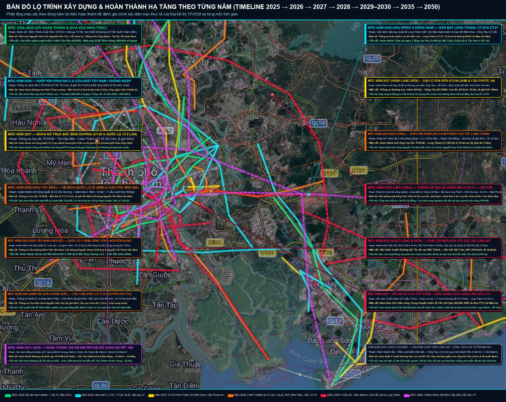
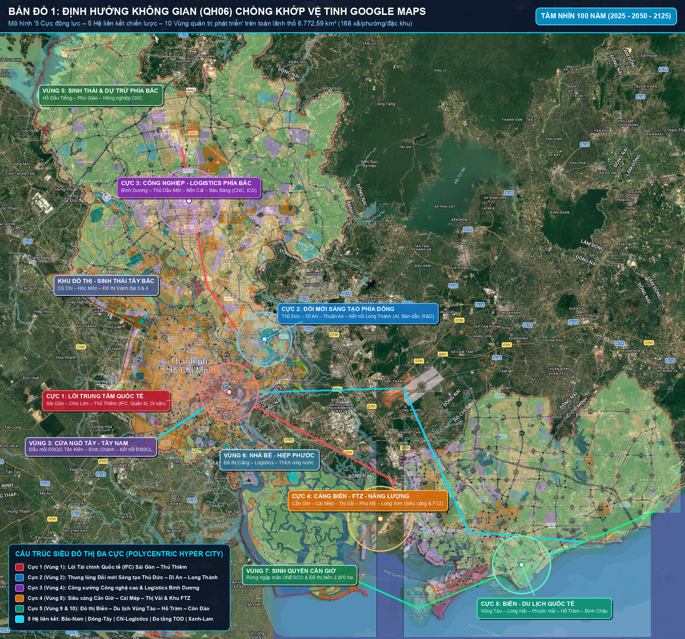
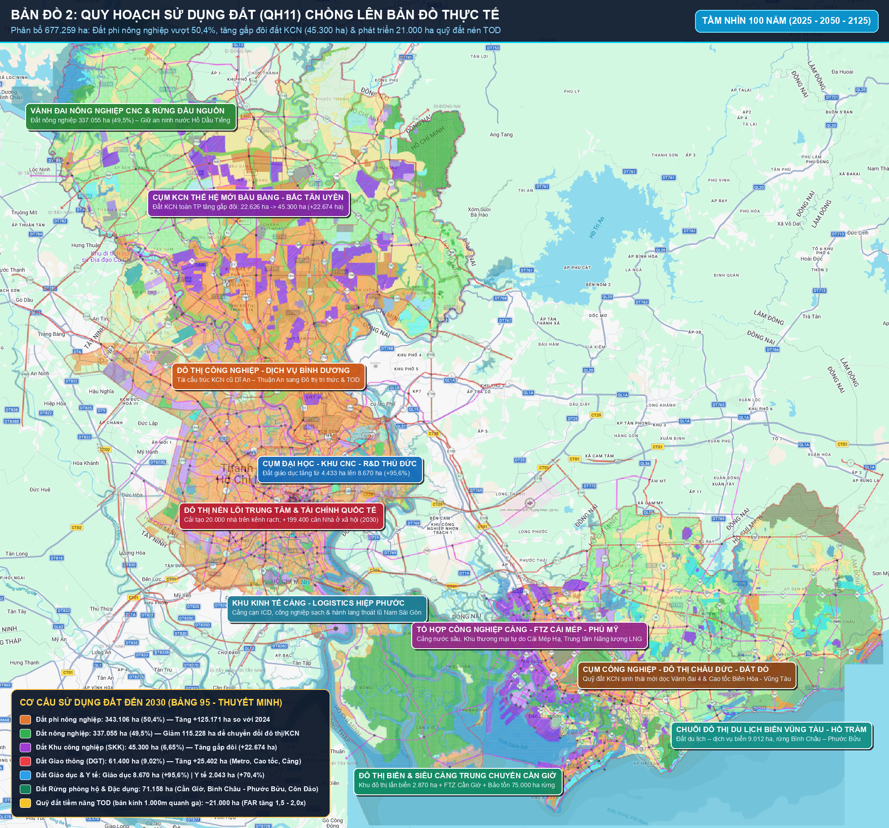
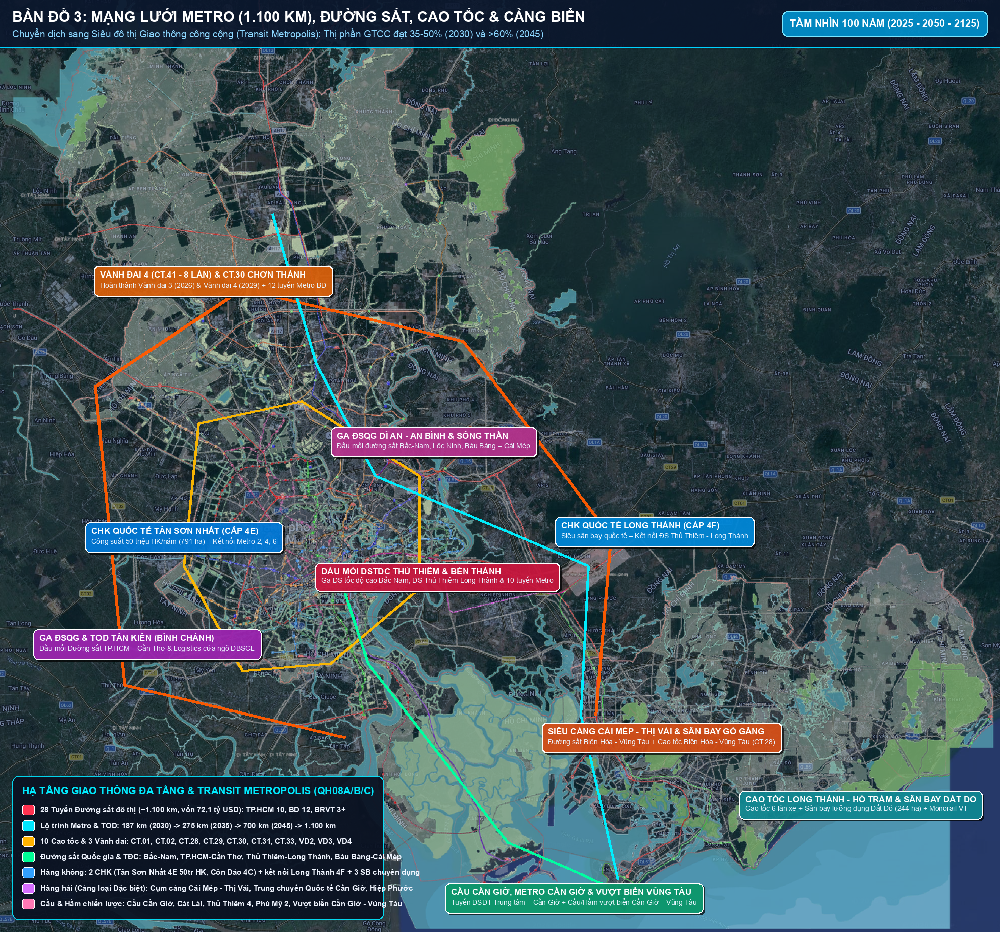
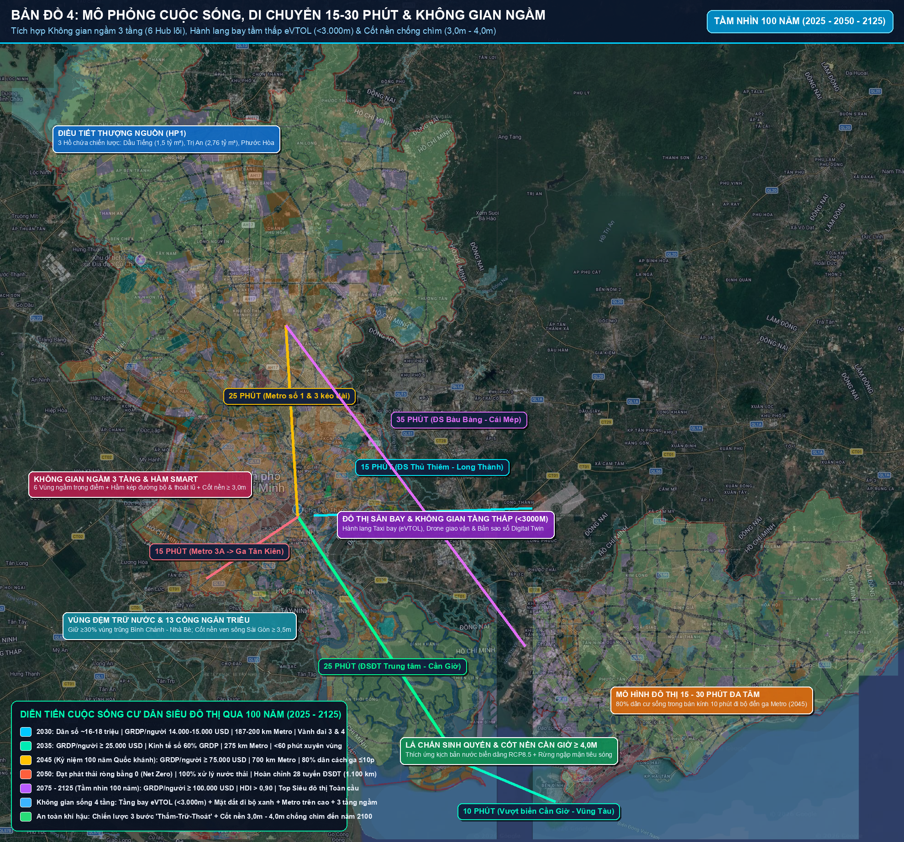
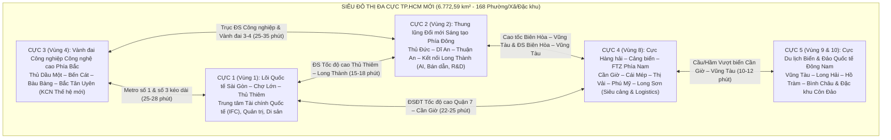
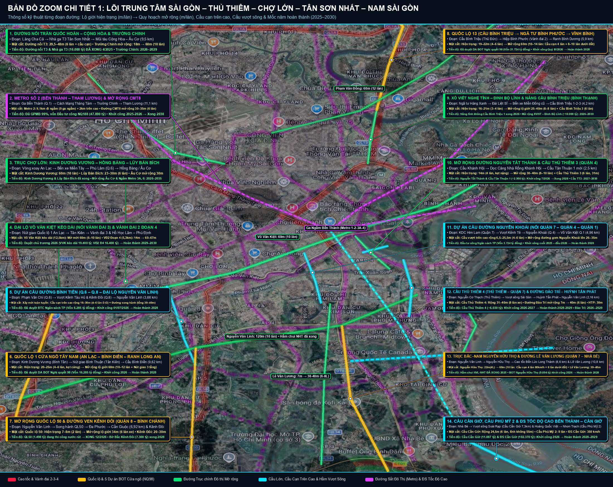
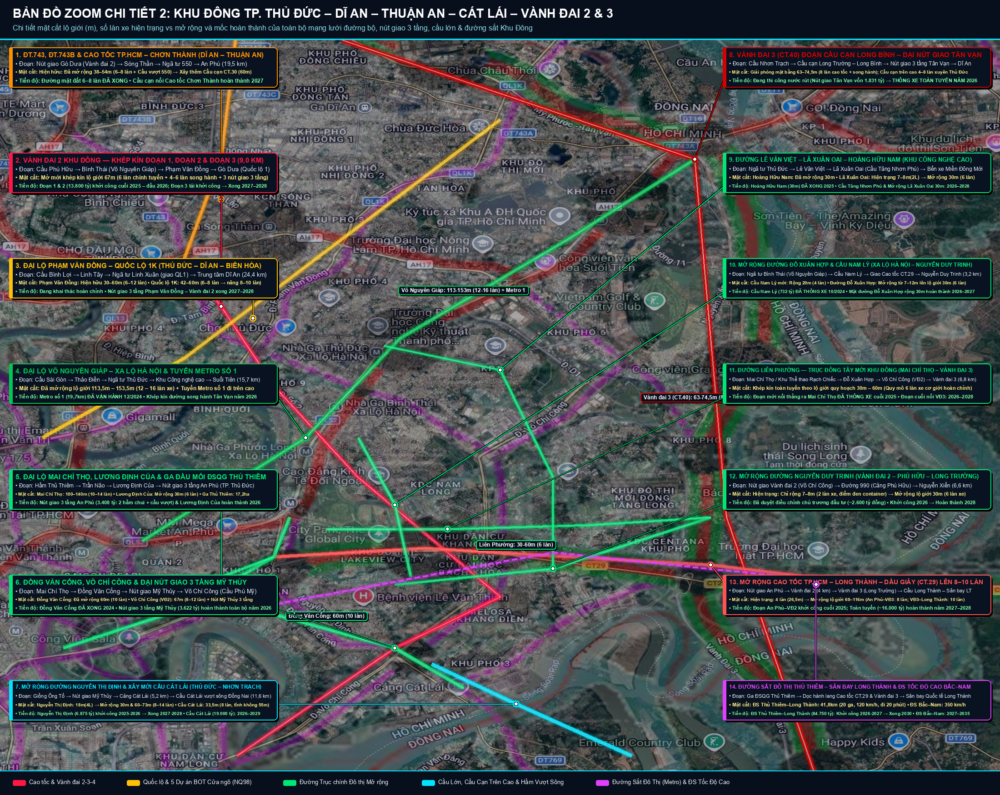
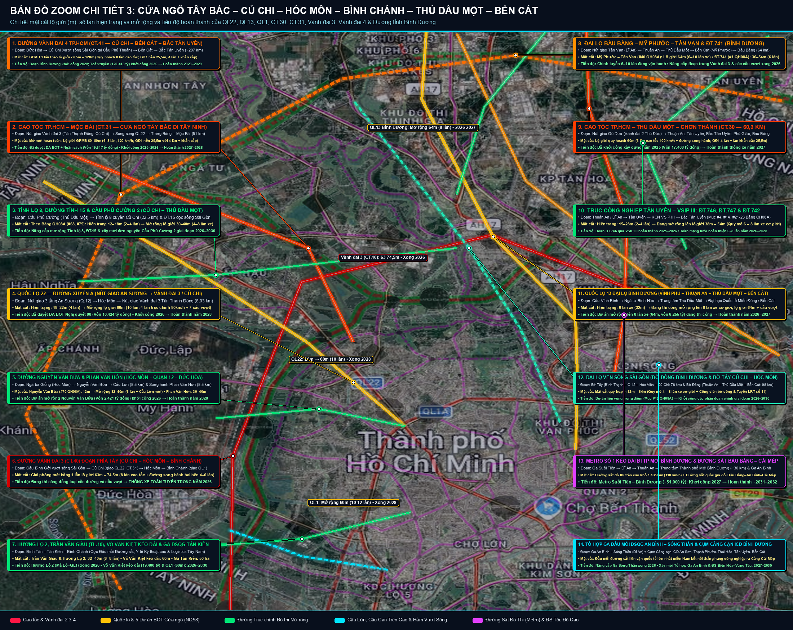
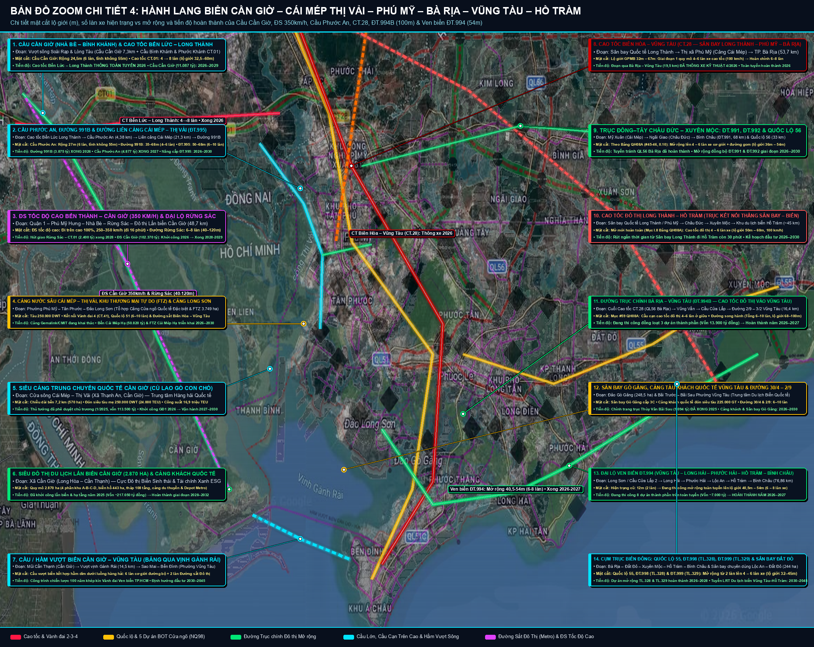

# BÁO CÁO TỔNG HỢP & CHỒNG LỚP BẢN ĐỒ THỰC TẾ (GIS OVERLAY): ĐỒ ÁN QUY HOẠCH CHUNG TP. HỒ CHÍ MINH ĐẾN NĂM 2050, TẦM NHÌN 100 NĂM (2075–2125)

> [!IMPORTANT]
> **Hồ sơ gốc được tổng hợp, định vị tọa độ (Georeferenced) & Triển khai Full-Stack Live Web GIS:**
> - **🌐 Link Live Web GIS (Xem trực tiếp trên Điện thoại & Máy tính — GitHub Pages Vĩnh viễn):** [**https://drthienlongfacs-hub.github.io/tphcm-100-nam-gis/**](https://drthienlongfacs-hub.github.io/tphcm-100-nam-gis/)
> - **📦 Kho mã nguồn & Cơ sở dữ liệu Full-Stack GitHub Repository:** [**https://github.com/drthienlongfacs-hub/tphcm-100-nam-gis**](https://github.com/drthienlongfacs-hub/tphcm-100-nam-gis) (`data/full_gis_data.json` + 14 bản đồ độ phân giải cao + Web GIS Timeline).
> - **Thuyết minh Tổng hợp (1.334 trang, 7 Chương):** [1. DTM_QHC TPHCM_09042026_Du thao lay y kien.pdf](file:///Users/longlinh/Downloads/Ho%20so%20du%20thao%20QH%20TPHCM/1.%20DTM_QHC%20TPHCM_09042026_Du%20thao%20lay%20y%20kien.pdf) — Liên danh tư vấn **HIDS – VIUP – BCG – Nikken Sekkei** (Dự thảo tháng 04/2026).
> - **5 Bản vẽ Quy hoạch Tổng thể ghép chuẩn 2 khung A0 (`2800 × 2612 px`):** `QH06` (Định hướng không gian), `QH08A` (Giao thông đường bộ), `QH08B` (Giao thông đường thủy), `QH08C` (Đường sắt đô thị & Hàng không), `QH11` (Quy hoạch sử dụng đất).
> - **Ứng dụng Bản đồ Tương tác Web GIS Offline/Local (Tích hợp Thanh Kéo Timeline Năm `2024 → 2050` & Giao diện Điện thoại):** [quy_hoach_100_nam_tphcm_gis_overlay.html](./quy_hoach_100_nam_tphcm_gis_overlay.html) (Bản sao tại Downloads: [Quy_Hoach_100_Nam_TPHCM_GIS_Overlay.html](file:///Users/longlinh/Downloads/Quy_Hoach_100_Nam_TPHCM_GIS_Overlay.html)).

---

## PHẦN I. BỘ 5 BẢN ĐỒ TỔNG THỂ CHỒNG LỚP TRỰC TIẾP LÊN BẢN ĐỒ THỰC TẾ (GOOGLE MAPS SATELLITE & STREET)

Toàn bộ 5 bản vẽ kỹ thuật ghép đôi A0 của Đồ án đã được hiệu chỉnh tọa độ địa lý (**VN-2000 sang WGS84**, khung bao `10.290°N – 11.535°N`, `106.250°E – 107.610°E`), tách nền trong suốt (RGBA) và chồng lớp trực tiếp lên nền ảnh vệ tinh Google Maps Hybrid & Google Street Map của siêu đô thị TP.HCM mới (`6.772,59 km²`):

````carousel

<!-- slide -->

<!-- slide -->

<!-- slide -->

<!-- slide -->

````

### Danh mục Tệp Bản đồ Chồng lớp Độ phân giải cao (`1980 × 1847 px` & `2200 × 1750 px`)
1. **Bản đồ Chồng lớp 5 (Lộ trình Xây dựng & Hoàn thành Hạ tầng theo từng năm 2024–2050):** [Overlay_5_Lo_Trinh_Xay_Dung_Timeline_2025_2050.png](./Overlay_5_Lo_Trinh_Xay_Dung_Timeline_2025_2050.png) (Bản sao tại Downloads: [Overlay_5_Lo_Trinh_Xay_Dung_Timeline_2025_2050.png](file:///Users/longlinh/Downloads/Overlay_5_Lo_Trinh_Xay_Dung_Timeline_2025_2050.png))
2. **Bản đồ Chồng lớp 1 (Không gian 5 Cực – 10 Vùng trên Vệ tinh):** [Overlay_1_Khong_Gian_5_Cuc_10_Vung_Ve_Tinh.png](./Overlay_1_Khong_Gian_5_Cuc_10_Vung_Ve_Tinh.png)
3. **Bản đồ Chồng lớp 2 (Sử dụng đất QH11 & 17 Cụm Kinh tế trên Bản đồ Đường phố):** [Overlay_2_Su_Dung_Dat_2030_2050_Ban_Do_Thuc.png](./Overlay_2_Su_Dung_Dat_2030_2050_Ban_Do_Thuc.png)
4. **Bản đồ Chồng lớp 3 (28 Tuyến Metro, ĐSTĐC, Vành đai 3–4, Cảng & 5 Sân bay):** [Overlay_3_Mang_Luoi_Metro_Duong_Sat_Cao_Toc_TOD.png](./Overlay_3_Mang_Luoi_Metro_Duong_Sat_Cao_Toc_TOD.png)
5. **Bản đồ Chồng lớp 4 (Mô phỏng Di chuyển 15–30 Phút, 6 Hub Ngầm & Cốt nền 100 năm):** [Overlay_4_Mo_Phong_Cuoc_Song_Di_Chuyen_100_Nam.png](./Overlay_4_Mo_Phong_Cuoc_Song_Di_Chuyen_100_Nam.png)

---

## PHẦN II. BỘ 5 BẢN VẼ GỐC GHÉP ĐÔI 2 KHUNG A0 LIỀN MẠCH (`2760 × 2000 px`)

Toàn bộ 5 bản vẽ PDF gốc (mỗi bản gồm 2 tờ A0 Tây và Đông cắt tại Phú Mỹ – Cần Giờ) đã được xử lý cắt viền kỹ thuật và ghép liền mạch chính xác từng pixel:

````carousel

<!-- slide -->

<!-- slide -->

<!-- slide -->

<!-- slide -->

````

- [QH06_Stitched_2A0.png](./QH06_Stitched_2A0.png) — Định hướng phát triển không gian tổng thể.
- [QH11_Stitched_2A0.png](./QH11_Stitched_2A0.png) — Quy hoạch sử dụng đất toàn vùng.
- [QH08C_Stitched_2A0.png](./QH08C_Stitched_2A0.png) — Mạng lưới đường sắt đô thị, đường sắt tốc độ cao & sân bay.
- [QH08A_Stitched_2A0.png](./QH08A_Stitched_2A0.png) — Hệ thống cao tốc, vành đai, trục chính đô thị.
- [QH08B_Stitched_2A0.png](./QH08B_Stitched_2A0.png) — Hệ thống cảng biển đặc biệt, luồng hàng hải và thủy nội địa.

---

## PHẦN III. TẦM NHÌN CHIẾN LƯỢC 100 NĂM & CÁC CHỈ TIÊU ĐỘT PHÁ (CHƯƠNG 1–3)

### 1. Bước ngoặt Lịch sử: Siêu Đô thị Hợp nhất (Hyper City)
Đồ án quy hoạch lập trên ranh giới hành chính mới của **Thành phố Hồ Chí Minh sau hợp nhất** (bao gồm TP.HCM hiện hữu + tỉnh Bình Dương + tỉnh Bà Rịa - Vũng Tàu):
- **Tổng diện tích tự nhiên:** `6.772,59 km²` (`677.259 ha`) — gấp hơn **3,2 lần** quy mô TP.HCM cũ (`2.095 km²`), tương đương vùng đô thị Tokyo hoặc Singapore + Thượng Hải mở rộng.
- **Đơn vị hành chính:** **168 đơn vị cấp xã** gồm **113 phường, 54 xã và 01 đặc khu (Côn Đảo)**.
- **Dân số hiện trạng (2024):** Khoảng **14,0 triệu người** (thường trú ~13,6 triệu), tạo ra ~**23,5% GDP toàn quốc** và hơn **30% tổng thu ngân sách quốc gia**.

### 2. Tầm nhìn "30 Năm + 100 Năm" (2025 → 2050 → 2075–2125)
Đồ án định vị TP.HCM là **"Siêu đô thị Quốc tế Đa cực – Cửa ngõ Hàng hải, Tài chính và Công nghệ cao của Châu Á"**, phát triển theo 4 trụ cột: **(1) Bền vững & Thích ứng Khí hậu; (2) Toàn cầu & Hội nhập sâu; (3) Đổi mới Sáng tạo dẫn dắt; (4) Đáng sống & Nhân văn**.

| Chỉ tiêu Chiến lược | Hiện trạng (2025–2026) | Giai đoạn 2030 (Nền tảng) | Giai đoạn 2035 (Bứt phá) | Giai đoạn 2045 (100 năm Quốc khánh) | Giai đoạn 2050 (Hoàn thiện) | Tầm nhìn 100 năm (2075–2125) |
| :--- | :---: | :---: | :---: | :---: | :---: | :---: |
| **Quy mô Dân số toàn vùng** | ~14,0 triệu | **16,5 – 17,9 triệu** | ~18,8 triệu | **20,5 triệu** | **21,0 – 22,9 triệu** (max 25,9tr) | **24,0 – 26,0 triệu** (ổn định) |
| **GRDP bình quân đầu người** | ~8.200 USD | **14.740 USD** | ~24.000 USD | **≥ 75.000 USD** | **> 85.000 USD** | **Top 15 Siêu Đô thị Toàn cầu** |
| **Tổng chiều dài Metro / ĐSĐT** | 19,7 km (Metro 1) | **187 – 200 km** (6 tuyến) | **275 km** | **700 km** | **~1.100 km** (28 tuyến) | **100% Tự động hóa + ĐSTĐC** |
| **Thị phần Giao thông Công cộng** | < 10% | **25 – 30%** | **40 – 45%** | **> 60%** | **70 – 80%** | **> 80% (Kỷ nguyên Không xe cá nhân)** |
| **Chỉ số Phát triển Con người (HDI)** | ~0,79 | **> 0,83** | **> 0,86** | **> 0,90** | **> 0,92** | **Đô thị Không phát thải – Bền vững 100 năm** |
| **Tỷ lệ Đô thị hóa** | ~78% | **82 – 85%** | **86 – 88%** | **> 90%** | **90 – 92%** | **Đô thị Đa tầng Không – Mặt đất – Ngầm** |

---

## PHẦN IV. MÔ HÌNH CẤU TRÚC KHÔNG GIAN: "5 CỰC ĐỘNG LỰC – 5 HỆ LIÊN KẾT – 10 VÙNG QUẢN TRỊ – 6 KHU ĐẶC THÙ" (CHƯƠNG 4 & BẢN VẼ QH06)

Để giải quyết triệt để căn bệnh "đô thị đơn tâm quá tải" của Sài Gòn cũ, Đồ án tái cấu trúc không gian toàn vùng theo mô hình **Siêu Đô thị Đa tâm (Polycentric Hyper City)** kết hợp **Đô thị Nén Đa tầng theo TOD**:



### 1. Chi tiết 5 Cực Động lực Tăng trưởng & 10 Vùng Quản trị Không gian

| Phân vùng Quản trị | Vai trò trong 5 Cực Động lực | Phạm vi Trọng tâm | Chức năng Chiến lược & Định hướng Không gian (2030–2050–2125) |
| :--- | :--- | :--- | :--- |
| **Vùng 1: Đô thị Lõi Trung tâm Lịch sử & Quốc tế** | **CỰC 1: Lõi Tài chính & Quản trị Quốc tế** | Sài Gòn, Bến Thành, Chợ Lớn, Thủ Thiêm, Phú Mỹ Hưng | Trung tâm Tài chính Quốc tế (**IFC Thủ Thiêm – Quận 1**), thương mại toàn cầu, văn hóa – di sản. Tái thiết đô thị nén theo TOD và không gian ngầm 3 tầng; di dời ~20.000 nhà trên và ven kênh rạch; cốt nền kiểm soát `≥ 3,0m` (ven sông Sài Gòn `≥ 3,5m`). |
| **Vùng 2: Đô thị Khoa học – Công nghệ Phía Đông** | **CỰC 2: Thung lũng Đổi mới Sáng tạo** | TP. Thủ Đức, Dĩ An, Thuận An (kết nối Sân bay Long Thành) | Hạt nhân nghiên cứu R&D, thiết kế vi mạch bán dẫn, AI, công nghệ sinh học, Đại học Quốc gia TP.HCM, Khu Công nghệ cao SHTP mở rộng. Kết nối trực tiếp Sân bay Quốc tế Long Thành qua đường sắt tốc độ cao Thủ Thiêm – Long Thành (`15–18 phút`). |
| **Vùng 3: Đô thị Cửa ngõ Phía Tây & Tây Nam** | Vùng Cửa ngõ Y tế – Logistics ĐBSCL | Tân Kiên, Bình Chánh, Hóc Môn, Củ Chi Nam | Đầu mối đường sắt quốc gia đi miền Tây (**Hub TOD Tân Kiên**), Cụm Y tế chuyên sâu Tân Kiên (`>73 ha`), trung tâm phân phối nông sản – thực phẩm công nghệ cao kết nối ĐBSCL qua Cao tốc CT.01, CT.02 và Vành đai 3. |
| **Vùng 4: Đô thị Công nghiệp – Đô thị Phía Bắc** | **CỰC 3: Thủ phủ Công nghiệp Công nghệ cao** | Thủ Dầu Một, TP Mới Bình Dương, Tân Uyên, Bến Cát, Bàu Bàng | Trung tâm sản xuất thông minh, công nghiệp sạch, cơ khí chính xác, năng lượng mới và ICD/Dry Port quy mô lớn (`45.300 ha` đất KCN toàn thành phố). Chuyển dịch các KCN thế hệ cũ sang Khu công nghiệp sinh thái – công nghệ cao. |
| **Vùng 5: Vùng Sinh thái Nông – Lâm nghiệp Phía Bắc & Tây Bắc** | Vùng An ninh Nguồn nước & Sinh thái Bắc | Dầu Tiếng, Phú Giáo, Củ Chi Bắc | Lá phổi xanh phía Bắc, bảo vệ hành lang sinh thái Hồ Dầu Tiếng (`1,5 tỷ m³`), rừng phòng hộ, nông nghiệp công nghệ cao kết hợp năng lượng tái tạo, du lịch sinh thái – nghỉ dưỡng và **Sân bay chuyên dùng Dầu Tiếng** (`200–500 ha`). |
| **Vùng 6: Đô thị Ven sông & Cảng Hiệp Phước Phía Nam** | Vùng Đô thị Thích ứng Nước & Kinh tế Số | Nhà Bè, Hiệp Phước, Nam Bình Chánh | Đô thị thích ứng nước (Sponge City / Water-sensitive Urban Design), cụm cảng – công nghiệp – dữ liệu Hiệp Phước, hành lang chuyển tiếp xanh kết nối lõi trung tâm với Khu dự trữ sinh quyển Cần Giờ. |
| **Vùng 7: Vùng Sinh thái Rừng ngập mặn & Đô thị Biển Cần Giờ** | **CỰC 4 (Nhánh Tây): Cửa ngõ Biển & Sinh quyển** | Cần Giờ (Rừng ngập mặn + Đô thị lấn biển + Cảng Cần Giờ) | Bảo tồn nghiêm ngặt hơn **75.000 ha Khu Dự trữ Sinh quyển Thế giới UNESCO Cần Giờ** (vùng lõi không xây dựng). Phát triển **Đô thị du lịch biển Cần Giờ (2.870 ha)** và **Siêu cảng trung chuyển quốc tế Cần Giờ** tại Cù lao Phú Lợi. |
| **Vùng 8: Hành lang Cảng biển – Công nghiệp – FTZ Thị Vải – Phú Mỹ** | **CỰC 4 (Nhánh Đông): Siêu Cảng & FTZ Quốc tế** | Phú Mỹ, Cái Mép – Thị Vải, Long Sơn | **Cụm cảng nước sâu đặc biệt Cái Mép – Thị Vải** (tiếp nhận tàu mẹ `250.000 DWT / 24.000 TEU`), Khu Thương mại Tự do (**FTZ Cái Mép Hạ ~3.764 ha**), Tổ hợp hóa dầu – năng lượng sạch Long Sơn và trung tâm công nghiệp nặng/cảng biển. |
| **Vùng 9: Hành lang Du lịch Biển Quốc tế Đông Nam** | **CỰC 5 (Đất liền): Du lịch & Giải trí Quốc tế** | TP. Vũng Tàu, Long Hải, Phước Hải, Đất Đỏ, Hồ Tràm, Bình Châu | Trung tâm du lịch nghỉ dưỡng biển, giải trí quốc tế, hội nghị MICE, kinh tế đêm, dịch vụ tài chính – dầu khí biển, thể thao biển; bao gồm **Sân bay Gò Găng (248,5 ha)** và **Sân bay Đất Đỏ (244,3 ha)**. |
| **Vùng 10: Đặc khu Đảo Côn Đảo** | **CỰC 5 (Hải đảo): Đặc khu Sinh thái – Di sản** | Quần đảo Côn Đảo (16 hòn đảo, ~76 km²) | Đặc khu du lịch sinh thái biển đảo đẳng cấp quốc tế, bảo tồn Vườn Quốc gia Côn Đảo và Di tích Quốc gia Đặc biệt; vận hành 100% năng lượng xanh – kinh tế tuần hoàn, nâng cấp **Sân bay Côn Đảo đạt cấp 4C** (2 triệu khách/năm). |

### 2. Sáu (06) Khu Chức năng Đặc thù Cấp Quốc gia & Quốc tế
1. **Trung tâm Tài chính Quốc tế (IFC Thủ Thiêm – Quận 1):** Cơ chế thể chế vượt trội thu hút định chế tài chính, ngân hàng đầu tư, Fintech và sàn giao dịch quốc tế.
2. **Hệ thống Khu Thương mại Tự do (FTZ) gắn với Cảng biển & Sân bay:**
   - **FTZ Cái Mép Hạ** (`~3.764 ha` tại Phú Mỹ – Bà Rịa Vũng Tàu);
   - **FTZ Cần Giờ** (`1.000 – 2.000 ha` gắn với Cảng trung chuyển quốc tế Cần Giờ);
   - **FTZ Bàu Bàng** & **FTZ An Bình – Sóng Thần** (gắn với ga đường sắt hàng hóa liên vận quốc tế).
3. **Siêu Hành lang Đổi mới Sáng tạo Phía Đông:** Khu Công nghệ cao TP.HCM (SHTP) – Đại học Quốc gia – Dĩ An.
4. **Cụm Cảng nước sâu Đặc biệt Cái Mép – Thị Vải – Cần Giờ:** Top 10 cụm cảng trung chuyển container lớn nhất thế giới.
5. **Khu Đô thị Biển Cần Giờ (`2.870 ha`) & Khu Dự trữ Sinh quyển UNESCO Cần Giờ (`75.000+ ha`).**
6. **Đặc khu Đảo Côn Đảo & Dải Du lịch Quốc tế Vũng Tàu – Hồ Tràm – Bình Châu.**

---

## PHẦN V. QUY HOẠCH SỬ DỤNG ĐẤT ĐẾN NĂM 2030 & ĐỊNH HƯỚNG 2050 (CHƯƠNG 4, BẢNG 95 & BẢN VẼ QH11)

> [!NOTE]
> Số liệu trích xuất nguyên bản từ **Bảng 95 – Quy hoạch sử dụng đất toàn Thành phố đến năm 2030** (Trang 1110–1115, Thuyết minh Tổng hợp) và **Bản vẽ QH11**.

### 1. Bảng Cân đối Quy hoạch Sử dụng Đất Toàn Thành phố đến năm 2030

| STT | Chỉ tiêu Sử dụng Đất | Mã đất | Hiện trạng 2024 (ha) | Tỷ trọng 2024 (%) | Quy hoạch 2030 (ha) | Tỷ trọng 2030 (%) | Biến động 2024–2030 (ha) | Ý nghĩa Chiến lược trong Đồ án |
| :-: | :--- | :---: | :---: | :---: | :---: | :---: | :---: | :--- |
| **I** | **ĐẤT NÔNG NGHIỆP** | **NNP** | **452.283** | **66,5%** | **337.055** | **49,5%** | **-115.228** | Chuyển đổi sang công nghiệp, hạ tầng, đô thị TOD; giữ vững rừng phòng hộ & sinh quyển |
| 1 | Đất trồng lúa | LUA | 22.905 | 3,4% | 14.000 | 2,1% | -8.905 | Tập trung vùng nông nghiệp công nghệ cao |
| 2 | Đất trồng cây lâu năm | CLN | 291.771 | 42,9% | 177.269 | 26,1% | -114.502 | Chuyển đổi đất cao su già cỗi tại Bình Dương, BR-VT sang KCN thế hệ mới & đô thị |
| 3 | Đất lâm nghiệp (Rừng đặc dụng, phòng hộ, SX) | LNP | 107.185 | 15,8% | 106.597 | 15,7% | -588 | **Bảo vệ nghiêm ngặt** Rừng ngập mặn Cần Giờ, VQG Côn Đảo, rừng phòng hộ Dầu Tiếng |
| **II** | **ĐẤT PHI NÔNG NGHIỆP** | **PNN** | **217.935** | **32,0%** | **343.106** | **50,4%** | **+125.171** | **Đột phá không gian đô thị – công nghiệp – hạ tầng chiến lược** |
| 1 | Đất ở tại đô thị | ODT | 46.842 | 6,9% | 64.961 | 9,5% | **+18.119** | Phát triển nhà ở nén cao tầng quanh 28 tuyến Metro (TOD) & nhà ở xã hội |
| 2 | Đất ở tại nông thôn | ONT | 19.656 | 2,9% | 19.442 | 2,9% | -214 | Đô thị hóa các xã ven đô lên phường |
| 3 | **Đất Khu công nghiệp** | **SKK** | **22.626** | **3,3%** | **45.300** | **6,7%** | **+22.674** | **Tăng gấp đôi (+100,2%)**: hình thành vành đai KCN công nghệ cao Bắc – Đông |
| 4 | Đất Cụm công nghiệp | SKN | 2.132 | 0,3% | 5.219 | 0,8% | +3.087 | Phục vụ công nghiệp phụ trợ và doanh nghiệp vừa & nhỏ |
| 5 | Đất Thương mại, Dịch vụ | TMD | 8.210 | 1,2% | 22.690 | 3,3% | **+14.480** | Tăng **+176%**: phát triển IFC Thủ Thiêm, các khu FTZ, trung tâm MICE & du lịch biển |
| 6 | **Đất Giao thông** | **DGT** | **35.998** | **5,3%** | **61.400** | **9,0%** | **+25.402** | Tăng **+70,6%**: 10 cao tốc, Vành đai 3–4, 28 tuyến Metro, cảng biển, 5 sân bay |
| 7 | **Đất Giáo dục – Đào tạo** | **DGD** | **4.433** | **0,7%** | **8.670** | **1,3%** | **+4.237** | Tăng gần **gấp đôi (+95,6%)**: xây dựng các đại học nghiên cứu, trường chuẩn quốc tế |
| 8 | **Đất Y tế** | **DYT** | **1.199** | **0,2%** | **2.043** | **0,3%** | **+844** | Tăng **+70,4%**: Cụm Y tế Tân Kiên, Thủ Đức, Bình Dương, Vũng Tàu (tiệm cận chuẩn ACS/quốc tế) |
| 9 | Đất Văn hóa & Thể dục thể thao | DVH+DTT | 2.941 | 0,4% | 5.663 | 0,8% | +2.722 | Khu Liên hợp TDTT Rạch Chiếc, trung tâm văn hóa biểu diễn tầm cỡ châu Á |
| 10 | Đất Công trình Năng lượng | DNL | 1.564 | 0,2% | 3.748 | 0,6% | +2.184 | Điện khí LNG Long Sơn/Hiệp Phước, điện gió ngoài khơi Cần Giờ – Vũng Tàu, trạm GIS |
| 11 | Đất Bưu chính Viễn thông & Hạ tầng Số | DBV | 158 | 0,02% | 334 | 0,05% | +176 | Tăng **+111%**: Trung tâm Dữ liệu Siêu lớn (Hyperscale Data Centers), trạm cáp quang biển |
| **III** | **ĐẤT CHƯA SỬ DỤNG** | **CSD** | **7.041** | **1,0%** | **98** | **0,01%** | **-6.943** | Đưa gần như 100% quỹ đất chưa sử dụng vào khai thác hiệu quả |

### 2. Khai thác Quỹ đất Đô thị Nén theo Định hướng Giao thông Công cộng (TOD)
- **Tổng quỹ đất tiềm năng TOD (trong bán kính `1.000m` quanh các nhà ga đường sắt đô thị):** Khoảng **21.000 ha** trên toàn vùng (trong đó riêng phạm vi TP.HCM cũ là `~7.717 ha` dọc 355 km đường sắt đô thị theo Nghị quyết 38/2025/NQ-HĐND và Nghị quyết 260/2025/QH15; quỹ đất ròng có thể tái phát triển ngay đạt `3.500 – 4.500 ha`).
- **Phân cấp 3 Loại Đầu mối TOD (Bảng 96):**
  - **TOD Cấp 1 (Đầu mối Quốc gia & Liên vùng — bán kính ảnh hưởng 800–1.000m):** Bến Thành, Thủ Thiêm, Suối Tiên, Tân Kiên, Dĩ An, Thành phố Mới Bình Dương, Phú Mỹ, Vũng Tàu. Được phép áp dụng **hệ số sử dụng đất (FAR) tăng thêm 1,5 – 2,0 lần** (lên tới `FAR 12–18`), không giới hạn tầng cao trong vùng an toàn tĩnh không, kết nối bắt buộc với tối thiểu 3 tầng hầm thương mại – giao thông.
  - **TOD Cấp 2 (Đầu mối Đô thị — bán kính 500–800m):** Các ga giao cắt giữa 2 tuyến Metro, trung tâm các vùng đô thị; tích hợp văn phòng, thương mại, nhà ở cao mật độ và dịch vụ công cộng.
  - **TOD Cấp 3 (Đầu mối Khu ở / Cộng đồng — bán kính 400–500m):** Các ga nội vùng phục vụ mô hình "Đô thị 15 phút", bố trí trường học, trạm y tế, công viên, nhà ở xã hội và bãi đỗ xe trung chuyển (Park & Ride).

---

## PHẦN VI. HỆ THỐNG GIAO THÔNG ĐA PHƯƠNG THỨC & ĐÔ THỊ ĐA TẦNG (CHƯƠNG 5 & BẢN VẼ QH08A, QH08B, QH08C)

### 1. Mạng lưới Đường sắt Đô thị (28 Tuyến ~ 1.100 km) & Đường sắt Quốc gia / Tốc độ cao (QH08C)
Đồ án xác lập **Đường sắt đô thị (MRT/LRT/Monorail) và Đường sắt tốc độ cao** là xương sống tuyệt đối của siêu đô thị:
- **Quy mô toàn mạng lưới đến năm 2050:** **28 tuyến với tổng chiều dài ~1.100 km**, tổng vốn đầu tư dự kiến khoảng **72,1 tỷ USD**:
  - **Khu vực TP.HCM hiện hữu:** **10 tuyến chính (`~510 km`)** + tuyến Tramway/LRT ven sông (`~35 km`):
    - *Metro số 1:* Bến Thành – Suối Tiên – kéo dài tới Bình Dương & Sân bay Long Thành (`>53 km`).
    - *Metro số 2:* Củ Chi – Quốc lộ 22 – Bếnến Thành – Thủ Thiêm (`~62 km`).
    - *Metro số 3 (3A & 3B):* Tân Kiên – Bến Thành – Hiệp Bình Phước – kéo dài đi Thủ Dầu Một (`~50 km`).
    - *Metro số 4:* Đông Thạnh (Hóc Môn) – Tân Sơn Nhất – Bến Thành – Khu đô thị Hiệp Phước (`~47 km`).
    - *Metro số 5:* Đa Phước – Bảy Hiền – Cầu Sài Gòn – Cần Giuộc (`~33 km`).
    - *Metro số 6:* Vòng xuyến nội đô kết nối 5 tuyến xuyên tâm + nhánh đi ngầm dọc sông Sài Gòn (`~53 km`).
    - *Metro số 7:* Tân Kiên – Nguyễn Văn Linh – Thủ Thiêm – Thảo Điền – Thanh Đa – Vinhomes Grand Park (`~51 km`).
    - *Metro số 8, 9, 10:* Các tuyến vành đai liên kết Bình Dương – Thủ Đức – Nhà Bè – Bình Chánh.
  - **Khu vực Bình Dương:** **12 tuyến (`~305 km`)** kết nối Thành phố Mới Bình Dương, Thủ Dầu Một, Dĩ An, Thuận An, Tân Uyên, Bến Cát, Bàu Bàng trực tiếp vào mạng lưới Metro số 1 và Metro số 3.
  - **Khu vực Bà Rịa - Vũng Tàu:** **3 tuyến chính (`~125 km`)** kết nối Phú Mỹ – Cái Mép – Bà Rịa – TP. Vũng Tàu – Long Hải – Hồ Tràm.
  - **Các tuyến Đường sắt Đô thị Tốc độ cao Liên vùng (Regional Express Rail – 120 đến 160 km/h):**
    1. **Tuyến Thủ Thiêm – Sân bay Quốc tế Long Thành (`~42 km`):** Rút ngắn thời gian từ Trung tâm Tài chính Thủ Thiêm ra sân bay Long Thành còn **15–18 phút**.
    2. **Tuyến Trung tâm (Quận 7 / Tân Thuận) – Cần Giờ (`~48,7 km`):** Chạy dọc hành lang Rừng Sác kết nối Phú Mỹ Hưng với Đô thị biển Cần Giờ và Cảng Cần Giờ chỉ trong **22–25 phút**.
    3. **Tuyến Đường sắt Công nghiệp – Cảng biển (Bàu Bàng – Dĩ An – Biên Hòa – Cái Mép – Vũng Tàu):** Vận chuyển container khối lượng lớn trực tiếp từ các KCN Bình Dương ra cảng nước sâu Cái Mép – Thị Vải.
  - **Đường sắt Tốc độ cao Quốc gia (`350 km/h`):**
    - **ĐSTĐC Bắc – Nam** kết thúc tại **Ga Thủ Thiêm**;
    - **Đường sắt TP.HCM – Cần Thơ** xuất phát từ **Ga Tân Kiên**;
    - **Đường sắt TP.HCM – Tây Ninh (Mộc Bài)** kết nối hành lang xuyên Á.

### 2. Mạng lưới 10 Cao tốc, 3 Vành đai & Cầu/Hầm Vượt biển (QH08A)
- **3 Tuyến Vành đai Chiến lược:**
  - **Vành đai 2 (`~64 km`, 8–10 làn):** Khép kín hoàn toàn trước 2028.
  - **Vành đai 3 (`CT.40`, `~76,3 km`, 8 làn cao tốc + đường song hành):** Hoàn thành năm 2026, kết nối trực tiếp TP.HCM – Bình Dương – Đồng Nai – Long An.
  - **Vành đai 4 (`CT.41`, `~207 km`, 8 làn cao tốc):** Trục vành đai ngoại vi siêu đô thị nối Cảng Hiệp Phước – Củ Chi – Bến Cát/Bắc Tân Uyên – Sân bay Long Thành – Cảng Cái Mép Phú Mỹ (hoàn thành trước 2029–2030).
- **10 Tuyến Cao tốc Hướng tâm & Liên vùng:**
  1. **CT.01** (TP.HCM – Long Thành – Dầu Giây, mở rộng 10–12 làn);
  2. **CT.01 Nam** (TP.HCM – Trung Lương – Mỹ Thuận, mở rộng 8–10 làn);
  3. **CT.02** (Cao tốc Bắc – Nam phía Tây: Chơn Thành – Đức Hòa);
  4. **CT.28** (Cao tốc Biên Hòa – Phú Mỹ – Vũng Tàu, 6–8 làn);
  5. **CT.29** (Cao tốc Dầu Giây – Tân Phú – Liên Khương);
  6. **CT.30** (Cao tốc TP.HCM – Thủ Dầu Một – Chơn Thành, 6–8 làn);
  7. **CT.31** (Cao tốc TP.HCM – Mộc Bài, 6 làn);
  8. **CT.33** (Cao tốc TP.HCM – Tiền Giang – Bến Tre – Trà Vinh qua cầu Cần Giờ / Hiệp Phước);
  9. **Cao tốc Long Thành – Hồ Tràm** (kết nối thẳng Sân bay Long Thành tới dải du lịch biển Hồ Tràm – Bình Châu);
  10. **Trục Động lực Vượt biển Cần Giờ – Vũng Tàu:** Xây dựng **Cầu Cần Giờ** (vượt sông Soài Rạp, tĩnh không `55m`) kết hợp **Tuyến Đường sắt & Cầu – Hầm vượt biển Cần Giờ – Vũng Tàu** (`~14–15 km` qua vịnh Gành Rái), biến Cần Giờ và TP. Vũng Tàu thành hai bờ của một vịnh đô thị duy nhất (di chuyển chỉ **10–12 phút** thay vì đi vòng 2,5 giờ).

### 3. Hệ thống Cảng biển Đặc biệt & 5 Sân bay + Kinh tế Tầm thấp `<3.000m` (QH08B & QH08C)
- **Tổ hợp Cảng biển Loại Đặc biệt (Cửa ngõ Trung chuyển Quốc tế):**
  - **Cụm cảng nước sâu Cái Mép – Thị Vải** kết hợp **Siêu cảng trung chuyển quốc tế Cần Giờ** (Cù lao Phú Lợi, công suất `16,9 triệu TEU/năm` vào năm 2045) tạo thành **Tổ hợp Cảng Đôi Vịnh Gành Rái** đủ sức đón tàu container lớn nhất thế giới (`250.000 DWT / 24.000 TEU`).
  - **Cụm cảng Hiệp Phước (Nhà Bè)**, **Cát Lái** (chuyển đổi dần công năng giảm tải nội đô), **Long Sơn** (chuyên dùng LNG/hóa dầu), và hệ thống **Cảng hành khách quốc tế** tại Bến Nhà Rồng – Khánh Hội, Mũi Đèn Đỏ, Vũng Tàu và Côn Đảo.
- **Hệ sinh thái 5+1 Sân bay & Không gian Kinh tế Tầm thấp (`Low-Altitude Economy < 3.000m`):**
  1. **Cảng HKQT Tân Sơn Nhất (Cấp 4E):** Quy mô `~791 ha`, công suất **50 triệu hành khách/năm** (T1, T2, T3 kết nối trực tiếp Metro số 2, số 4, số 6).
  2. **Cảng HKQT Long Thành (Cấp 4F — liền kề ranh giới phía Đông):** Quy mô `5.000 ha`, công suất **100 triệu hành khách/năm & 5 triệu tấn hàng hóa/năm**, đóng vai trò sân bay cửa ngõ quốc tế chính của Đại đô thị TP.HCM.
  3. **Cảng Hàng không Côn Đảo (Cấp 4C):** Nâng cấp đường băng đón tàu bay thân hẹp tầm trung (A320/A321), công suất **2 triệu hành khách/năm**.
  4. **Sân bay Chuyên dùng / Lưỡng dụng Gò Găng (TP. Vũng Tàu):** Quy mô **`248,5 ha`**, phục vụ hàng không chung, trực thăng dịch vụ biển đảo, thủy phi cơ và eVTOL.
  5. **Sân bay Chuyên dùng / Du lịch Đất Đỏ (Bà Rịa - Vũng Tàu):** Quy mô **`244,3 ha`**, phục vụ chuyên cơ thương gia (Business Jet), du lịch nghỉ dưỡng cao cấp Hồ Tràm – Bình Châu.
  6. **Sân bay Chuyên dùng Dầu Tiếng (Bắc Bình Dương / Tây Bắc):** Quy mô **`200 – 500 ha`**, phục vụ đào tạo bay, công nghiệp hàng không nhẹ, cứu hộ cứu nạn và logistics tầm thấp.
  - **Đô thị 4 Tầng Cao độ (Vertical 4-Layer City):** Lần đầu tiên quy hoạch chính thức hóa **Tầng Không gian Tầm thấp (`0 – 3.000m`)** với các hành lang bay định danh cho **Taxi bay điện (eVTOL / UAM)** và **Drone giao hàng tự động** dọc theo sông Sài Gòn, sông Đồng Nai, vịnh Gành Rái và các trục cao tốc, kết nối các **Vertiport** đặt trên nóc các tòa tháp TOD Cấp 1 (Thủ Thiêm, Bến Thành, Phú Mỹ Hưng, Bình Dương New City, Vũng Tàu, Hồ Tràm).

---

## PHẦN VII. KHÔNG GIAN NGẦM 3 TẦNG (`0 ĐẾN -30M`) & CHIẾN LƯỢC CHỐNG NGẬP – THÍCH ỨNG KHÍ HẬU 100 NĂM (CHƯƠNG 5 & CHƯƠNG 6)

### 1. Sáu (06) Khu vực Trọng điểm Phát triển Không gian Ngầm 3 Tầng (`0m đến -30m`)
Đồ án quy hoạch phân tầng độ sâu lòng đất thành 3 lớp: **Tầng nông (`0 đến -10m`)** cho trung tâm thương mại ngầm, phố đi bộ ngầm, bãi đỗ xe thông minh và hào kỹ thuật chung; **Tầng trung (`-10m đến -20m`)** cho nhà ga Metro, đường giao thông ngầm và hồ điều tiết ngầm; **Tầng sâu (`-20m đến -30m+`)** cho các tuyến Metro vượt sông, hầm đường bộ xuyên tâm và hầm thoát nước chống ngập SMART:
1. **Khu Trung tâm Hiện hữu Sài Gòn – Bến Thành (`930 ha`):** Liên thông đại ga ngầm Bến Thành với toàn bộ các tòa nhà thương mại dọc trục Lê Lợi – Nguyễn Huệ – Hàm Nghi – Tôn Đức Thắng.
2. **Khu Đô thị mới Thủ Thiêm (IFC):** Hệ thống giao thông ngầm và thương mại ngầm kết nối qua sông Sài Gòn sang Quận 1.
3. **Khu vực Chợ Lớn – Phú Thọ:** Tái thiết không gian ngầm gắn với Metro số 3A, số 5 và số 6.
4. **Khu vực Hòa Hưng – Cộng Hòa – Cửa ngõ Tân Sơn Nhất:** Giải tỏa ùn tắc cửa ngõ sân bay bằng mạng lưới hầm chui nhiều tầng và ga ngầm Metro số 2, số 4.
5. **Khu Trung tâm Thành phố Mới Bình Dương (Bình Dương New City):** Tổ hợp ga ngầm trung tâm kết nối WTC Bình Dương.
6. **Khu Trung tâm Đô thị Bà Rịa – Vũng Tàu:** Không gian ngầm dịch vụ du lịch biển Bãi Trước – Bãi Sau.
- **Hai Siêu Dự án Hầm Giao thông Ngầm Chiến lược:**
  - **Tuyến Đường bộ Ngầm kết hợp Metro số 6 ven sông Sài Gòn (`dài ~9 km`)** từ cầu Ba Son đến cầu Tân Thuận, giải phóng hoàn toàn mặt đất ven sông thành công viên cảnh quan đi bộ.
  - **Tuyến Đường hầm Thủ Thiêm – Phạm Văn Đồng (`dài ~5 km`)** kết nối thẳng Trung tâm Tài chính Thủ Thiêm lên Vành đai 2 và Sân bay Tân Sơn Nhất.

### 2. Chiến lược Thủy văn – Chống ngập "Thấm – Trữ – Thoát" & Cốt nền Xây dựng
Trước kịch bản nước biển dâng `75–100 cm` vào cuối thế kỷ XXI (2100–2125) kết hợp lũ thượng nguồn và sụt lún nền đất, Đồ án thiết lập hệ thống phòng thủ 4 lớp:
- **Quy chuẩn Cốt nền Xây dựng Tối thiểu (`Hxd`, hệ cao độ Quốc gia Hòn Dấu):**
  - Khu vực Trung tâm TP.HCM, Bình Dương Nam, Phú Mỹ: **`Hxd ≥ +3,0 m`**;
  - Hành lang ven sông Sài Gòn, sông Đồng Nai, Nhà Bè: **`Hxd ≥ +3,5 m`**;
  - Khu đô thị lấn biển Cần Giờ, cảng biển và ven biển Vũng Tàu: **`Hxd ≥ +4,0 m`**;
  - Khu vực đồi gò phía Bắc Bình Dương và Đông Bắc BR-VT: thiết kế bám địa hình tự nhiên (`+5,0 m đến +35,0 m`).
- **Hệ thống Công trình "Thấm – Trữ – Thoát" Đa mục tiêu:**
  - **Thượng nguồn:** Điều tiết thông minh 3 hồ chứa chiến lược (**Dầu Tiếng `1,58 tỷ m³`**, **Trị An `2,76 tỷ m³`**, **Phước Hòa**).
  - **Nội đô (Thấm & Trữ):** Nghiêm cấm san lấp kênh rạch; khôi phục kênh Hàng Bàng, Lò Gốm, Xuyên Tâm, Rạch Chiếc; xây dựng hệ thống **Hồ điều tiết ngầm khổng lồ** bên dưới các công viên lớn (Gia Định, Hoàng Văn Thụ, Phú Lâm, Rạch Chiếc) kết hợp **Hầm đa năng SMART** (vừa làm đường hầm ô tô khi trời nắng, vừa làm cống ngầm thoát lũ khổng lồ khi mưa cực đoan).
  - **Hạ lưu & Ven biển (Ngăn triều):** Hoàn thiện **13 cống kiểm soát triều lớn** (Bến Nghé, Tân Thuận, Phú Xuân, Mương Chuối, Cây Khô, Phú Định...) kết hợp tuyến đê biển sinh thái rừng ngập mặn Cần Giờ.

---

## PHẦN VIII. MÔ PHỎNG CUỘC SỐNG, KHÔNG GIAN SỐNG & DI CHUYỂN CỦA CƯ DÂN TRONG 100 NĂM TỚI (2026 → 2125)

Khi chồng lớp các bản vẽ quy hoạch lên bản đồ thực tế, sự thay đổi căn bản nhất đối với một người dân TP.HCM trong thế kỷ tới là sự chuyển dịch từ **"Đô thị Phụ thuộc Xe máy – Đơn tâm – Ngập nước"** sang **"Siêu Đô thị Đa cực 15–30 Phút – Đa tầng – Thích ứng Nước"**:

### 1. Bảng Mô phỏng Thời gian Di chuyển Thực tế Giữa các Cực (Trước và Sau Quy hoạch)

| Hành trình Thực tế của Cư dân | Hiện trạng 2026 (Phương tiện cá nhân) | Giai đoạn 2035–2050+ (Phương thức Mới trong Quy hoạch) | Thời gian Mới |
| :--- | :--- | :--- | :---: |
| **Trung tâm Quận 1 / Thủ Thiêm ↔ Sân bay Long Thành** | 60 – 90 phút (Ô tô qua cao tốc CT.01 thường kẹt xe) | **Đường sắt Tốc độ cao Thủ Thiêm – Long Thành** (`120–160 km/h`) | **15 – 18 phút** |
| **Bến Thành / Phú Mỹ Hưng ↔ Đô thị biển Cần Giờ** | 90 – 120 phút (Qua phà Bình Khánh + đường Rừng Sác) | **Metro Tốc độ cao Quận 7 – Cần Giờ** + **Cầu Cần Giờ** | **22 – 25 phút** |
| **Đô thị biển Cần Giờ ↔ Trung tâm TP. Vũng Tàu** | 150 – 180 phút (Đi vòng qua Nhơn Trạch – Quốc lộ 51 hoặc phà biển) | **Tuyến Đường sắt & Cầu/Hầm Vượt biển Cần Giờ – Vũng Tàu** | **10 – 12 phút** |
| **Sài Gòn (Bến Thành) ↔ Thủ Dầu Một / TP Mới Bình Dương** | 75 – 110 phút (Qua Quốc lộ 13 thường xuyên ùn tắc) | **Metro số 1 & Metro số 3 kéo dài** + **Cao tốc CT.30** | **25 – 28 phút** |
| **Bến Thành ↔ Đầu mối ĐSQG & Cụm Y tế Tân Kiên** | 45 – 60 phút (Qua đại lộ Võ Văn Kiệt / Quốc lộ 1A) | **Metro số 3A / Tuyến số 7 (Tân Kiên – Thủ Thiêm)** | **15 phút** |
| **KCN Bàu Bàng (Bắc Bình Dương) ↔ Cảng Cái Mép – Thị Vải** | 150 – 210 phút (Xe đầu kéo container qua QL13 – QL51) | **Đường sắt Công nghiệp – Cảng biển chuyên dụng** + **Vành đai 4** | **35 – 40 phút** |
| **IFC Thủ Thiêm ↔ Khu nghỉ dưỡng Hồ Tràm – Bình Châu** | 120 – 150 phút (Đường bộ) | **Cao tốc Long Thành – Hồ Tràm** (`45 phút`) hoặc **Taxi bay eVTOL** | **18 phút bay** |

### 2. Hành trình Tiến hóa Đời sống Đô thị qua 5 Cột mốc Thế kỷ

> [!TIP]
> Bạn có thể trượt thanh **Time-Horizon Simulator (`2026` → `2030` → `2035` → `2045` → `2050` → `2075–2125`)** ngay trên ứng dụng [quy_hoach_100_nam_tphcm_gis_overlay.html](./quy_hoach_100_nam_tphcm_gis_overlay.html) để quan sát trực quan các chỉ số và kịch bản đời sống thay đổi theo thời gian thực.

1. **Giai đoạn 2026 – 2030 (Tháo gỡ Điểm nghẽn & Định hình Khung Bộ xương sống):**
   - Khép kín **Vành đai 3 (2026)**, khởi công đồng loạt **Vành đai 4**, **Cầu Cần Giờ**, **Đường sắt Thủ Thiêm – Long Thành** và **6 tuyến Metro ưu tiên (`187–200 km`)** theo cơ chế đặc thù Nghị quyết 188/2025/QH15.
   - Sân bay Quốc tế Long Thành đi vào vận hành giai đoạn 1, chia sẻ tải quốc tế với Tân Sơn Nhất (Nhà ga T3).
   - Cư dân bắt đầu chuyển từ xe máy cá nhân sang Metro số 1, Metro số 2 và xe buýt điện gom khách.

2. **Giai đoạn 2031 – 2035 (Bứt phá Đô thị Nén TOD & Kinh tế Cảng biển – Tài chính):**
   - Hoàn thành **275 km đường sắt đô thị**; các siêu đô thị nén TOD Cấp 1 tại **Thủ Thiêm, Bến Thành, Tân Kiên, Suối Tiên, Dĩ An, Bình Dương New City, Phú Mỹ** hình thành rõ nét.
   - **Siêu cảng Cần Giờ** và **Khu Thương mại Tự do (FTZ) Cái Mép Hạ** vận hành toàn diện, biến vịnh Gành Rái thành trung tâm trung chuyển hàng hải quốc tế.
   - Hoàn thành việc di dời toàn bộ nhà trên và ven kênh rạch nội đô, trả lại hành lang xanh mát dọc kênh Xuyên Tâm, Đôi – Tẻ, Tàu Hủ – Bến Nghé.

3. **Giai đoạn 2036 – 2045 (Kỷ niệm 100 Năm Quốc khánh – Siêu Đô thị Đa cực Hoàn chỉnh):**
   - Mạng lưới Metro cán mốc **700 km**, thị phần giao thông công cộng vượt **60%**.
   - **80% cư dân** sinh sống trong bán kính đi bộ **10–15 phút (`400–800m`)** tới ga tàu điện, trường học, bệnh viện chuẩn quốc tế và công viên.
   - Một kỹ sư AI làm việc tại Thủ Đức hoặc chuyên gia tài chính tại IFC Thủ Thiêm có thể chọn sống tại căn hộ ven biển Cần Giờ – Vũng Tàu hoặc biệt thự sinh thái Bình Dương mà chỉ mất **20–25 phút** đi tàu điện tốc độ cao mỗi sáng.

4. **Giai đoạn 2046 – 2050 (Hoàn thiện 1.100 km Metro, Đô thị 4 Tầng & Net Zero):**
   - Hoàn chỉnh toàn bộ **28 tuyến đường sắt đô thị (`~1.100 km`)** và **6 trung tâm không gian ngầm 3 tầng (`0 đến -30m`)**.
   - Giao thông mặt đất tại lõi trung tâm Sài Gòn – Thủ Thiêm ưu tiên tuyệt đối cho người đi bộ, xe đạp và phương tiện tự hành không phát thải; xe cơ giới và logistics hàng hóa di chuyển trong các đường hầm ngầm.
   - Hành lang kinh tế tầm thấp (`<3.000m`) vận hành thường nhật với các tuyến **eVTOL (Taxi bay điện)** nối các đảo, khu nghỉ dưỡng biển và sân bay.

5. **Tầm nhìn 100 Năm: 2075 – 2125 (Siêu Đô thị Sinh thái – Tuần hoàn – Thích ứng Vĩnh cửu):**
   - TP.HCM vận hành như một **Cơ thể Sinh thái Tự cân bằng (Regenerative Hyper-Metropolis)**: 100% năng lượng tái tạo (điện gió ngoài khơi Cần Giờ – Vũng Tàu, điện mặt trời, hydro xanh), 100% nước thải và chất thải rắn được tuần hoàn khép kín.
   - Hệ thống công viên ngập nước thông minh, đê sinh thái rừng ngập mặn Cần Giờ (`75.000+ ha`), 13 cống ngăn triều và mạng lưới hồ ngầm giúp thành phố thích ứng an toàn tuyệt đối trước mực nước biển dâng thế kỷ XXII.

---

## VIII. BỘ 4 BẢN ĐỒ ZOOM CHI TIẾT TỪNG KHU VỰC & TRA CỨU KỸ THUẬT TỪNG ĐOẠN ĐƯỜNG (HIỆN TRẠNG M → MỞ RỘNG M → KHI NÀO XONG)

> [!IMPORTANT]
> **Nâng cấp Toàn diện End-to-End theo yêu cầu:**
> 1. **Nâng cấp 5 Lớp Bản vẽ Gốc 2-A0 (`QH06`, `QH08A`, `QH08B`, `QH08C`, `QH11`) lên độ phân giải Ultra-HD (`2800 × 2612 px`)** để khi phóng to (zoom sâu) tới cấp độ từng con đường và từng phường/xã trên ứng dụng [quy_hoach_100_nam_tphcm_gis_overlay.html](./quy_hoach_100_nam_tphcm_gis_overlay.html) (và bản sao tại [Quy_Hoach_100_Nam_TPHCM_GIS_Overlay.html](file:///Users/longlinh/Downloads/Quy_Hoach_100_Nam_TPHCM_GIS_Overlay.html)), mọi nét vẽ quy hoạch và ký hiệu mặt cắt đều sắc nét.
> 2. **Tích hợp Cơ sở dữ liệu Kỹ thuật 356 Thực thể Địa không gian (Georeferenced Entities):** Gồm **76 hành lang đường bộ, cầu lớn, hầm vượt sông/biển & đại nút giao 3 tầng**, **45 nhóm bao phủ toàn bộ 77 tuyến đường tỉnh trong Bảng Thống kê Bản vẽ `QH08A`**, **16 hành lang đường sắt bao phủ 28 tuyến Metro & Đường sắt tốc độ cao**, **43 cảng biển, sân bay, ga ĐSQG, depot & ICD**, **8 đại dự án chống ngập/kiểm soát triều**, và **toàn bộ 168 Phường / Xã / Đặc khu Côn Đảo** trích xuất tọa độ trực tiếp từ bản vẽ vector `QH08A`, `QH08B`, `QH08C`.
> 3. **Xuất bản 4 Bản đồ Zoom Chi tiết Từng Phân khu (`2200 × 1750 px`)** chồng lớp trên nền Google Maps độ phóng đại lớn (Zoom 11–13), hiển thị trực tiếp thông số kỹ thuật của từng đoạn tuyến: **Đoạn nào (Từ đâu → Đến đâu) | Hiện trạng rộng bao nhiêu `m` (mấy làn) → Dự kiến mở rộng bao nhiêu `m` (mấy làn, có cầu cạn/hầm chui không) | Kế hoạch khi nào khởi công & khi nào hoàn thành**.

### 8.1. Trình chiếu Bộ 4 Bản đồ Zoom Chi tiết Từng Khu vực (Deep-Zoom Engineering Map Plates)

````carousel

<!-- slide -->

<!-- slide -->

<!-- slide -->

````

---

### 8.2. Bảng Tra cứu Chi tiết Toàn bộ 76 Tuyến Đường Bộ, Cao tốc, Vành đai, Quốc lộ BOT, Trục Đô thị Mở rộng & Cầu Lớn

| TT | Mã / Tên Tuyến Đường & Công Trình | Đoạn Tuyến Cụ Thể & Chiều Dài | Hiện Trạng (Lộ giới `m` / Số làn / Điểm nghẽn) | Quy Hoạch Mở Rộng (Lộ giới `m` / Số làn / Cầu cạn - Hầm) | Kế Hoạch Đầu Tư, Khi Nào Xong & Tổng Vốn |
|:--:|---|---|---|---|---|

| **1** | **VĐ.2 (Đoạn 1-2-3)**<br/>_Đường Vành đai 2 TP.HCM — Đoạn Khép kín Khu Đông (Cầu Phú Hữu – Phạm Văn Đồng – Gò Dưa)_<br/>`(Cao tốc & Vành đai)` | **9,0 km (trên tổng 64 km toàn tuyến Vành đai 2)**<br/>Đoạn 1 (Cầu Phú Hữu – Võ Nguyên Giáp: 3,5 km) + Đoạn 2 (Võ Nguyên Giáp – Phạm Văn Đồng: 2,8 km) + Đoạn 3 (Phạm Văn Đồng – Quốc lộ 1 Gò Dưa: 2,7 km) qua TP. Thủ Đức (Phường Tăng Nhơn Phú, Bình Trưng, Thủ Đức, Hiệp Bình) | Chưa khép kín (hiện hữu ngắt quãng; Đoạn 1-2 chưa thông, Đoạn 3 đang thi công dang dở từ 2020); các đoạn đã có rộng 35–67m | **Lộ giới quy hoạch 67m (6 làn xe cơ giới chính tuyến + 4–6 làn đường song hành hai bên + nút giao 3 tầng Bình Thái, Gò Dưa, Phạm Văn Đồng; tổng quy mô toàn VĐ2 từ 6–14 làn xe, lộ giới 67–120m)** | **Đoạn 1 & Đoạn 2 khởi công Quý IV/2025 – Quý I/2026; Đoạn 3 tái khởi công 2025 → Hoàn thành thông xe khép kín cả 3 đoạn năm 2027–2028**<br/>💰 _Vốn: ~13.800 tỷ đồng (Đoạn 1 & 2 đầu tư công; Đoạn 3 BT)_ |
| **2** | **VĐ.2 (Đoạn 4)**<br/>_Đường Vành đai 2 TP.HCM — Đoạn 4 (Quốc lộ 1 An Lạc – Nguyễn Văn Linh)_<br/>`(Cao tốc & Vành đai)` | **5,3 km (mảnh ghép cuối cùng khép kín toàn tuyến Vành đai 2 dài 64 km)**<br/>Nút giao An Lạc (Quốc lộ 1, Phường Bình Tân) → Đường Nguyễn Văn Linh (Xã Bình Hưng / Phường Phú Định), gồm Cầu Phú Định vượt Kênh Đôi | Chưa thông tuyến hoàn chỉnh (hiện đi qua đường Hồ Học Lãm rộng 12–16m, 2–4 làn xe, thường xuyên ngập triều & kẹt xe container) | **Lộ giới quy hoạch 60m – 67m (6 làn trục chính + 4 làn đường song hành + Cầu Phú Định tĩnh không cao vượt Kênh Đôi)** | **Lập báo cáo nghiên cứu tiền khả thi 2025–2026 → Khởi công giai đoạn 2026–2027, hoàn thành khép kín 100% Vành đai 2 trước năm 2030**<br/>💰 _Vốn: ~16.400 tỷ đồng (Đầu tư công / PPP)_ |
| **3** | **CT.40 (Vành đai 3)**<br/>_Đường Vành đai 3 TP.HCM (CT.40) — Cao tốc Đô thị Liên vùng_<br/>`(Cao tốc & Vành đai)` | **76,34 km dự án xây mới (toàn vòng khép kín 92 km)**<br/>Khép kín qua TP. Thủ Đức (Cầu Nhơn Trạch – Vinhomes Grand Park – Tân Vạn) → Dĩ An, Thuận An, Thủ Dầu Một (Bình Dương) → Củ Chi, Hóc Môn, Bình Chánh (TP.HCM) → Bến Lức, Nhơn Trạch | Đoạn Mỹ Phước – Tân Vạn (15,3 km) đã hiện hữu 6 làn xe (lộ giới 32–64m); các đoạn còn lại đang thi công đồng loạt | **Giải phóng mặt bằng 1 lần theo lộ giới quy hoạch hoàn chỉnh 63m – 74,5m (nút giao đến 120m): Gồm 8 làn xe cao tốc (100 km/h) + đường song hành hai bên (4–6 làn xe, 60 km/h); Đoạn qua Long Bình – Tân Vạn đi trên cầu cạn cao tốc 4–8 làn** | **Khởi công 6/2023 → Thông xe kỹ thuật đoạn cầu cạn Thủ Đức & Dĩ An đầu 2026, hoàn thành thông xe toàn tuyến năm 2026**<br/>💰 _Vốn: 75.378 tỷ đồng (Đầu tư công Trung ương + Địa phương)_ |
| **4** | **CT.41 (Vành đai 4)**<br/>_Đường Vành đai 4 TP.HCM (CT.41) — Đại lộ Liên kết Vùng Siêu Đô thị_<br/>`(Cao tốc & Vành đai)` | **~207 km toàn tuyến (đoạn qua Bình Dương ~47,8 km, Củ Chi - Nhà Bè ~20,5 km, BR-VT ~18,3 km)**<br/>Cảng Quốc tế Cái Mép – Thị Vải (Phú Mỹ, BR-VT) → Sân bay Long Thành → Bắc Tân Uyên, Bến Cát (Bình Dương) → Cầu Phú Thuận vượt sông Sài Gòn → Củ Chi (TP.HCM) → Đức Hòa, Bến Lức, Cần Đước → Cảng Hiệp Phước (Nhà Bè) | Tuyến mở mới hoàn toàn; hiện đang giải phóng mặt bằng & khởi công các dự án thành phần | **Giải phóng mặt bằng 1 lần theo lộ giới quy hoạch hoàn chỉnh 74,5m – 120m: Quy mô hoàn chỉnh 8 làn xe cao tốc (100 km/h) + đường gom song hành hai bên; Giai đoạn 1 đầu tư 4 làn cao tốc hoàn chỉnh + làn dừng khẩn cấp liên tục (bề rộng nền 25,5m)** | **Đoạn qua Bình Dương khởi công 2025; toàn tuyến được Quốc hội thông qua chủ trương đầu tư 2025, khởi công đồng loạt 2026 → Hoàn thành toàn tuyến năm 2028–2029**<br/>💰 _Vốn: ~120.413 tỷ đồng (PPP / BOT kết hợp vốn ngân sách Nhà nước)_ |
| **5** | **CT.01 (Bến Lức - Long Thành)**<br/>_Cao tốc Bến Lức – Long Thành (CT.01) & Cầu Bình Khánh – Cầu Phước Khánh_<br/>`(Cao tốc & Vành đai)` | **57,8 km**<br/>Bến Lức → Bình Chánh (giao QL1, QL50) → Nhà Bè (giao Nguyễn Hữu Thọ) → Cầu dây văng Bình Khánh (tĩnh không 55m vượt sông Soài Rạp) → Cần Giờ (nút giao Rừng Sác) → Cầu dây văng Phước Khánh (tĩnh không 55m vượt sông Lòng Tàu) → Nhơn Trạch – Long Thành (giao CT.28 Biên Hòa – Vũng Tàu) | Đã thông xe các đoạn đầu tuyến phía Tây (Bến Lức – QL50) và phía Đông (Phước An – QL51) năm 2025 with 4 làn xe; đang hợp long cầu Phước Khánh | **Lộ giới quy hoạch 32,5m – 60m: Giai đoạn 1 quy mô 4 làn xe cao tốc + 2 làn dừng khẩn cấp (nền đường 24m); Giai đoạn hoàn chỉnh mở rộng lên 8 làn xe cao tốc (100 km/h)** | **Thông xe các đoạn Đông & Tây năm 2025 → Hoàn thành cầu Phước Khánh và thông xe toàn tuyến 100% trong năm 2026**<br/>💰 _Vốn: 29.586 tỷ đồng (Vốn VEC + ODA + Ngân sách)_ |
| **6** | **CT.29 (TP.HCM - Long Thành)**<br/>_Cao tốc TP.HCM – Long Thành – Dầu Giây (CT.29) — Dự án Mở rộng lên 8–10 làn xe_<br/>`(Cao tốc & Vành đai)` | **25,9 km (đoạn An Phú – Long Thành mở rộng khẩn cấp trên tổng 55 km)**<br/>Nút giao 3 tầng An Phú (TP. Thủ Đức) → Nút giao Vành đai 2 → Nút giao Vành đai 3 → Cầu Long Thành vượt sông Đồng Nai → Sân bay Quốc tế Long Thành (giao CT.28) | Hiện trạng 4 làn xe + 2 làn khẩn cấp (bề rộng nền 26,5m); đường dẫn từ An Phú đến Vành đai 2 (4 km) mới có 4 làn xe, quá tải nghiêm trọng | **Mở rộng lộ giới 60m – 116m: Đoạn An Phú – Vành đai 2 mở rộng lên 8 làn xe; Đoạn Vành đai 2 – Vành đai 3 mở rộng lên 8 làn xe; Đoạn Vành đai 3 – Sân bay Long Thành mở rộng lên 10 làn xe cao tốc + xây mới đơn nguyên Cầu Long Thành thứ 2** | **Đoạn An Phú – Vành đai 2 khởi công cuối 2025; Đoạn Vành đai 2 – Long Thành khởi công 2025–2026 → Hoàn thành toàn bộ mở rộng 8–10 làn năm 2027–2028 đồng bộ Sân bay Long Thành**<br/>💰 _Vốn: ~15.000 – 16.300 tỷ đồng (VEC + Ngân sách TP.HCM)_ |
| **7** | **CT.28 (Biên Hòa - Vũng Tàu)**<br/>_Cao tốc Biên Hòa – Vũng Tàu (CT.28)_<br/>`(Cao tốc & Vành đai)` | **53,7 km (Đoạn qua Bà Rịa – Vũng Tàu dài 19,5 km + Đường nối vào Vũng Tàu 16,4 km)**<br/>Biên Hòa → Sân bay Quốc tế Long Thành → Thị xã Phú Mỹ (Cảng Cái Mép – Thị Vải) → TP. Bà Rịa → Cửa Lấp (TP. Vũng Tàu) | Đoạn qua Bà Rịa – Vũng Tàu (Dự án thành phần 3, dài 19,5 km) đã hoàn thành thảm nhựa & thông xe kỹ thuật tháng 4/2025–4/2026 với 4 làn cao tốc (nền đường 24,75m) | **Lộ giới giải phóng mặt bằng 32m – 67m: Giai đoạn 1 quy mô 4–6 làn xe cao tốc (100 km/h); Giai đoạn hoàn chỉnh mở rộng lên 6–8 làn xe cao tốc; Đoạn đường nối Bà Rịa – Vũng Tàu (ĐT.994B) thiết kế cầu cạn cao tốc đô thị 4–6 làn + đường song hành mặt đất (tổng 6–10 làn, lộ giới 68–100m)** | **Đoạn qua BR-VT & Thành phần 2 thông xe kỹ thuật Quý II/2026 → Hoàn thành đồng bộ toàn tuyến và đường nối vào Vũng Tàu năm 2026–2027**<br/>💰 _Vốn: 17.837 tỷ đồng (Cao tốc CT.28) + 13.900 tỷ đồng (Đường nối cao tốc vào Vũng Tàu)_ |
| **8** | **CT.30 (TP.HCM - Chơn Thành)**<br/>_Cao tốc TP.HCM – Thủ Dầu Một – Chơn Thành (CT.30)_<br/>`(Cao tốc & Vành đai)` | **60,3 km (Đoạn qua TP.HCM cũ 1,7 km + Đoạn qua Bình Dương 52,1 km + Bình Phước 6,6 km)**<br/>Nút giao Gò Dưa (Vành đai 2, TP. Thủ Đức) → Đi trên cao dọc ĐT.743 / ĐT.747 (Thuận An, Dĩ An, Tân Uyên) → Bắc Tân Uyên → Phú Giáo → Bàu Bàng → Chơn Thành | Đoạn đầu tuyến từ Vành đai 3 đến Khánh Bình (7,1 km) tận dụng ĐT.743 & ĐT.747 hiện hữu (4–6 làn) để nâng cấp mở rộng và xây cầu cạn; đoạn còn lại mở mới hoàn toàn | **Giải phóng mặt bằng theo lộ giới quy hoạch 60m: Quy mô hoàn chỉnh 6 làn xe cao tốc (100 km/h) + đường song hành hai bên; Giai đoạn 1 đầu tư 4 làn cao tốc hoàn chỉnh + 2 làn dừng khẩn cấp liên tục (bề rộng nền 25,5m)** | **Đã khởi công xây dựng năm 2025 → Dự kiến hoàn thành thông xe toàn tuyến năm 2027**<br/>💰 _Vốn: ~17.408 tỷ đồng (BOT / PPP kết hợp vốn Ngân sách)_ |
| **9** | **CT.31 (TP.HCM - Mộc Bài)**<br/>_Cao tốc TP.HCM – Mộc Bài (CT.31)_<br/>`(Cao tốc & Vành đai)` | **50,97 km (Đoạn qua địa phận Củ Chi, TP.HCM dài 24,66 km)**<br/>Nút giao Vành đai 3 (Xã Tân Thạnh Đông / Phú Hòa Đông, Củ Chi) → Song song Quốc lộ 22 qua Củ Chi → Trảng Bàng → Cửa khẩu Quốc tế Mộc Bài (Tây Ninh) | Tuyến mở mới hoàn toàn nhằm chia lửa cho Quốc lộ 22 đang quá tải | **Giải phóng mặt bằng 1 lần theo lộ giới quy hoạch 60m – 80m (6–8 làn xe cao tốc, vận tốc 120 km/h); Giai đoạn 1 đầu tư 4 làn xe cao tốc + 2 làn dừng khẩn cấp liên tục (nền đường 25,5m) + hệ thống đường gom dân sinh** | **Khởi công gói thầu rà phá bom mìn & đường gom cuối 2025, khởi công chính tuyến 2026 → Hoàn thành thông xe cuối năm 2027 – đầu 2028**<br/>💰 _Vốn: 19.617 tỷ đồng (BOT kết hợp vốn Ngân sách TP.HCM & Trung ương)_ |
| **10** | **CT.01 (TP.HCM - Trung Lương)**<br/>_Cao tốc TP.HCM – Trung Lương – Mỹ Thuận (Mở rộng lên 8–12 làn xe)_<br/>`(Cao tốc & Vành đai)` | **40 km (đoạn TP.HCM – Trung Lương) + Đường dẫn Tân Tạo – Chợ Đệm và Bình Thuận – Chợ Đệm (9,5 km)**<br/>Nút giao Chợ Đệm (Tân Túc, Bình Chánh) → Bến Lức → Tân An → Trung Lương (Tiền Giang / Đồng Tháp) | Hiện trạng 4 làn xe + 2 làn khẩn cấp (nền đường 25m), lưu lượng vượt 60.000 xe/ngày đêm, thường xuyên ùn tắc dịp lễ và giờ cao điểm | **Mở rộng đoạn Chợ Đệm – Vành đai 4 lên 8–10 làn xe (lộ giới 60–120m, định hướng 10–12 làn tầm nhìn 2050); đoạn Vành đai 4 – Trung Lương mở rộng lên 8 làn xe cao tốc + 2 làn dừng khẩn cấp (120 km/h)** | **Khởi công dự án mở rộng theo phương thức BOT năm 2025 → Hoàn thành đưa vào khai thác năm 2028**<br/>💰 _Vốn: ~39.800 tỷ đồng (tổng dự án mở rộng TP.HCM – Trung Lương – Mỹ Thuận theo BOT)_ |
| **11** | **CT.02 (Bắc - Nam phía Tây)**<br/>_Cao tốc Bắc – Nam phía Tây (CT.02 — Đoạn Chơn Thành – Đức Hòa qua Dầu Tiếng – Củ Chi)_<br/>`(Cao tốc & Vành đai)` | **72,7 km toàn đoạn Chơn Thành – Đức Hòa**<br/>Chơn Thành → Dầu Tiếng (Bình Dương) → Củ Chi (TP.HCM) → Đức Hòa (Long An/Tây Ninh) | Đang thi công nền đường và cầu lớn giai đoạn 1 | **Quy hoạch hoàn chỉnh 6 làn xe cao tốc (lộ giới 60m); Giai đoạn phân kỳ đầu tư 2–4 làn xe, hoàn thiện 6 làn giai đoạn 2030–2050** | **Đang thi công giai đoạn phân kỳ → Hoàn thành thông xe năm 2026**<br/>💰 _Vốn: 2.292 tỷ đồng (Giai đoạn phân kỳ đầu tư công) → Nâng cấp 6 làn sau 2030_ |
| **12** | **CT Long Thành - Hồ Tràm**<br/>_Cao tốc Đô thị Long Thành – Hồ Tràm_<br/>`(Cao tốc & Vành đai)` | **~45 km**<br/>Sân bay Quốc tế Long Thành / Cao tốc Biên Hòa – Vũng Tàu (Phú Mỹ) → Châu Đức → Xuyên Mộc → Khu du lịch biển Quốc tế Hồ Tràm | Tuyến quy hoạch mở mới kết nối trực tiếp Sân bay Long Thành với thủ phủ du lịch biển Hồ Tràm – Bình Châu trong 30 phút | **Cao tốc đô thị 4 – 6 làn xe (lộ giới quy hoạch 50m – 60m, tốc độ thiết kế 100 km/h)** | **Đã đưa vào Quy hoạch tổng thể TP.HCM (Bản vẽ QH08A mục I.8) → Chuẩn bị đầu tư giai đoạn 2026–2030**<br/>💰 _Vốn: ~17.000 tỷ đồng (PPP / BOT kết hợp ngân sách)_ |
| **13** | **QL.13 (BOT NQ98)**<br/>_Quốc lộ 13 (Đoạn Cầu Bình Triệu → Ranh Bình Dương / Cầu Vĩnh Bình) — Mở rộng 60m + Đường trên cao_<br/>`(Quốc lộ & BOT Cửa ngõ)` | **5,9 km**<br/>Cầu Bình Triệu (Phường Hiệp Bình / Bình Lợi) → Ngã tư Bình Phước (Vành đai 2) → Cầu Vĩnh Bình (ranh Thuận An, Bình Dương) | Hiện trạng rộng 19m – 22m (4–6 làn xe), nút cổ chai nghiêm trọng nhất cửa ngõ Đông Bắc, thường xuyên ùn tắc kéo dài & ngập khi triều cường | **Mở rộng lộ giới lên 60m (Tổng 10 – 14 làn xe): Xây dựng Đường trên cao (cầu cạn) dài 3,75 km quy mô 4 làn xe ô tô (tốc độ 80 km/h) ở giữa + Đường song hành mặt đất hai bên quy mô 8–10 làn xe (60 km/h) + Hầm chui nút giao Bình Lợi & Bình Phước** | **HĐND TP.HCM đã thông qua chủ trương đầu tư BOT theo Nghị quyết 98 (2/2025); GPMB 2025–2026 → Khởi công Quý III/2026, hoàn thành năm 2028**<br/>💰 _Vốn: 21.724 tỷ đồng (Vốn ngân sách GPMB ~14.700 tỷ + Vốn BOT xây lắp ~7.000 tỷ)_ |
| **14** | **QL.13 (Bình Dương)**<br/>_Quốc lộ 13 — Đại lộ Bình Dương (Đoạn Cầu Vĩnh Bình → Thuận An → Thủ Dầu Một → Bến Cát → Bàu Bàng)_<br/>`(Quốc lộ & BOT Cửa ngõ)` | **62 km (Đoạn đang mở rộng Vĩnh Phú – Thủ Dầu Một dài 12,7 km)**<br/>Cầu Vĩnh Bình (Phường Vĩnh Phú, Thuận An) → Ngã tư Bình Hòa → Ngã tư Địa Chất (Phường Thủ Dầu Một) → Bến Cát → Bàu Bàng | Hiện trạng 6 làn xe (bề rộng 28–32m) | **Đang thi công mở rộng lên 8 làn xe cơ giới hoàn chỉnh, lộ giới 64m (kèm cầu vượt tại các ngã tư lớn Hòa Lân, Bình Hòa, Hữu Nghị) và hành lang đường sắt đô thị trên cao ở dải phân cách** | **Đang thi công mở rộng từ 6 lên 8 làn xe → Hoàn thành đoạn Thuận An – Thủ Dầu Một năm 2026–2027**<br/>💰 _Vốn: ~6.255 tỷ đồng (BOT nâng cấp mở rộng QL13 Bình Dương)_ |
| **15** | **QL.1 (BOT NQ98)**<br/>_Quốc lộ 1 — Cửa ngõ Tây Nam (Đoạn Kinh Dương Vương / An Lạc → Ranh Long An)_<br/>`(Quốc lộ & BOT Cửa ngõ)` | **9,62 km**<br/>Đường Kinh Dương Vương (Vòng xoay An Lạc, Phường Bình Tân) → Nút giao Tân Tạo → Nút giao Bình Thuận (Nguyễn Văn Linh, Tân Kiên) → Cầu Bình Điền → Ranh Long An (Xã Bình Chánh) | Hiện trạng rộng 20m – 25m (4–6 làn xe), mặt cắt hẹp, quá tải xe khách và xe tải liên vùng về miền Tây | **Mở rộng lộ giới lên 60m (Quy mô 10 – 12 làn xe): Gồm 6–8 làn xe cơ giới chính tuyến tốc độ cao (80 km/h) ở giữa + 4 làn đường song hành hai bên (60 km/h) + Mở rộng Cầu Bình Điền (thêm đơn nguyên cầu mới) và xây nút giao 3 tầng Bình Thuận & Đoàn Nguyễn Tuấn** | **Đã được HĐND TP.HCM thông qua chủ trương đầu tư BOT theo Nghị quyết 98 (2/2025) → Khởi công năm 2026, hoàn thành năm 2028**<br/>💰 _Vốn: 16.285 tỷ đồng (BOT Nghị quyết 98)_ |
| **16** | **QL.22 (BOT NQ98)**<br/>_Quốc lộ 22 — Đường Xuyên Á (Đoạn Nút giao An Sương → Vành đai 3 / Củ Chi)_<br/>`(Quốc lộ & BOT Cửa ngõ)` | **8,03 km (đoạn BOT An Sương – Vành đai 3; toàn tuyến qua TP.HCM dài 30,2 km)**<br/>Nút giao 3 tầng An Sương (Phường Đông Hưng Thuận / Trung Mỹ Tây) → Hóc Môn (Xã Bà Điểm, Hóc Môn, Xuân Thới Sơn) → Nút giao Vành đai 3 (Xã Tân Thạnh Đông, Củ Chi) → Ranh Tây Ninh | Hiện trạng rộng 18m – 22m (4 làn xe cơ giới + 2 làn hỗn hợp), giao cắt đồng mức dày đặc tại Nguyễn Ảnh Thủ, Nguyễn Thị Sóc, Lê Thị Hà, thường xuyên kẹt cứng | **Mở rộng lộ giới lên 60m (Quy mô 10 làn xe): Gồm 4 làn xe trục chính tốc độ 80 km/h đi liên tục (xây dựng 7 cầu vượt trực thông tại các giao lộ lớn: Nguyễn Ảnh Thủ, Nguyễn Thị Sóc, Lê Thị Hà, Trần Văn Mười, Lý Thường Kiệt, Nguyễn Văn Bứa, Vành đai 3) + 6 làn đường song hành hai bên (60 km/h)** | **Đã được HĐND TP.HCM thông qua chủ trương đầu tư BOT theo Nghị quyết 98 (2/2025) → Khởi công năm 2026, hoàn thành năm 2028**<br/>💰 _Vốn: 10.424 tỷ đồng (BOT Nghị quyết 98)_ |
| **17** | **Trục Bắc-Nam (BOT NQ98)**<br/>_Đường Trục Bắc – Nam (Đường Nguyễn Hữu Thọ: Nguyễn Văn Linh → Cao tốc Bến Lức – Long Thành)_<br/>`(Quốc lộ & BOT Cửa ngõ)` | **8,6 km**<br/>Nút giao Nguyễn Văn Linh – Nguyễn Hữu Thọ (Phường Tân Hưng, Quận 7) → Xã Nhà Bè / Hiệp Phước → Nút giao Cao tốc Bến Lức – Long Thành & Khu công nghiệp Hiệp Phước | Hiện trạng rộng 22m (4 làn xe), mặt đường xuống cấp, ngập khi triều cường và kẹt xe container đi Cảng Hiệp Phước | **Mở rộng lộ giới lên 60m (Quy mô 10 làn xe): Xây dựng Đường trên cao (cầu cạn) dài 6,62–7,2 km quy mô 4 làn xe ô tô (tốc độ 80 km/h) ở giữa + Đường song hành mặt đất hai bên quy mô 6 làn xe (mỗi bên 3 làn, 60 km/h) + Hành lang dự trữ Metro số 4** | **Đã được HĐND TP.HCM thông qua chủ trương đầu tư BOT theo Nghị quyết 98 (2/2025) → Khởi công năm 2026, hoàn thành năm 2028**<br/>💰 _Vốn: 9.894 tỷ đồng (BOT Nghị quyết 98)_ |
| **18** | **QL.50 (Bình Chánh)**<br/>_Quốc lộ 50 (Đoạn Nguyễn Văn Linh → Ranh Long An / Đồng Tháp)_<br/>`(Quốc lộ & BOT Cửa ngõ)` | **6,92 km (gồm 4,36 km xây mới đường song hành QL50 + 2,56 km mở rộng QL50 hiện hữu)**<br/>Giao lộ Nguyễn Văn Linh (Xã Bình Hưng, Bình Chánh) → Đường song hành QL50 (Phong Phú) → Đa Phước → Quy Đức → Ranh Cần Giuộc | Hiện trạng QL50 cũ chỉ rộng 7m – 8m (2 làn xe), đi qua Bãi rác Đa Phước, tai nạn & ùn tắc nghiêm trọng | **Mở rộng lên lộ giới 34m (Quy mô 6 làn xe cơ giới hoàn chỉnh + cầu Bà Lớn + cầu Ông Thìn mới)** | **Đang thi công nước rút (đoạn song hành đã thông xe từng phần năm 2025) → Hoàn thành thông xe toàn tuyến tháng 12/2026**<br/>💰 _Vốn: 1.498 tỷ đồng (Đầu tư công)_ |
| **19** | **QL.1 (Vành đai 2 Bắc - Tây)**<br/>_Quốc lộ 1 — Đoạn Xa lộ Đại Hàn (Trạm 2 Thủ Đức → An Sương → Tân Tạo → An Lạc)_<br/>`(Quốc lộ & BOT Cửa ngõ)` | **32,5 km**<br/>Nút giao Trạm 2 (TP. Thủ Đức) → Cầu vượt Linh Xuân → Gò Dưa → Ngã tư Bình Phước → Cầu Bình Phước → An Sương (Q.12) → Hương lộ 2 / Tân Kỳ Tân Quý (Bình Tân) → Vòng xoay An Lạc | Hiện trạng rộng 35m – 60m (6–10 làn xe: 4–6 làn ô tô + 2–4 làn hỗn hợp), đã có cầu vượt/hầm chui tại các giao lộ chính nhưng vẫn quá tải xe container | **Nâng cấp hoàn thiện theo tiêu chuẩn Vành đai 2 lộ giới 60m – 120m (8–14 làn xe, bổ sung nút giao khác mức 3 tầng tại Gò Dưa, Bình Phước, Ngã tư Bốn Xã/Hương Lộ 2)** | **Hiện hữu đang khai thác → Nâng cấp hoàn thiện các nút giao 3 tầng giai đoạn 2026–2030**<br/>💰 _Vốn: Đầu tư theo từng dự án nút giao & cải tạo đồng bộ Vành đai 2_ |
| **20** | **QL.51 & ĐT.994C**<br/>_Quốc lộ 51 (Đoạn Long Thành – Phú Mỹ – Bà Rịa – Vũng Tàu / ĐT.994C)_<br/>`(Quốc lộ & BOT Cửa ngõ)` | **46 km (đoạn qua Phú Mỹ – Bà Rịa – Vũng Tàu)**<br/>Long Thành → Phường Phú Mỹ, Tân Thành, Tân Phước, Tân Hải (Cụm cảng Cái Mép – Thị Vải) → Phường Bà Rịa → Đường 30/4 & Đường 2/9 vào Phường Vũng Tàu | Hiện trạng rộng 32m – 46m (6–8 làn xe), lưu lượng xe đầu kéo container cực lớn phục vụ cảng Cái Mép – Thị Vải | **Quy hoạch đường cấp I / trục chính đô thị ĐT.994C quy mô 6 – 10 làn xe, lộ giới 46m – 60m (kết hợp cầu vượt nút giao Mỹ Xuân, Phú Mỹ, Hội Bài và chia tải sang Cao tốc Biên Hòa – Vũng Tàu CT.28)** | **Hiện hữu 6–8 làn → Cải tạo mặt đường & xây dựng các nút giao khác mức giai đoạn 2026–2030**<br/>💰 _Vốn: Vốn ngân sách & bảo trì nâng cấp quốc lộ / đường tỉnh_ |
| **21** | **QL.55**<br/>_Quốc lộ 55 (Đoạn Bà Rịa – Đất Đỏ – Xuyên Mộc – Bình Châu đi Lâm Đồng/Bình Thuận)_<br/>`(Quốc lộ & BOT Cửa ngõ)` | **52 km**<br/>Phường Bà Rịa → Xã Long Điền, Đất Đỏ → Xã Xuyên Mộc, Bình Châu → Ranh Bình Thuận (Lâm Đồng mới) | Hiện trạng rộng 12m – 24m (2–4 làn xe) | **Nâng cấp đạt chuẩn đường cấp III đồng bằng, quy mô 4 – 6 làn xe (lộ giới 28m – 42m)** | **Nâng cấp mở rộng giai đoạn 2026–2030**<br/>💰 _Vốn: Vốn ngân sách Trung ương & Địa phương_ |
| **22** | **QL.56**<br/>_Quốc lộ 56 & Tuyến tránh TP. Bà Rịa (Đoạn Bà Rịa – Châu Đức – Long Khánh)_<br/>`(Quốc lộ & BOT Cửa ngõ)` | **33 km**<br/>Phường Bà Rịa → Xã Nghĩa Thành, Ngãi Giao, Kim Long (Châu Đức) → Ranh Đồng Nai (đi Long Khánh) | Hiện trạng 4 làn xe (tuyến tránh Bà Rịa 4–6 làn đã hoàn thành; đoạn Châu Đức 2–4 làn rộng 15–28m) | **Quy hoạch đường cấp III, quy mô 4 – 6 làn xe hoàn chỉnh (lộ giới 32m – 46m)** | **Tuyến tránh Bà Rịa đã hoàn thành; nâng cấp đồng bộ đoạn Châu Đức giai đoạn 2026–2030**<br/>💰 _Vốn: Đầu tư công_ |
| **23** | **Cầu đường Bình Tiên**<br/>_Dự án Cầu đường Bình Tiên (Đường trên cao vượt Kênh Tàu Hủ & Kênh Đôi nối Q.6 – Q.8 – Bình Chánh)_<br/>`(Cầu lớn & Hầm vượt sông/biển)` | **3,66 km (toàn tuyến đi trên cầu cạn trên cao + hệ thống đường gom và nhánh lên xuống)**<br/>Đường Phạm Văn Chí (Phường Bình Tiên, Quận 6) → Vượt Kênh Tàu Hủ, đường Võ Văn Kiệt → Vượt Kênh Đôi, đường Tạ Quang Bửu (Quận 8) → Kết nối đại lộ Nguyễn Văn Linh (Xã Bình Hưng, Bình Chánh) | Tuyến mở mới hoàn toàn (hiện người dân phải đi vòng qua cầu Chà Và hoặc cầu Nhị Thiên Đường luôn quá tải) | **Mặt cắt ngang 30m – 40m: Gồm Cầu cạn chính tuyến rộng 16m – 30m (4 – 6 làn xe ô tô đi trên cao liên tục) + Đường song hành mặt đất hai bên (2–6 làn xe)** | **HĐND TP.HCM đã thông qua chủ trương đầu tư (2025); GPMB 2025–2026 → Khởi công ngày 01/07/2026, hoàn thành năm 2028**<br/>💰 _Vốn: 6.285 tỷ đồng (Đầu tư công Ngân sách TP.HCM)_ |
| **24** | **Cầu đường Nguyễn Khoái**<br/>_Dự án Cầu đường Nguyễn Khoái (Vượt Kênh Tẻ & Rạch Bến Nghé nối Quận 7 – Quận 4 – Quận 1)_<br/>`(Cầu lớn & Hầm vượt sông/biển)` | **4,96 km (gồm 2,5 km cầu chính + 2,46 km đường đầu cầu và đường gom)**<br/>Đường D1 Khu dân cư Him Lam (Phường Tân Hưng, Quận 7) → Vượt Kênh Tẻ đi trên cao dọc đường Nguyễn Khoái (Quận 4) → Vượt Rạch Bến Nghé đáp xuống đại lộ Võ Văn Kiệt (Quận 1) | Tuyến cầu mới hoàn toàn; đường Nguyễn Khoái hiện hữu dưới đất rộng 12–16m, Cầu Kênh Tẻ hiện hữu quá tải 150% | **Phần cầu vượt trên cao rộng 6,5m – 25,5m (4 – 6 làn xe); phần đường gom Nguyễn Khoái mở rộng lộ giới 26m – 35m; nhánh kết nối đường Trần Xuân Soạn & Tôn Thất Thuyết** | **Khởi công gói thầu đầu tiên cuối năm 2025 – đầu 2026 → Hoàn thành thông xe toàn bộ năm 2028**<br/>💰 _Vốn: 3.724 tỷ đồng (Đầu tư công Ngân sách TP.HCM)_ |
| **25** | **Cầu Cần Giờ**<br/>_Cầu Cần Giờ (Vượt sông Soài Rạp thay thế Phà Bình Khánh)_<br/>`(Cầu lớn & Hầm vượt sông/biển)` | **7,3 km (Cầu chính dây văng dài ~3 km + đường dẫn 4,3 km)**<br/>Đường Nguyễn Lương Bằng – Đường 15B (Xã Nhà Bè) → Vượt sông Soài Rạp (tĩnh không thông thuyền 55m) → Kết nối đường Rừng Sác (Xã Bình Khánh, Cần Giờ) | Hiện trạng chưa có cầu, phải đi qua Phà Bình Khánh (thường xuyên ùn tắc 1–2 giờ vào cuối tuần/lễ) | **Quy mô 6 làn xe (4 làn xe cơ giới + 2 làn hỗn hợp), bề rộng mặt cầu 24,5m, vận tốc thiết kế 80 km/h, tĩnh không thông thuyền 55m cho tàu biển quốc tế vào cảng Hiệp Phước** | **Trình thông qua chủ trương đầu tư & khởi công năm 2026 → Hoàn thành thông xe năm 2028–2029**<br/>💰 _Vốn: 11.087 tỷ đồng (BOT kết hợp vốn Ngân sách TP.HCM)_ |
| **26** | **Cầu Thủ Thiêm 4**<br/>_Cầu Thủ Thiêm 4 (Vượt sông Sài Gòn nối Khu Đô thị Mới Thủ Thiêm – Quận 7)_<br/>`(Cầu lớn & Hầm vượt sông/biển)` | **2,16 km (Cầu chính dài 1,635 km)**<br/>Giao lộ Nguyễn Cơ Thạch – Châu thổ phía Nam (KĐT Thủ Thiêm, TP. Thủ Đức) → Vượt sông Sài Gòn → Đường Lưu Trọng Lư – Huỳnh Tấn Phát – Nguyễn Văn Linh (Phường Tân Thuận, Quận 7) | Mở mới hoàn toàn (hiện từ Quận 7 qua Thủ Thiêm phải đi vòng qua Cầu Phú Mỹ hoặc hầm Thủ Thiêm) | **Quy mô 8 làn xe (6 làn cơ giới + 2 làn hỗn hợp), bề rộng mặt cầu 31m – 40m, vận tốc 60 km/h** | **Hoàn tất thủ tục đầu tư 2025–2026 → Khởi công 2026–2027, hoàn thành năm 2028–2029**<br/>💰 _Vốn: ~6.030 tỷ đồng (PPP / Đầu tư công)_ |
| **27** | **Cầu Thủ Thiêm 3**<br/>_Cầu Thủ Thiêm 3 (Vượt sông Sài Gòn nối Quận 4 – Khu Đô thị Mới Thủ Thiêm)_<br/>`(Cầu lớn & Hầm vượt sông/biển)` | **~1,8 km**<br/>Đường Tôn Đản – Nguyễn Tất Thành (Cảng Khánh Hội, Quận 4) → Vượt sông Sài Gòn → Khu lõi Trung tâm Tài chính Thủ Thiêm | Mở mới hoàn toàn, đồng bộ với dự án mở rộng đường Nguyễn Tất Thành và chuyển đổi công năng Cảng Nhà Rồng – Khánh Hội | **Quy mô 6 làn xe (rộng 25m – 31m), thiết kế kiến trúc biểu tượng kết nối trực tiếp phố đi bộ Nguyễn Huệ – Khánh Hội – Thủ Thiêm** | **Chuẩn bị đầu tư 2026 → Triển khai thi công giai đoạn 2027–2030**<br/>💰 _Vốn: ~4.500 tỷ đồng (PPP / BT / Đầu tư công)_ |
| **28** | **Cầu Cát Lái**<br/>_Cầu Cát Lái (Vượt sông Đồng Nai nối TP. Thủ Đức – Nhơn Trạch / Sân bay Long Thành)_<br/>`(Cầu lớn & Hầm vượt sông/biển)` | **11,6 km (Cầu chính dây văng dài ~3,0 km)**<br/>Đường Nguyễn Thị Định (cách nút giao Mỹ Thủy ~1,5 km, Phường Cát Lái, TP. Thủ Đức) → Vượt sông Đồng Nai (tĩnh không 55m) → Xã Phú Hữu / Đại Phước (Nhơn Trạch) → Nối Cao tốc Bến Lức – Long Thành | Hiện trạng đi qua Phà Cát Lái (quá tải nghiêm trọng, ùn tắc xe container trên đường Nguyễn Thị Định) | **Quy mô 8 làn xe (6 làn cơ giới + 2 làn hỗn hợp), bề rộng mặt cầu 33,5m, vận tốc 80 km/h, tĩnh không thông thuyền 55m** | **TP.HCM và Đồng Nai đã thống nhất phương án; dự kiến khởi công Quý III/2026 → Hoàn thành năm 2029**<br/>💰 _Vốn: ~19.000 tỷ đồng (PPP / BOT kết hợp vốn Ngân sách)_ |
| **29** | **Cầu Phú Mỹ 2**<br/>_Cầu Phú Mỹ 2 (Vượt sông Đồng Nai / Nhà Bè nối Nam Sài Gòn – Nhơn Trạch – Sân bay Long Thành)_<br/>`(Cầu lớn & Hầm vượt sông/biển)` | **6,3 km (kết nối trục đường bộ ngắn nhất từ Nam Sài Gòn đi Sân bay Long Thành)**<br/>Đường Nguyễn Hữu Thọ – Hoàng Quốc Việt (Quận 7 / Nhà Bè) → Đi trên cao dọc Hoàng Quốc Việt → Vượt sông Nhà Bè / Đồng Nai (tĩnh không 55m) → Đường Liên cảng – đường 25C (Nhơn Trạch) đi thẳng vào Sân bay Quốc tế Long Thành | Tuyến cầu mở mới hoàn toàn nhằm chia tải cho Cầu Phú Mỹ 1 hiện hữu | **Quy mô 8 làn xe (6 làn cơ giới + 2 làn hỗn hợp), bề rộng 32m – 36m, tĩnh không thông thuyền 55m** | **Khởi công giai đoạn 2026–2027 → Hoàn thành năm 2029–2030**<br/>💰 _Vốn: ~12.912 tỷ đồng (PPP / Đầu tư công liên vùng)_ |
| **30** | **Cầu Phước An**<br/>_Cầu Phước An (Vượt sông Thị Vải nối Cảng Cái Mép – Thị Vải với Cao tốc Bến Lức – Long Thành)_<br/>`(Cầu lớn & Hầm vượt sông/biển)` | **4,38 km (Phần cầu vượt sông dài 3,51 km)**<br/>Đường Liên cảng Cái Mép – Thị Vải (Phường Phú Mỹ, BR-VT) → Vượt sông Thị Vải (tĩnh không 55m) → Xã Phước An (Nhơn Trạch) nối thẳng vào Cao tốc Bến Lức – Long Thành (CT.01) | Đang thi công trụ tháp chính giữa sông Thị Vải và cầu dẫn hai bờ | **Quy mô 6 làn xe (4 làn xe cơ giới + 2 làn hỗn hợp), bề rộng mặt cầu 27m, tĩnh không thông thuyền 55m cho tàu container trọng tải lớn** | **Khởi công tháng 6/2023 → Dự kiến hợp long 2026, hoàn thành thông xe toàn bộ năm 2027**<br/>💰 _Vốn: 4.877 tỷ đồng (Ngân sách Trung ương + Địa phương)_ |
| **31** | **Cầu/Hầm Cần Giờ - Vũng Tàu**<br/>_Cầu / Hầm Vượt biển Cần Giờ – Vũng Tàu (Băng qua Vịnh Gành Rái)_<br/>`(Cầu lớn & Hầm vượt sông/biển)` | **14,0 – 15,2 km vượt biển**<br/>Mũi Cần Thạnh / Khu đô thị lấn biển Cần Giờ → Vượt vịnh Gành Rái (kết hợp Cầu dẫn vượt biển + Hầm dìm dưới luồng hàng hải quốc tế Cái Mép – Thị Vải) → Mũi Sao Mai – Bến Đình (Phường Vũng Tàu) | Công trình biểu tượng chiến lược 100 năm trong Đồ án Quy hoạch Tổng thể TP.HCM (QH06 & QH08A), rút ngắn thời gian từ Cần Giờ sang Vũng Tàu còn 15 phút | **Quy mô 6 làn xe cơ giới đường bộ + 2 làn đường sắt đô thị kết nối Cần Giờ – Vũng Tàu (bề rộng mặt cắt ~32m – 38m)** | **Định hướng chiến lược trong Quy hoạch Tổng thể 2030–2050 → Nghiên cứu đầu tư giai đoạn 2030–2045**<br/>💰 _Vốn: ~65.000 – 85.000 tỷ đồng (PPP Quốc tế / Trái phiếu công trình chiến lược)_ |
| **32** | **Đường Nguyễn Tất Thành (Q.4)**<br/>_Mở rộng Đường Nguyễn Tất Thành & Xây mới Cầu Tân Thuận 1 (Quận 4)_<br/>`(Trục chính Đô thị & Đường trên cao)` | **2,5 km**<br/>Cầu Khánh Hội (Phường Xóm Chiếu, Quận 4) → Dọc Cảng Nhà Rồng – Khánh Hội → Cầu Tân Thuận 1 & 2 (nối Quận 7) | Hiện trạng chỉ rộng 14m (4 làn xe), là điểm nghẽn giao thông nặng nhất kết nối Quận 1 – Quận 4 – Quận 7 | **Mở rộng lộ giới lên 30m – 40m (Quy mô 8 – 10 làn xe hoàn chỉnh) về phía đất Cảng Khánh Hội + Xây mới Cầu Tân Thuận 1 đạt chuẩn tải trọng và tĩnh không mới + Kết nối công viên ven sông Sài Gòn** | **UBND TP.HCM đã giao lập dự án ưu tiên → Dự kiến khởi công tháng 7/2026, hoàn thành năm 2028**<br/>💰 _Vốn: ~2.950 tỷ đồng (Đầu tư công Ngân sách TP.HCM)_ |
| **33** | **Đường Lê Văn Lương (Q.7 - Nhà Bè)**<br/>_Mở rộng Đường Lê Văn Lương & Thay thế 4 Cầu Sắt (Rạch Đỉa, Long Kiểng, Rạch Tôm, Rạch Dơi)_<br/>`(Trục chính Đô thị & Đường trên cao)` | **10,8 km**<br/>Đường Nguyễn Thị Thập (Quận 7) → Cầu Rạch Đỉa → Xã Nhà Bè / Phước Kiển / Nhơn Đức → Cầu Long Kiểng → Cầu Rạch Tôm → Cầu Rạch Dơi → Ranh Cần Giuộc (Long An) | Hiện trạng mặt đường chỉ rộng 6m – 8m (2 làn xe), thường xuyên ngập sâu khi triều cường; Cầu Long Kiểng (rộng 15m) và Cầu Rạch Đỉa (rộng 10,5m) đã thông xe 2023–2024 | **Mở rộng toàn tuyến lên lộ giới 30m – 40m (Quy mô 6 – 8 làn xe) + Xây mới hoàn chỉnh Cầu Rạch Tôm (rộng 15m) và Cầu Rạch Dơi (rộng 15m)** | **Cầu Long Kiểng & Cầu Rạch Đỉa đã xong (2023–2024); Cầu Rạch Tôm khởi công 2025 (xong 2026); Cầu Rạch Dơi khởi công 2026 (xong 2028); Mở rộng toàn tuyến Lê Văn Lương giai đoạn 2026–2029**<br/>💰 _Vốn: ~850 tỷ đồng (2 cầu Rạch Tôm, Rạch Dơi) + ~6.500 tỷ đồng (Mở rộng mặt đường Lê Văn Lương)_ |
| **34** | **Đường Đào Trí (Q.7)**<br/>_Mở rộng Đường Đào Trí — Trục Du lịch Ven sông Sài Gòn Nam Sài Gòn_<br/>`(Trục chính Đô thị & Đường trên cao)` | **3,3 km**<br/>Cầu Phú Mỹ / Đường Gò Ô Môi (Phường Phú Thuận, Quận 7) → Mũi Đèn Đỏ (Saigon Peninsula) → Đường Hoàng Quốc Việt | Hiện trạng rộng 7m – 12m (2 làn xe), nhiều đoạn xuống cấp và ngập nặng khi triều cường sông Sài Gòn dâng cao | **Mở rộng lộ giới lên 40m (Quy mô 6 làn xe cơ giới + vỉa hè cảnh quan ven sông rộng + nâng cốt nền chống ngập triều ≥ +2,5m)** | **Triển khai nâng cấp mở rộng đồng bộ với Khu đô thị Mũi Đèn Đỏ giai đoạn 2026–2029**<br/>💰 _Vốn: ~2.100 tỷ đồng (Đầu tư công kết hợp xã hội hóa)_ |
| **35** | **Võ Văn Kiệt (Đoạn nối VĐ3)**<br/>_Đại lộ Võ Văn Kiệt & Dự án Võ Văn Kiệt Kéo dài nối Vành đai 3 – Đức Hòa_<br/>`(Trục chính Đô thị & Đường trên cao)` | **25,9 km (13,4 km hiện hữu + 12,5 km xây mới kéo dài)**<br/>Đoạn hiện hữu: Hầm Thủ Thiêm (Q.1) → Quốc lộ 1 An Lạc (13,4 km) | Đoạn kéo dài xây mới: Cầu vượt Quốc lộ 1 (Tân Kiên, Bình Chánh) → Nút giao Vành đai 3 → Ranh Đức Hòa, Long An (12,5 km) | Đoạn nội đô (Q.1 – An Lạc) đã hoàn chỉnh rộng 60m (6–10 làn xe); Đoạn kéo dài từ QL1 đi Vành đai 3 (dự án Hải Thượng Lãn Ông / Võ Văn Kiệt nối dài) đã dừng từ 2018, chưa thông | **Xây mới đoạn kéo dài 12,5 km theo lộ giới quy hoạch 60m (Quy mô 6 – 10 làn xe, vận tốc 80 km/h trục chính + 60 km/h đường song hành, xây nút giao khác mức với Vành đai 3)** | **Trình HĐND TP.HCM thông qua chủ trương đầu tư mới năm 2026 → Khởi công 2027, hoàn thành năm 2030**<br/>💰 _Vốn: ~19.400 tỷ đồng (Đoạn kéo dài 12,5 km từ QL1 đến ranh Long An)_ |
| **36** | **Đường Nguyễn Thị Định (Thủ Đức)**<br/>_Mở rộng Đường Nguyễn Thị Định (Đoạn Nút giao Mỹ Thủy → Cảng Cát Lái / Cầu Cát Lái)_<br/>`(Trục chính Đô thị & Đường trên cao)` | **5,2 km (Đoạn nút giao Mỹ Thủy – Phà Cát Lái dài 3,2 km)**<br/>Cầu Giồng Ông Tố (An Phú) → Nút giao 3 tầng Mỹ Thủy → Phà Cát Lái / Cổng Cảng Cát Lái (Phường Cát Lái, TP. Thủ Đức) | Hiện trạng rộng 16m – 20m (4 làn xe), phải gánh hơn 22.000 lượt xe container/ngày đêm ra vào Cảng Cát Lái | **Đoạn Giồng Ông Tố – Mỹ Thủy (2 km) mở rộng lên 30m (6 làn xe); Đoạn Mỹ Thủy – Cát Lái (3,2 km) mở rộng lộ giới lên 60m – 73m (Quy mô 8 – 14 làn xe, kết nối trực tiếp đường dẫn Cầu Cát Lái và Nút giao 3 tầng Mỹ Thủy)** | **Nút giao Mỹ Thủy GĐ3 đang thi công (xong 2026); Đoạn Giồng Ông Tố – Mỹ Thủy & Đoạn Mỹ Thủy – Cát Lái khởi công 2025–2026 → Hoàn thành 2027–2028**<br/>💰 _Vốn: ~2.075 tỷ đồng (Đoạn Giồng Ông Tố – Mỹ Thủy) + ~4.800 tỷ đồng (Đoạn Mỹ Thủy – Cát Lái)_ |
| **37** | **Đường Nguyễn Duy Trinh (Thủ Đức)**<br/>_Mở rộng Đường Nguyễn Duy Trinh (Đoạn Vành đai 2 → Khu Công nghiệp Phú Hữu / Nguyễn Xiển)_<br/>`(Trục chính Đô thị & Đường trên cao)` | **6,6 km (Đoạn Vành đai 2 – KCN Phú Hữu 1,6 km + Đoạn KCN Phú Hữu – Nguyễn Xiển 5,0 km)**<br/>Nút giao Vành đai 2 (Phường Phú Hữu) → Đường vào KCN Phú Hữu (990) → Đường Nguyễn Xiển (Phường Long Trường, TP. Thủ Đức) | Hiện trạng mặt đường chỉ rộng 7m – 8m (2 làn xe), lưu lượng xe container dày đặc, là điểm đen tai nạn giao thông Khu Đông | **Mở rộng toàn tuyến lên lộ giới 30m (Quy mô 6 làn xe: 4 làn xe cơ giới + 2 làn hỗn hợp + vỉa hè đồng bộ)** | **Đoạn Vành đai 2 – KCN Phú Hữu & Đoạn đến Nguyễn Xiển đã điều chỉnh chủ trương đầu tư → Khởi công năm 2026, hoàn thành năm 2028**<br/>💰 _Vốn: ~2.600 tỷ đồng (Đầu tư công Ngân sách TP.HCM)_ |
| **38** | **Đường Liên Phường (Thủ Đức)**<br/>_Trục Đông – Tây Khu Đông: Đường Liên Phường (Mai Chí Thọ – Khu Thể thao Rạch Chiếc – Vành đai 3)_<br/>`(Trục chính Đô thị & Đường trên cao)` | **6,8 km**<br/>Đại lộ Mai Chí Thọ / Khu đô thịThe Global City (Phường An Phú) → Vượt Rạch Mương Kinh → Đỗ Xuân Hợp → Võ Chí Công (Vành đai 2) → Khu Công nghệ cao → Vành đai 3 (Long Trường) | Đoạn giữa (Đỗ Xuân Hợp – Bưng Ông Thoàn) đã hiện hữu rộng 30–60m; đoạn đầu nối thẳng ra Mai Chí Thọ (dài 660m + cầu Rạch Mương Kinh) vừa xây mới thông xe cuối 2025 | **Khép kín toàn tuyến lộ giới 30m – 60m (Quy mô 6 làn xe cơ giới hoàn chỉnh)** | **Đoạn nối Mai Chí Thọ đã thông xe cuối 2025; đoạn cuối nối Vành đai 3 hoàn thành giai đoạn 2026–2028**<br/>💰 _Vốn: ~1.200 tỷ đồng (Đầu tư công + Xã hội hóa doanh nghiệp)_ |
| **39** | **Đường Đỗ Xuân Hợp (Thủ Đức)**<br/>_Mở rộng Đường Đỗ Xuân Hợp & Cầu Nam Lý (Xa lộ Hà Nội → Nguyễn Duy Trinh)_<br/>`(Trục chính Đô thị & Đường trên cao)` | **3,2 km (Đoạn đang mở rộng từ Cầu Nam Lý đến Nguyễn Duy Trinh dài 1,83 km)**<br/>Ngã tư Bình Thái (Võ Nguyên Giáp, Phường Phước Long) → Cầu Nam Lý → Giao Cao tốc TP.HCM – Long Thành → Đường Nguyễn Duy Trinh | Cầu Nam Lý mới (rộng 20m, 4 làn xe) đã thông xe tháng 10/2024; đoạn đường còn lại một số vị trí thắt cổ chai rộng 7m – 12m | **Mở rộng đồng bộ toàn tuyến lên lộ giới 30m (Quy mô 6 làn xe cơ giới)** | **Cầu Nam Lý đã thông xe 10/2024; bàn giao mặt bằng và thi công hoàn tất toàn tuyến rộng 30m trong năm 2026–2027**<br/>💰 _Vốn: 732 tỷ đồng (Cầu Nam Lý) + 360 tỷ đồng (Mở rộng Đỗ Xuân Hợp)_ |
| **40** | **Đường Lương Định Của (Thủ Đức)**<br/>_Mở rộng Đường Lương Định Của & Nút giao 3 tầng An Phú (Trần Não → Mai Chí Thọ)_<br/>`(Trục chính Đô thị & Đường trên cao)` | **2,5 km**<br/>Giao lộ Trần Não (Phường An Khánh, Thủ Thiêm) → Nút giao 3 tầng An Phú (Mai Chí Thọ – Cao tốc TP.HCM – Long Thành) | Đã mở rộng 1,9 km lên 30m (6 làn); đoạn cuối 600m tiếp giáp Nút giao An Phú đang vướng mặt bằng 22.000m² | **Mở rộng hoàn chỉnh toàn tuyến lộ giới 30m (6 làn xe) + Tổ hợp Nút giao 3 tầng An Phú (2 hầm chui 4 làn + 4 nhánh cầu vượt trên cao)** | **Nút giao 3 tầng An Phú (vốn 3.408 tỷ đồng) thông xe hầm chui HC1 năm 2025, hoàn thành toàn bộ nút giao & khép kín Lương Định Của 30m năm 2026–2027**<br/>💰 _Vốn: 826 tỷ đồng (Lương Định Của) + 3.408 tỷ đồng (Nút giao 3 tầng An Phú)_ |
| **41** | **Xô Viết Nghệ Tĩnh - Đinh Bộ Lĩnh**<br/>_Mở rộng Đường Xô Viết Nghệ Tĩnh – Đinh Bộ Lĩnh & Xây mới Cầu Bình Triệu (Bình Thạnh)_<br/>`(Trục chính Đô thị & Đường trên cao)` | **4,2 km (2 km Xô Viết Nghệ Tĩnh + 2,2 km Đinh Bộ Lĩnh)**<br/>Ngã tư Hàng Xanh → Đài Liệt Sĩ (Ngã 5 চূa Liệt Sĩ) → Bến xe Miền Đông cũ → Cầu Bình Triệu 1 & 2 (nối Quốc lộ 13) | Hiện trạng rộng 16m – 21m (3–4 làn xe một chiều), thường xuyên ùn tắc nghiêm trọng tại Ngã 5 Đài Liệt Sĩ và chân cầu Bình Triệu | **Mở rộng lộ giới lên 25m – 40m (Quy mô 6 – 8 làn xe) + Nâng tĩnh không Cầu Bình Triệu 1 lên 7m (khởi công 2025, xong 2026) và xây thêm Cầu Bình Triệu 3 (6 làn xe) + Nghiên cứu Tuyến đường trên cao số 1 nối vào cầu cạn QL13** | **Nâng tĩnh không Cầu Bình Triệu 1 hoàn thành 2026; Mở rộng Xô Viết Nghệ Tĩnh – Đinh Bộ Lĩnh & Cầu Bình Triệu 3 giai đoạn 2026–2030**<br/>💰 _Vốn: ~10.000 tỷ đồng (GPMB + xây lắp mở rộng 2 trục và nút giao Đài Liệt Sĩ)_ |
| **42** | **Trần Quốc Hoàn - Cộng Hòa - Trường Chinh**<br/>_Cụm Trục Cửa ngõ Sân bay Tân Sơn Nhất: Đường nối Trần Quốc Hoàn – Cộng Hòa & Mở rộng Trường Chinh_<br/>`(Trục chính Đô thị & Đường trên cao)` | **9,5 km (Đường nối Trần Quốc Hoàn – Cộng Hòa dài 4,03 km; Trường Chinh dài 5,5 km)**<br/>Vòng xoay Lăng Cha Cả → Đường nối Trần Quốc Hoàn – Cộng Hòa (chạy dọc Nhà ga T3 Tân Sơn Nhất) → Mũi tàu Cộng Hòa – Trường Chinh → Ngã tư An Sương | Đường nối Trần Quốc Hoàn – Cộng Hòa (lộ giới 29,5m – 48m, 6 làn xe + cầu cạn trước Nhà ga T3 + 2 hầm chui) đã thông xe toàn tuyến tháng 4/2025; Đường Trường Chinh đoạn Cộng Hòa – Âu Cơ rộng 14–18m (4 làn) đang chuẩn bị mở rộng | **Đường nối Trần Quốc Hoàn – Cộng Hòa: 29,5m – 48m (6 làn xe + cầu cạn T3); Đường Trường Chinh (Cộng Hòa – Âu Cơ): mở rộng lên lộ giới 30m – 60m (6–10 làn xe) + Mở rộng đường Tân Kỳ Tân Quý (đã xong đoạn Bình Long – QL1 rộng 30m, 6 làn năm 2025)** | **Đường nối Trần Quốc Hoàn – Cộng Hòa & Nhà ga T3 + Đường/Cầu Tân Kỳ Tân Quý (30m) ĐÃ HOÀN THÀNH năm 2025; Mở rộng Trường Chinh (Cộng Hòa – Âu Cơ, 60m) giai đoạn 2026–2029**<br/>💰 _Vốn: 4.848 tỷ đồng (Đường nối T3 — Đã xong) + ~4.500 tỷ đồng (Mở rộng Trường Chinh – Âu Cơ)_ |
| **43** | **Võ Nguyên Giáp - Xa lộ Hà Nội**<br/>_Đại lộ Võ Nguyên Giáp – Xa lộ Hà Nội (Cầu Sài Gòn → Khu Công nghệ cao → Suối Tiên → Tân Vạn)_<br/>`(Trục chính Đô thị & Đường trên cao)` | **15,7 km**<br/>Cầu Sài Gòn (Bình Thạnh / Thủ Đức) → Ngã tư Thủ Đức → Khu Công nghệ cao → Bến xe Miền Đông Mới / Suối Tiên → Nút giao Tân Vạn | Đã mở rộng hoàn chỉnh phần lớn tuyến lên 12 – 16 làn xe (lộ giới 113,5m – 153,5m) chạy song hành cùng Tuyến Metro số 1 Bến Thành – Suối Tiên; còn vướng ~1,5 km đường song hành qua الدĩ An / Tân Vạn | **Lộ giới 113,5m – 153,5m (Quy mô 12 – 16 làn xe: 8 làn chính tuyến tốc độ cao + 4–8 làn song hành hai bên + Cầu vượt bộ hành kết nối các ga Metro số 1)** | **Đã hoàn thành 92% + Vận hành thương mại Metro số 1 (12/2024) → Hoàn tất khép kín đoạn Tân Vạn & Nút giao Tân Vạn năm 2026**<br/>💰 _Vốn: 4.905 tỷ đồng (BOT Mở rộng Xa lộ Hà Nội)_ |
| **44** | **Đại lộ Mai Chí Thọ (Thủ Thiêm)**<br/>_Đại lộ Mai Chí Thọ (Hầm Thủ Thiêm → Nút giao Cát Lái / Xa lộ Hà Nội)_<br/>`(Trục chính Đô thị & Đường trên cao)` | **7,8 km**<br/>Cửa Hầm vượt sông Sài Gòn (Phường Thủ Thiêm) → Giao lộ Trần Não → Nút giao 3 tầng An Phú (Cao tốc TP.HCM – Long Thành) → Cầu vượt Cát Lái (Võ Nguyên Giáp) | Hiện hữu hoàn chỉnh lộ giới 100m – 140m (10 – 14 làn xe) | **Lộ giới 100m – 140m (10 – 14 làn xe) + Hoàn thiện Nút giao 3 tầng An Phú + Hành lang Đường sắt nhẹ Thủ Thiêm – Long Thành và Metro số 2 ở dải phân cách giữa** | **Đại lộ đã hoàn chỉnh → Nút giao 3 tầng An Phú hoàn thành năm 2026; Đường sắt Thủ Thiêm – Long Thành khởi công 2026–2027 (xong 2030)**<br/>💰 _Vốn: Hiện hữu + 3.408 tỷ đồng (Nút giao An Phú)_ |
| **45** | **Đại lộ Nguyễn Văn Linh**<br/>_Đại lộ Nguyễn Văn Linh (Khu Chế xuất Tân Thuận, Q.7 → Phú Mỹ Hưng → Quốc lộ 1 Bình Chánh)_<br/>`(Trục chính Đô thị & Đường trên cao)` | **17,8 km**<br/>Đường Huỳnh Tấn Phát / Cầu Thủ Thiêm 4 (Quận 7) → Nút giao Nguyễn Hữu Thọ → Quốc lộ 50 → Cầu vượt / Nút giao Bình Thuận (Quốc lộ 1, Tân Kiên) | Hiện hữu lộ giới 120m (10 làn xe + dải phân cách dự trữ rộng 18m – 36m ở giữa); Hầm chui nút giao Nguyễn Văn Linh – Nguyễn Hữu Thọ (vốn 830 tỷ đồng) đã thông xe cả 2 nhánh cuối năm 2024 – đầu 2025 | **Lộ giới 120m (10 – 14 làn xe) + Xây dựng cầu vượt trên cao tại nút giao Nguyễn Văn Linh – Nguyễn Hữu Thọ + Tuyến Metro số 4 / Monorail số 2 đi trên dải dự trữ giữa** | **Hầm chui Nguyễn Văn Linh – Nguyễn Hữu Thọ ĐÃ HOÀN THÀNH (2024–2025); Kết nối Cầu Thủ Thiêm 4 & Cầu đường Bình Tiên năm 2028**<br/>💰 _Vốn: Hiện hữu 120m + 830 tỷ đồng (Hầm chui NVL–NHT đã xong)_ |
| **46** | **Đại lộ Phạm Văn Đồng**<br/>_Đại lộ Phạm Văn Đồng (Sân bay Tân Sơn Nhất → Cầu Bình Lợi → Quốc lộ 1K Linh Xuân)_<br/>`(Trục chính Đô thị & Đường trên cao)` | **13,6 km**<br/>Nút giao Nguyễn Thái Sơn (Gò Vấp / Tân Sơn Nhất) → Cầu Bình Lợi vượt sông Sài Gòn → Hiệp Bình Chánh → Linh Tây → Quốc lộ 1K (nối Dĩ An, Bình Dương) | Hiện hữu hoàn chỉnh lộ giới 30m – 60m (6 – 12 làn xe) | **Lộ giới 30m – 60m (6 – 12 làn xe) + Bổ sung Nút giao khác mức Phạm Văn Đồng – Vành đai 2 (Gò Dưa, khởi công 2026) + Định hướng Đường hầm kết nối Thủ Thiêm – Phạm Văn Đồng (5 km)** | **Hiện hữu đang khai thác → Nút giao Vành đai 2 – Phạm Văn Đồng hoàn thành năm 2027–2028**<br/>💰 _Vốn: Hiện hữu + Nút giao Vành đai 2_ |
| **47** | **5 Tuyến Đường trên cao & Đường ngầm Ven sông**<br/>_Hệ thống 5 Tuyến Đường Trên Cao Nội Đô (70,7 km) & Đường Ngầm Ven Sông Sài Gòn (9 km)_<br/>`(Trục chính Đô thị & Đường trên cao)` | **70,7 km đường trên cao + 9,0 km đường ngầm ven sông**<br/>Tuyến trên cao số 1 (Cộng Hòa – Bùi Thị Xuân – Nhiêu Lộc Thị Nghè – Xô Viết Nghệ Tĩnh: 9,5 km) + Tuyến số 2 (Bắc Nhà Bè – Giao lộ Cộng Hòa: 11,8 km) + Tuyến số 3 (Chế Lan Viên – Nguyễn Văn Linh: 8,1 km) + Tuyến số 4 (Quốc lộ 1 – Vườn Lài – Nguyễn Hữu Cảnh: 7,3 km) + Tuyến số 5 (Trạm 2 – An Sương – An Lạc: 34 km) + Đường ngầm ven sông Sài Gòn (Cầu Ba Son – Cầu Tân Thuận: 9 km) | Quy hoạch mới trong Đồ án Quy hoạch chung & Quy hoạch tổng thể TP.HCM (mục 8.1.3.1 Quyết định phê duyệt) | **Quy mô 4 làn xe ô tô tốc độ cao (80 km/h, bề rộng cầu cạn 17,5m – 21m) đi trên các hành lang kênh rạch và dải phân cách; Đường ngầm ven sông Sài Gòn quy mô 4–6 làn xe + Metro số 6 đi ngầm dưới công viên Bến Bạch Đằng – Khánh Hội** | **Ưu tiên triển khai trước các đoạn cầu cạn trên Quốc lộ 13 (3,75 km) & Nguyễn Hữu Thọ (7,2 km) giai đoạn 2026–2028; các tuyến trên cao số 1–5 và đường ngầm ven sông triển khai theo PPP giai đoạn 2028–2040**<br/>💰 _Vốn: ~75.000 tỷ đồng (PPP / BOT / BT)_ |
| **48** | **Đường Ven Sông Sài Gòn (Củ Chi - Bình Dương - Q.1)**<br/>_Đại lộ Ven Sông Sài Gòn (Kết nối Củ Chi – Hóc Môn – Thuận An – Thủ Dầu Một – Bến Cát – Trung tâm Sài Gòn)_<br/>`(Trục chính Đô thị & Đường trên cao)` | **~78 km (Bờ Tây TP.HCM) + ~98 km (Bờ Đông Bình Dương)**<br/>Bờ Tây (Cầu Ba Son → Bình Thạnh → Quận 12 → Hóc Môn → Củ Chi → Hồ Dầu Tiếng: ~78 km) & Bờ Đông (Vĩnh Phú, Thuận An → Thủ Dầu Một → Bến Cát → Dầu Tiếng: ~98 km) | Hiện mới có một số đoạn ngắn tại Thủ Dầu Một (đường Bạch Đằng) và Vinhomes Central Park; phần lớn chưa thông suốt | **Mặt cắt quy hoạch 32m – 64m (Quy mô 4 – 8 làn xe cơ giới + hành lang công viên cảnh quan ven sông, bến du thuyền và tuyến LRT/Tramway ven sông)** | **Bình Dương và TP.HCM đã đưa vào danh mục dự án trọng điểm liên vùng → Khởi công các phân đoạn Thuận An – Thủ Dầu Một và Quận 12 – Hóc Môn – Củ Chi giai đoạn 2026–2030**<br/>💰 _Vốn: ~35.000 tỷ đồng (Đầu tư công + BT/TOD quỹ đất ven sông)_ |
| **49** | **Bàu Bàng - Mỹ Phước - Tân Vạn**<br/>_Đại lộ Bàu Bàng – Mỹ Phước – Tân Vạn (Trục Xương sống Công nghiệp Bình Dương – Mục #40 QH08A)_<br/>`(Đường tỉnh Bình Dương & BR-VT)` | **64 km**<br/>Nút giao Tân Vạn (Dĩ An / Xa lộ Hà Nội) → Thuận An → Thủ Dầu Một → Bến Cát (Mỹ Phước) → KCN Bàu Bàng | Hiện hữu hoàn chỉnh 6 – 10 làn xe (lộ giới 32m – 64m); đoạn Tân Vạn – Bình Chuẩn (15,3 km) trùng với Vành đai 3 TP.HCM | **Đường cấp II đô thị, quy mô 6 – 10 làn xe (lộ giới 64m) + Xây dựng hệ thống cầu vượt/hầm chui tại các giao lộ lớn và cầu cạn Vành đai 3 đoạn Tân Vạn – Bình Chuẩn** | **Toàn tuyến 6–10 làn đang khai thác → Hoàn thiện nâng cấp đoạn trùng Vành đai 3 và nút giao Tân Vạn năm 2026**<br/>💰 _Vốn: Đã hoàn thành đầu tư chính tuyến + Nâng cấp nút giao Vành đai 3 (2026)_ |
| **50** | **ĐT.743 & ĐT.743B (#8-9 QH08A)**<br/>_Đường tỉnh ĐT.743 & ĐT.743B (Cầu vượt Sóng Thần – Dĩ An – Thuận An – Tân Uyên)_<br/>`(Đường tỉnh Bình Dương & BR-VT)` | **19,5 km**<br/>Nút giao Sóng Thần (Vành đai 2, Dĩ An) → Ngã tư 550 (cầu vượt thép đã xong) → Vòng xoay An Phú (Thuận An) → Miếu Ông Cù (Tân Uyên) | Đã nâng cấp mở rộng lên 6 – 8 làn xe (bề rộng 38m – 54m) và thông xe cầu vượt Ngã tư 550 | **Quy hoạch cấp II đô thị: 6 – 8 làn xe mặt đất (lộ giới 38m – 54m) + Đường trên cao (cầu cạn) kết nối Vành đai 2 (Gò Dưa) lên Cao tốc TP.HCM – Thủ Dầu Một – Chơn Thành (CT.30)** | **Mặt đất 6–8 làn đã hoàn thành → Phần cầu cạn kết nối Cao tốc CT.30 hoàn thành năm 2027**<br/>💰 _Vốn: Đã hoàn thành mở rộng mặt đất + Tích hợp dự án CT.30_ |
| **51** | **ĐT.741 (#1-3 QH08A)**<br/>_Đường tỉnh ĐT.741 — Quốc lộ 14 cũ (Thủ Dầu Một – Tân Uyên – Phú Giáo – Đồng Xoài)_<br/>`(Đường tỉnh Bình Dương & BR-VT)` | **49 km**<br/>Ngã tư Sở Sao (Phường Thủ Dầu Một) → Hòa Lợi (Bến Cát) → Tân Bình (Bắc Tân Uyên) → Phước Vĩnh (Phú Giáo) → Ranh Bình Phước | Hiện hữu rộng 28m – 36m (4–6 làn xe) | **Đường cấp II, quy mô 6 làn xe hoàn chỉnh (lộ giới 36m – 54m) cùng các tuyến nhánh ĐT.741B, ĐT.741C, ĐT.741D (6 làn xe)** | **Hiện hữu 4–6 làn → Nâng cấp đồng bộ 6 làn toàn tuyến giai đoạn 2026–2030**<br/>💰 _Vốn: BOT / Ngân sách tỉnh_ |
| **52** | **ĐT.746 & ĐT.747B (#14, 21-22 QH08A)**<br/>_Đường tỉnh ĐT.746 & ĐT.747B (Trục Công nghiệp Tân Uyên – Bắc Tân Uyên – VSIP III)_<br/>`(Đường tỉnh Bình Dương & BR-VT)` | **42 km**<br/>Dĩ An / Thuận An → Tân Uyên (Cầu Bạch Đằng 2 nối Đồng Nai) → KCN VSIP III → Bắc Tân Uyên (Vành đai 4) | Hiện trạng rộng 15m – 28m (2–4 làn), đang thi công mở rộng các đoạn qua KCN VSIP III và Bắc Tân Uyên | **Đường cấp II, mở rộng lộ giới 38m – 54m (Quy mô 6 – 8 làn xe cơ giới hoàn chỉnh)** | **Đang thi công mở rộng ĐT.746 (đoạn Tân Thành – Hội Nghĩa xong 2025–2026) → Hoàn thiện toàn tuyến 2026–2028**<br/>💰 _Vốn: ~2.930 tỷ đồng (Đầu tư công)_ |
| **53** | **ĐT.994 (Ven biển Vũng Tàu - Bình Châu)**<br/>_Đường Ven Biển ĐT.994 (Vũng Tàu – Long Hải – Phước Hải – Hồ Tràm – Bình Châu — Mục #48 QH08A)_<br/>`(Đường tỉnh Bình Dương & BR-VT)` | **76,86 km**<br/>Cảng Cái Mép / Đảo Long Sơn (Phường Vũng Tàu) → Cầu Cửa Lấp 2 → Long Hải → Phước Hải (Đất Đỏ) → Hồ Tràm → Bình Châu (Xuyên Mộc) nối Bình Thuận | Trước đây chỉ rộng 12m (2 làn xe); hiện đang thi công đồng loạt 8 dự án thành phần mở rộng toàn tuyến và xây mới Cầu Cửa Lấp 2 | **Mở rộng toàn tuyến lên lộ giới 40,5m – 54m (Quy mô 6 – 8 làn xe cơ giới hoàn chỉnh, vận tốc 80 km/h, trở thành một trong những đại lộ ven biển đẹp và hiện đại nhất Đông Nam Á)** | **Đang thi công nước rút trên toàn tuyến 76,86 km → Hoàn thành thông xe đồng bộ năm 2026–2027**<br/>💰 _Vốn: ~7.000 tỷ đồng (Đầu tư công Ngân sách tỉnh)_ |
| **54** | **ĐT.991B & ĐT.995 (Liên cảng Cái Mép)**<br/>_Đường Liên Cảng Cái Mép – Thị Vải (ĐT.995) & Đường 991B (Kết nối Cảng Cái Mép ra QL51 & Cao tốc CT.28)_<br/>`(Đường tỉnh Bình Dương & BR-VT)` | **21,3 km (Đường Liên cảng ĐT.995) + 9,73 km (Đường 991B)**<br/>Khu bến cảng nước sâu Cái Mép Hạ → Khu bến Thị Vải → Cầu Phước An → Đường 991B nối thẳng Quốc lộ 51 & Nút giao Hội Bài Cao tốc Biên Hòa – Vũng Tàu (Phường Phú Mỹ) | Đường Liên cảng hiện hữu 4 làn xe; Đường 991B (dài 9,73 km, gồm cầu vượt QL51 và cầu Rạch Tre, Mỏ Nhát) đã hoàn thành 95% | **Đường Liên cảng ĐT.995 (#49 QH08A) nâng cấp lên 6 – 10 làn xe (lộ giới 50m – 68m); Đường 991B quy mô 4 – 6 làn xe (lộ giới 35m – 68m)** | **Đường 991B hoàn thành thông xe toàn tuyến năm 2026; Cầu Phước An xong 2027; Nâng cấp ĐT.995 lên 6–10 làn giai đoạn 2026–2030**<br/>💰 _Vốn: 3.875 tỷ đồng (Đường 991B) + 2.838 tỷ đồng (Đường Liên cảng Cái Mép)_ |
| **55** | **Tỉnh lộ 8, Tỉnh lộ 15 & Trần Văn Giàu (#68-77 QH08A)**<br/>_Cụm 10 Tuyến Đường Tỉnh Khu vực TP.HCM cũ (TL.8, ĐT.15, TL.2, TL.6, TL.7, Nguyễn Văn Bứa, Hà Duy Phiên, Trần Văn Giàu, Nguyễn Hữu Trí, Đinh Đức Thiện)_<br/>`(Đường tỉnh Bình Dương & BR-VT)` | **~185 km tổng cộng 10 tuyến**<br/>Mạng lưới trục liên huyện Củ Chi – Hóc Môn – Bình Chánh kết nối Bình Dương và Tây Ninh/Long An (Mục #68 đến #77 Bảng Thống kê QH08A) | Hiện trạng phổ biến rộng 8m – 18m (2–4 làn xe); riêng Trần Văn Giàu (TL.10) đoạn Bình Tân – Bình Chánh đã rộng 32–40m (6 làn) | **Theo Bảng Thống kê QH08A: Nâng cấp đạt chuẩn đường cấp II – III đồng bằng, quy mô 4 – 8 làn xe (lộ giới 30m – 60m); Mở rộng Cầu Phú Cường 2 trên Tỉnh lộ 8 nối Củ Chi – Thủ Dầu Một** | **Nâng cấp mở rộng từng phân đoạn ưu tiên (Nguyễn Văn Bứa, Tỉnh lộ 8, Tỉnh lộ 15, Đinh Đức Thiện) giai đoạn 2026–2030**<br/>💰 _Vốn: ~24.000 tỷ đồng (Đầu tư công giai đoạn 2026–2030)_ |
| **56** | **Đường Huỳnh Tấn Phát (Q.7 - Nhà Bè)**<br/>_Đường Huỳnh Tấn Phát (Cầu Tân Thuận → Phú Mỹ → Thị trấn Nhà Bè – Phà Bình Khánh)_<br/>`(Trục chính Đô thị & Đường trên cao)` | **11,8 km**<br/>Cầu Tân Thuận (Phường Tân Thuận, Quận 7) → Khu chế xuất Tân Thuận → Cầu Phú Mỹ → Phú Xuân (Nhà Bè) → Phà Bình Khánh | Hiện trạng rộng 16m – 24m (4 làn xe), đã nâng cốt mặt đường chống ngập giai đoạn 1-2 nhưng vẫn ùn tắc tại nút giao Nguyễn Văn Linh và Cầu Phú Xuân | **Mở rộng lộ giới quy hoạch 30m (Quy mô 6 làn xe cơ giới hoàn chỉnh + hệ thống cống thoát nước hộp D1500–D2000 kết nối cống ngăn triều Tân Thuận & Phú Xuân)** | **Đã hoàn thành nâng cấp chống ngập mặt đường → Mở rộng đạt chuẩn lộ giới 30m và kết nối Cầu Thủ Thiêm 4 giai đoạn 2026–2030**<br/>💰 _Vốn: ~2.400 tỷ đồng_ |
| **57** | **Đường Rừng Sác (Cần Giờ)**<br/>_Đại lộ Sinh thái Rừng Sác Cần Giờ & Nút giao Cao tốc Bến Lức – Long Thành_<br/>`(Trục chính Đô thị & Đường trên cao)` | **36,5 km**<br/>Chân Cầu Cần Giờ (Xã Bình Khánh) → Nút giao Cao tốc Bến Lức – Long Thành → Vượt sông Dần Xây & Lòng Tàu → Khu Đô thị Du lịch Lấn biển Cần Giờ (Xã Cần Giờ / Cần Thạnh) | Hiện hữu rộng 24m – 30m (6 làn xe) xuyên qua Khu dự trữ sinh quyển rừng ngập mặn Cần Giờ | **Lộ giới quy hoạch 40m – 120m (Quy mô 6 – 8 làn xe đường bộ + Hành lang Đường sắt đô thị tốc độ cao Bến Thành – Cần Giờ 350 km/h đi trên cao ở dải phân cách + Xây dựng Nút giao khác mức Rừng Sác nối thẳng Cao tốc Bến Lức – Long Thành)** | **Nút giao Rừng Sác – Cao tốc Bến Lức Long Thành (vốn 2.400 tỷ đồng) khởi công năm 2026 → Hoàn thành 2027–2028 đồng bộ Cầu Cần Giờ & ĐS Cần Giờ**<br/>💰 _Vốn: 2.400 tỷ đồng (Nút giao Rừng Sác – CT.01) + Tích hợp hành lang ĐS tốc độ cao_ |
| **58** | **Điện Biên Phủ - Võ Thị Sáu - CMT8**<br/>_Trục Xuyên tâm Nội đô: Điện Biên Phủ – Võ Thị Sáu – Cách Mạng Tháng Tám – Nguyễn Thị Minh Khai_<br/>`(Trục chính Đô thị & Đường trên cao)` | **14,2 km**<br/>Cầu Sài Gòn (Bình Thạnh) → Điện Biên Phủ → Vòng xoay Điện Biên Phủ / Ngã 6 Dân Chủ → Cách Mạng Tháng Tám → Bảy Hiền (Tân Bình) | Điện Biên Phủ đoạn Hàng Xanh – Cầu Sài Gòn rộng 60m (10 làn); đoạn nội đô Q.1–Q.3 rộng 20–30m (4–6 làn); Cách Mạng Tháng Tám rộng 20–25m (4–6 làn, đang thi công 9 ga ngầm Metro số 2) | **Mở rộng Cách Mạng Tháng Tám lên lộ giới 30m – 35m (6 làn xe) đồng bộ tái lập mặt bằng các nhà ga ngầm Metro số 2; Điện Biên Phủ lộ giới 30m – 60m + Xây cầu vượt/hầm chui Ngã 6 Dân Chủ** | **Đã bàn giao mặt bằng dọc Cách Mạng Tháng Tám – Trường Chinh (2025) → Hoàn thiện đồng bộ với Metro số 2 năm 2026–2030**<br/>💰 _Vốn: Tích hợp dự án Metro số 2 & Chỉnh trang trục xuyên tâm_ |
| **59** | **Lê Văn Việt - Lã Xuân Oai (Thủ Đức)**<br/>_Mở rộng Đường Lê Văn Việt – Lã Xuân Oai – Hoàng Hữu Nam (Kết nối Khu Công nghệ cao & Bến xe Miền Đông Mới)_<br/>`(Trục chính Đô thị & Đường trên cao)` | **11,5 km**<br/>Ngã tư Thủ Đức → Đường Lê Văn Việt → Đường Lã Xuân Oai (vượt rạch Tăng Nhơn Phú) → Nguyễn Duy Trinh & Đường Hoàng Hữu Nam (nối Bến xe Miền Đông Mới / Bệnh viện Ung Bướu CS2) | Lê Văn Việt rộng 18–25m (4 làn); Lã Xuân Oai chỉ rộng 7–8m (2 làn, cầu Tăng Nhơn Phú đang xây dở); Hoàng Hữu Nam vừa mở rộng lên 30m năm 2024–2025 | **Mở rộng đồng bộ Lê Văn Việt, Lã Xuân Oai và Hoàng Hữu Nam lên lộ giới 30m (Quy mô 6 làn xe cơ giới) + Hoàn thành Cầu Tăng Nhơn Phú** | **Đường Hoàng Hữu Nam (30m) hoàn thành 2025; Cầu Tăng Nhơn Phú & Mở rộng Lã Xuân Oai (30m) hoàn thành giai đoạn 2026–2028**<br/>💰 _Vốn: ~3.200 tỷ đồng (Đầu tư công)_ |
| **60** | **Hương Lộ 2 & Trần Văn Giàu (TL.10)**<br/>_Mở rộng Đường Hương Lộ 2 (Ngã tư Bốn Xã – Quốc lộ 1) & Đại lộ Trần Văn Giàu (Tỉnh lộ 10 — Mục #69 QH08A)_<br/>`(Trục chính Đô thị & Đường trên cao)` | **19,2 km**<br/>Ngã tư Bốn Xã (Tân Phú / Bình Tân) → Hương Lộ 2 → Quốc lộ 1 → Tỉnh lộ 10 / Đường Trần Văn Giàu → Cầu Xáng (Bình Chánh) → Ranh Đức Hòa | Đoạn Hương Lộ 2 (Bình Trị Đông, Bình Tân) hiện rộng 12–16m (đang mở rộng đoạn Mã Lò – QL1 lên 40m); Đoạn Trần Văn Giàu (Bình Chánh) đã rộng 32–40m (6 làn) | **Mở rộng Hương Lộ 2 lên lộ giới 40m (6–8 làn xe); Đường Trần Văn Giàu – Tỉnh lộ 10 mở rộng hoàn chỉnh 4 – 8 làn xe (lộ giới 40m)** | **Đoạn Hương Lộ 2 (Mã Lò – QL1) hoàn thành 2026; toàn tuyến nâng cấp đồng bộ giai đoạn 2026–2030**<br/>💰 _Vốn: ~2.800 tỷ đồng_ |
| **61** | **Nguyễn Văn Bứa & Tỉnh lộ 8 (#70, #75 QH08A)**<br/>_Mở rộng Đường Nguyễn Văn Bứa (Hóc Môn) & Tỉnh lộ 8 – Cầu Phú Cường 2 (Củ Chi – Thủ Dầu Một)_<br/>`(Đường tỉnh Bình Dương & BR-VT)` | **31,0 km (2 trục Đông – Tây Bắc trọng điểm)**<br/>Tuyến 1: Ngã ba Giồng (Hóc Môn) → Nguyễn Văn Bứa → Cầu Lớn → Đức Hòa (8,5 km) | Tuyến 2: Cầu Phú Cường (Thủ Dầu Một) → Tỉnh lộ 8 qua Củ Chi → Cầu Thầy Cai (22,5 km) | Hiện trạng rộng 12m – 18m (2–4 làn xe), thường xuyên kẹt xe tải tại Cầu Lớn (Nguyễn Văn Bứa) và Cầu Phú Cường | **Mở rộng Nguyễn Văn Bứa lên lộ giới 32m – 40m (6 làn xe + xây mới đơn nguyên Cầu Lớn & Cầu Tỉnh lộ 9); Mở rộng Tỉnh lộ 8 lên lộ giới 40m (6 – 8 làn xe + xây mới Cầu Phú Cường 2 vượt sông Sài Gòn)** | **Đã phê duyệt chủ trương đầu tư mở rộng Nguyễn Văn Bứa (vốn 2.421 tỷ đồng) → Khởi công 2026, hoàn thành 2028; Tỉnh lộ 8 mở rộng giai đoạn 2026–2030**<br/>💰 _Vốn: 2.421 tỷ đồng (Nguyễn Văn Bứa) + ~4.800 tỷ đồng (Tỉnh lộ 8 & Cầu Phú Cường 2)_ |
| **62** | **ĐT.994B (Cao tốc Đô thị Bà Rịa - Vũng Tàu)**<br/>_Đường Trục chính Bà Rịa – Vũng Tàu (ĐT.994B — Đường nối Cao tốc Biên Hòa – Vũng Tàu vào Bãi Sau Vũng Tàu)_<br/>`(Đường tỉnh Bình Dương & BR-VT)` | **16,4 km**<br/>Nút giao Quốc lộ 56 (TP. Bà Rịa, cuối Cao tốc Biên Hòa – Vũng Tàu CT.28) → Vòng xoay Vũng Vằn (Long Điền) → Cầu Cửa Lấp → Đường 2/9 – Nguyễn Hữu Cảnh → Vòng xoay đường 3/2 – Võ Nguyên Giáp (Phường Vũng Tàu) | Đang thi công đồng loạt cả 3 dự án thành phần (cầu cạn cao tốc đô thị đi giữa + đường song hành hai bên) | **Theo Mục #59 Bảng QH08A: Cao tốc đô thị quy mô 4 – 6 làn xe đi trên cầu cạn (tốc độ 80–100 km/h) + Đường song hành mặt đất hai bên (Tổng quy mô 6 – 10 làn xe, lộ giới giải phóng mặt bằng 68m – 100m)** | **Đã khởi công năm 2024–2025 → Hoàn thành thông xe toàn tuyến năm 2026–2027 đồng bộ Cao tốc Biên Hòa – Vũng Tàu**<br/>💰 _Vốn: 13.900 tỷ đồng (Đầu tư công Ngân sách tỉnh)_ |
| **63** | **Hầm Thủ Thiêm, Cầu Ba Son & Cầu Phú Mỹ 1**<br/>_Cụm Công trình Vượt Sông Sài Gòn Hiện Hữu: Hầm Thủ Thiêm, Cầu Ba Son (Thủ Thiêm 2), Cầu Thủ Thiêm 1 & Cầu Phú Mỹ 1_<br/>`(Cầu lớn & Hầm vượt sông/biển)` | **Hầm Thủ Thiêm (1,49 km, 6 làn) • Cầu Ba Son (1,46 km, 6 làn) • Cầu Thủ Thiêm 1 (1,25 km, 6 làn) • Cầu Phú Mỹ 1 (2,03 km, 6 làn)**<br/>4 công trình vượt sông Sài Gòn đang vận hành kết nối Quận 1, Bình Thạnh, Quận 7 với Khu Đô thị Mới Thủ Thiêm & TP. Thủ Đức | Đã hoàn thành và đang khai thác ổn định với quy mô 6 làn xe mỗi công trình (lộ giới 27m – 33m) | **Giữ nguyên quy mô 6 làn xe hiện hữu; bổ sung Cầu đi bộ qua sông Sài Gòn (nối Công viên Bến Bạch Đằng – Thủ Thiêm, rộng 7–11m, khởi công 3/2025, xong 2026–2027) + Xây mới Cầu Thủ Thiêm 3 & Cầu Thủ Thiêm 4** | **Đang vận hành 100% • Cầu đi bộ vượt sông Sài Gòn (vốn ~1.000 tỷ đồng) hoàn thành năm 2026–2027**<br/>💰 _Vốn: Đã hoàn thành + 1.000 tỷ đồng (Cầu đi bộ vượt sông Sài Gòn)_ |
| **64** | **Chuỗi Đại Nút Giao 3-4 Tầng (An Phú, Mỹ Thủy, Tân Vạn, Gò Dưa, Bình Thuận)**<br/>_Chuỗi 8 Đại Nút Giao Khác Mức 3–4 Tầng Trọng Điểm TP.HCM (An Phú, Mỹ Thủy, Tân Vạn, Gò Dưa, Bình Thái, An Sương, Bình Thuận, Bốn Xã)_<br/>`(Cầu lớn & Hầm vượt sông/biển)` | **8 tổ hợp nút giao lập thể đa tầng quy mô lớn (bán kính mỗi nút 500m – 1.200m)**<br/>Nút giao 3 tầng An Phú (Mai Chí Thọ – CT.29) • Nút giao 3 tầng Mỹ Thủy (VĐ2 – Nguyễn Thị Định) • Nút giao 3 tầng Tân Vạn (VĐ3 – XLHN) • Nút giao 3 tầng Gò Dưa (VĐ2 – QL1 – CT.30) • Nút giao 3 tầng Bình Thuận (QL1 – Nguyễn Văn Linh) | Nút giao An Sương (3 tầng) đã xong; Nút giao An Phú, Mỹ Thủy và Tân Vạn đang thi công đồng loạt | **Thiết kế lập thể 3 – 4 tầng (Hầm chui đôi 4–6 làn + Đảo trung tâm mặt đất + 2 tầng Cầu vượt trực thông và nhánh rẽ chữ Y/hoa thị hoàn chỉnh), triệt tiêu 100% xung đột giao cắt đồng mức** | **Nút giao An Phú (3.408 tỷ) & Nút giao Mỹ Thủy (3.622 tỷ) & Nút giao Tân Vạn (1.831 tỷ) hoàn thành năm 2026 • Nút giao Gò Dưa, Bình Thái, Bình Thuận hoàn thành năm 2027–2028**<br/>💰 _Vốn: >18.500 tỷ đồng tổng cộng 8 đại nút giao_ |
| **65** | **Kinh Dương Vương - Hồng Bàng - Ba Tháng Hai**<br/>_Trục Cửa ngõ Chợ Lớn – Miền Tây: Kinh Dương Vương – Hồng Bàng – Đường 3/2 (Q.6 – Q.5 – Q.11 – Q.10 – Q.3)_<br/>`(Trục chính Đô thị & Đường trên cao)` | **11,4 km**<br/>Vòng xoay An Lạc (Bình Tân) → Kinh Dương Vương (Bến xe Miền Tây) → Vòng xoay Phú Lâm (Q.6) → Hồng Bàng (Q.5) / Đường 3 Tháng 2 (Q.11, Q.10) → Ngã 6 Dân Chủ | Kinh Dương Vương rộng 40–60m (8–10 làn, đã nâng cốt chống ngập); Hồng Bàng & Đường 3/2 rộng 30–40m (6–8 làn) | **Lộ giới quy hoạch 40m – 60m (6–10 làn xe) + Tuyến Metro số 3A đi ngầm dưới Hồng Bàng – Kinh Dương Vương nối Ga Tân Kiên** | **Đường bộ đã hoàn thiện 30–60m → Xây dựng các nhà ga ngầm Metro 3A giai đoạn 2027–2035**<br/>💰 _Vốn: Hiện hữu + Tích hợp dự án Metro 3A_ |
| **66** | **Lý Thường Kiệt - Hoàng Văn Thụ - Phan Đăng Lưu**<br/>_Trục Vành đai Nội đô: Lý Thường Kiệt – Hoàng Văn Thụ – Phan Đăng Lưu – Bạch Đằng (Q.5 – Q.10 – Tân Bình – Phú Nhuận – Bình Thạnh)_<br/>`(Trục chính Đô thị & Đường trên cao)` | **10,8 km**<br/>Hồng Bàng (Q.5) → Lý Thường Kiệt (Bệnh viện Chợ Rẫy, ĐH Bách Khoa, Ngã tư Bảy Hiền) → Hoàng Văn Thụ (Công viên Hoàng Văn Thụ / Sân bay TSN) → Phan Đăng Lưu (Phú Nhuận) → Bạch Đằng (Hàng Xanh) | Hiện trạng rộng 25m – 35m (6 làn xe), mật độ phương tiện rất cao, có hầm chui & cầu vượt Lăng Cha Cả, Bảy Hiền | **Lộ giới quy hoạch 30m – 40m (6 – 8 làn xe) + Tuyến Metro số 5 đi ngầm dưới lòng đường suốt từ Chợ Lớn qua Bảy Hiền đến Cầu Sài Gòn** | **Hiện hữu 6 làn → Khởi công Metro số 5 giai đoạn 1 (Bảy Hiền – Cầu Sài Gòn, 8,9 km) giai đoạn 2027–2035**<br/>💰 _Vốn: Tích hợp Metro số 5 (~41.600 tỷ đồng GĐ1)_ |
| **67** | **Âu Cơ - Lũy Bán Bích - Hòa Bình (Tân Phú - Q.11)**<br/>_Trục Đô thị Tân Phú – Tân Bình – Quận 11: Mở rộng Đường Âu Cơ – Lũy Bán Bích – Thoại Ngọc Hầu – Hòa Bình_<br/>`(Trục chính Đô thị & Đường trên cao)` | **8,2 km**<br/>Mũi tàu Trường Chinh – Âu Cơ → Đường Âu Cơ → Đường Lũy Bán Bích / Thoại Ngọc Hầu → Vòng xoay Phú Lâm (Q.6) | Đường Lũy Bán Bích và Thoại Ngọc Hầu đã mở rộng ngầm hóa lưới điện lên 23m – 30m (6 làn); Đường Âu Cơ hiện rộng 16m – 20m (4 làn) | **Mở rộng đồng bộ đường Âu Cơ lên lộ giới 30m (6 làn xe) + Tuyến Metro số 6 đi dọc hành lang Lũy Bán Bích – Âu Cơ kết nối thẳng Nhà ga T3 Tân Sơn Nhất** | **Lũy Bán Bích (23–30m) đã xong; Mở rộng Âu Cơ (30m) và Metro số 6 giai đoạn 2026–2035**<br/>💰 _Vốn: ~2.500 tỷ đồng (Mở rộng Âu Cơ & nút giao Lạc Long Quân)_ |
| **68** | **Nguyễn Oanh - Quang Trung - Hà Huy Giáp (Gò Vấp - Q.12)**<br/>_Trục Bắc Nội Đô (Gò Vấp – Quận 12 – Hóc Môn): Nguyễn Kiệm – Nguyễn Oanh – Quang Trung – Hà Huy Giáp – Cầu Phú Long_<br/>`(Trục chính Đô thị & Đường trên cao)` | **13,5 km**<br/>Vòng xoay Nguyễn Thái Sơn (Công viên Gia Định) → Nguyễn Oanh / Quang Trung (Gò Vấp) → Cầu vượt Ngã tư Ga (Quốc lộ 1) → Hà Huy Giáp (Q.12) → Cầu Phú Long vượt sông Sài Gòn đi Thuận An (Bình Dương) | Nguyễn Oanh rộng 30m – 40m (6–8 làn); Quang Trung rộng 20m – 25m (4–6 làn); Hà Huy Giáp chỉ rộng 12m – 16m (2–4 làn, thường xuyên kẹt xe lên Cầu Phú Long) | **Mở rộng đường Hà Huy Giáp lên lộ giới 30m – 40m (6 làn xe) + Mở rộng Quang Trung lên 30m – 40m + Tuyến Metro số 4 đi dọc Nguyễn Oanh – Hà Huy Giáp về Depot Đông Thạnh** | **Mở rộng Hà Huy Giáp (30–40m) và nâng cấp các nút giao Gò Vấp giai đoạn 2026–2030**<br/>💰 _Vốn: ~4.200 tỷ đồng (Mở rộng Hà Huy Giáp & Quang Trung)_ |
| **69** | **Tạ Quang Bửu - Phạm Thế Hiển (Quận 8)**<br/>_Trục Xương sống Quận 8: Đường Tạ Quang Bửu – Phạm Thế Hiển & Đường Dọc Kênh Đôi_<br/>`(Trục chính Đô thị & Đường trên cao)` | **8,8 km**<br/>Cầu Chữ Y (Phường Chánh Hưng, Quận 8) → Tạ Quang Bửu / Phạm Thế Hiển → Cầu đường Bình Tiên → Quốc lộ 50 → Bến Phú Định | Đường Tạ Quang Bửu đã thông tuyến rộng 25m – 32m (6 làn); Đường Phạm Thế Hiển hiện rộng 10m – 16m (2–4 làn) dọc bờ Nam Kênh Đôi | **Mở rộng Phạm Thế Hiển & đường bờ Bắc – bờ Nam Kênh Đôi lên lộ giới 20m – 30m (4–6 làn xe) kết hợp di dời nhà trên và ven Kênh Đôi + Kết nối trực tiếp Cầu đường Bình Tiên (4–6 làn trên cao)** | **Dự án Cải tạo bờ Bắc Kênh Đôi (vốn 7.300 tỷ đồng) khởi công 8/2025 → Hoàn thành năm 2028 cùng Cầu đường Bình Tiên**<br/>💰 _Vốn: 7.300 tỷ đồng (Cải tạo bờ Bắc Kênh Đôi) + 6.285 tỷ đồng (Cầu đường Bình Tiên)_ |
| **70** | **Đồng Văn Cống & Võ Chí Công (Khu Đông)**<br/>_Trục Vận tải Cảng Cát Lái: Đường Đồng Văn Cống & Đường Võ Chí Công (Vành đai 2 Đông – Cầu Phú Mỹ)_<br/>`(Trục chính Đô thị & Đường trên cao)` | **11,2 km**<br/>Mai Chí Thọ → Đường Đồng Văn Cống → Nút giao 3 tầng Mỹ Thủy → Đường Võ Chí Công (Vành đai 2) → Cầu Phú Mỹ / Khu Công nghệ cao | Đồng Văn Cống vừa mở rộng thêm 2 làn xe lên 8–10 làn (rộng 40–60m); Võ Chí Công hiện hữu 6–8 làn (lộ giới 67m, đang mở rộng Cầu Giồng Ông Tố 2 & Cầu Bà Cua) | **Đồng Văn Cống lộ giới 60m (10 làn xe); Võ Chí Công nâng cấp hoàn chỉnh đạt chuẩn Vành đai 2 lộ giới 67m (8–12 làn xe) + Khép kín Nút giao 3 tầng Mỹ Thủy (cầu vượt 8 làn + hầm chui)** | **Mở rộng Đồng Văn Cống đã xong (2024); Nút giao Mỹ Thủy GĐ3 & Mở rộng cầu trên Võ Chí Công hoàn thành năm 2026**<br/>💰 _Vốn: 3.622 tỷ đồng (Nút giao Mỹ Thủy hoàn chỉnh)_ |
| **71** | **Phan Văn Hớn & Song hành Phan Văn Hớn (Q.12 - Hóc Môn)**<br/>_Mở rộng Đường Phan Văn Hớn & Xây mới Đường Song hành Phan Văn Hớn (Quận 12 – Hóc Môn)_<br/>`(Trục chính Đô thị & Đường trên cao)` | **8,5 km**<br/>Đường Trường Chinh (Phường Tân Thới Nhất, Q.12) → Quốc lộ 1 → Xã Bà Điểm, Xuân Thới Thượng (Hóc Môn) → Nút giao Vành đai 3 | Đường Phan Văn Hớn hiện hữu chỉ rộng 8m – 12m (2 làn xe), mật độ dân cư và kho xưởng cực kỳ đông đúc | **Mở rộng Phan Văn Hớn lên lộ giới 30m – 40m (6 làn xe) + Xây mới tuyến Đường Song hành Phan Văn Hớn lộ giới 30m (6 làn xe) kết nối thẳng vào Vành đai 3** | **Chuẩn bị đầu tư 2026 → Triển khai thi công giai đoạn 2026–2030**<br/>💰 _Vốn: ~3.720 tỷ đồng (Đầu tư công)_ |
| **72** | **Quốc lộ 1K (Thủ Đức - Dĩ An)**<br/>_Quốc lộ 1K (Đoạn Linh Xuân, TP. Thủ Đức → Phường Dĩ An, Đông Hòa → Cầu Hóa An Biên Hòa)_<br/>`(Quốc lộ & BOT Cửa ngõ)` | **10,8 km**<br/>Nối tiếp Đại lộ Phạm Văn Đồng (Ngã tư Linh Xuân, TP. Thủ Đức) → Khu Đô thị Đại học Quốc gia → Trung tâm Dĩ An → Biên Hòa | Hiện hữu hoàn chỉnh 6 – 8 làn xe (lộ giới 42m – 60m) | **Nâng cấp thành đại lộ đô thị cấp I quy mô 8 – 10 làn xe (lộ giới 60m) + Nút giao khác mức Linh Xuân (giao Quốc lộ 1 / Vành đai 2)** | **Hiện hữu 6–8 làn → Hoàn thiện nâng cấp nút giao Linh Xuân giai đoạn 2026–2029**<br/>💰 _Vốn: Hiện hữu + Nâng cấp nút giao_ |
| **73** | **ĐT.744 & ĐT.748 (#10, #24 QH08A — Bến Cát - Dầu Tiếng)**<br/>_Trục Tây Bắc Bình Dương: Đường tỉnh ĐT.744 (Thủ Dầu Một – Dầu Tiếng) & ĐT.748 – ĐT.748C (Bến Cát – An Tây)_<br/>`(Đường tỉnh Bình Dương & BR-VT)` | **62 km**<br/>Phường Thủ Dầu Một → Phú An, An Tây (Bến Cát) → Thanh Tuyền, Thị trấn Dầu Tiếng (dọc hành lang sông Sài Gòn) | Hiện trạng rộng 15m – 28m (4 làn xe) | **Theo Bảng Thống kê QH08A (#10-11, #24-26): Nâng cấp đạt chuẩn đường cấp II, quy mô 6 – 8 làn xe (lộ giới 38m – 54m) phục vụ Cụm Cảng An Tây & KCN Quốc tế Prodezi / Rạch Bắp** | **Đang nâng cấp mở rộng từng đoạn giai đoạn 2025–2029**<br/>💰 _Vốn: ~3.800 tỷ đồng_ |
| **74** | **ĐT.749 & ĐT.750 (#27-39 QH08A — Bàu Bàng - Dầu Tiếng - Phú Giáo)**<br/>_Mạng lưới Trục Ngang Bắc Bình Dương: ĐT.749 (A–G) & ĐT.750 (A–F) kết nối Bàu Bàng – Dầu Tiếng – Phú Giáo_<br/>`(Đường tỉnh Bình Dương & BR-VT)` | **95 km tổng cụm tuyến**<br/>Kết nối ngang giữa Hồ Dầu Tiếng → Bàu Bàng (QL13 & CT.30) → Phú Giáo (ĐT.741) | Hiện trạng rộng 12m – 22m (2–4 làn xe) | **Theo Bảng Thống kê QH08A (#27-39): Quy hoạch cấp II–III, mở rộng lên 4 – 10 làn xe (riêng ĐT.749F quy mô 10 làn xe, lộ giới 60m qua KCN Bàu Bàng mở rộng)** | **Nâng cấp mở rộng giai đoạn 2026–2032**<br/>💰 _Vốn: ~5.200 tỷ đồng_ |
| **75** | **ĐT.991 & ĐT.992 (#45-46 QH08A — Mỹ Xuân - Ngãi Giao - Bình Châu)**<br/>_Trục Ngang Đông – Tây Bà Rịa Vũng Tàu: ĐT.991 (Mỹ Xuân – Ngãi Giao – Bình Châu) & ĐT.992 (Phước Hòa – Đá Bạc – Bông Trang)_<br/>`(Đường tỉnh Bình Dương & BR-VT)` | **68 km**<br/>Cảng Cái Mép – Mỹ Xuân (Phú Mỹ) → Hắc Dịch → Ngãi Giao (Châu Đức) → Hòa Bình → Bình Châu (Xuyên Mộc) | Hiện trạng rộng 15m – 28m (2–4 làn xe) | **Theo Bảng Thống kê QH08A (#45-46): Nâng cấp đạt chuẩn đường cấp II–III, quy mô 4 – 6 làn xe + đường gom hai bên (lộ giới 36m – 54m)** | **Nâng cấp mở rộng giai đoạn 2026–2030**<br/>💰 _Vốn: ~4.100 tỷ đồng_ |
| **76** | **ĐT.996, ĐT.998 (TL.328) & ĐT.999 (TL.329) (#51-56 QH08A)**<br/>_Cụm Trục Kết nối Biển Long Hải – Đất Đỏ – Hồ Tràm: ĐT.996B (TL.44A), ĐT.998 (TL.328) & ĐT.999 (TL.329)_<br/>`(Đường tỉnh Bình Dương & BR-VT)` | **74 km tổng cộng**<br/>Kết nối từ Quốc lộ 55, Quốc lộ 56 và Cao tốc Long Thành – Hồ Tràm thẳng xuống bãi biển Long Hải, Phước Hải, Hồ Tràm, Hồ Cốc | Tỉnh lộ 44A / ĐT.996B đã rộng 4–6 làn; TL.328 (ĐT.998) và TL.329 (ĐT.999) đang thi công mở rộng từ 2 làn lên 4–6 làn | **Theo Bảng Thống kê QH08A (#51-56): Mở rộng đồng bộ lên 4 – 6 làn xe cơ giới (lộ giới 32m – 45m)** | **Dự án mở rộng ĐT.998 (TL.328) & ĐT.999 (TL.329) hoàn thành giai đoạn 2026–2028**<br/>💰 _Vốn: ~3.200 tỷ đồng_ |

---

### 8.3. Bảng Thống kê Chính thức 77 Tuyến Đường Tỉnh & Trục Chính Đô thị Trích xuất từ Bản vẽ `QH08A_Giao_Thong_Duong_Bo.pdf`

| TT Bản vẽ QH08A | Khu Vực Địa Lý | Mã Hiệu & Tên Tuyến Đường Tỉnh / Trục Chính | Cấp Kỹ Thuật, Số Làn Xe & Lộ Giới Quy Hoạch (Theo Bản Vẽ QH08A & Quy Hoạch Phân Khu) |
|:--:|---|---|---|

| **#1** | **Bình Dương** | **ĐT.741** | Cấp II, 6 làn xe (lộ giới 36–54m) |
| **#2** | **Bình Dương** | **ĐT.741B** | Cấp III, 6 làn xe |
| **#3** | **Bình Dương** | **ĐT.741C** | Cấp III, 6 làn xe |
| **#4** | **Bình Dương** | **ĐT.742** | Cấp II, 6 làn xe (Thủ Dầu Một – Vĩnh Tân – Cổng Xanh) |
| **#5** | **Bình Dương** | **ĐT.741D** | Cấp III, 6 làn xe |
| **#6** | **Bình Dương** | **ĐT.742B** | Cấp II, 6 làn xe |
| **#7** | **Bình Dương** | **ĐT.742C** | Cấp II, 6 làn xe |
| **#8** | **Bình Dương** | **ĐT.743** | Cấp II, 6–8 làn xe (lộ giới 38–54m, Sóng Thần – An Phú – Miếu Ông Cù) |
| **#9** | **Bình Dương** | **ĐT.743B** | Cấp II, 6–8 làn xe và Đường trên cao |
| **#10** | **Bình Dương** | **ĐT.744** | Cấp II, tối thiểu 4 làn xe (Thủ Dầu Một – Bến Cát – Dầu Tiếng) |
| **#11** | **Bình Dương** | **ĐT.744B** | Cấp II, tối thiểu 4 làn xe |
| **#12** | **Bình Dương** | **ĐT.745** | Cấp II, 6 làn xe (Vành đai Thuận An – Thủ Dầu Một) |
| **#13** | **Bình Dương** | **ĐT.745B** | Cấp II, tối thiểu 4 làn xe |
| **#14** | **Bình Dương** | **ĐT.746** | Cấp II, 6 làn xe (lộ giới 38–42m, Tân Uyên – Bắc Tân Uyên – VSIP III) |
| **#15** | **Bình Dương** | **ĐT.746B – ĐT.746G (#15-20)** | Cấp II–III, ĐĐT, tối thiểu 4 làn xe |
| **#21** | **Bình Dương** | **ĐT.747 & ĐT.747B & ĐT.747C (#21-23)** | Cấp II, 6–8 làn xe (lộ giới 38–54m) |
| **#24** | **Bình Dương** | **ĐT.748, ĐT.748B, ĐT.748C (#24-26)** | Cấp II–III, 4–8 làn xe (Bến Cát – An Tây – Phú An) |
| **#27** | **Bình Dương** | **ĐT.749 – ĐT.749G (#27-33)** | Cấp II–III, 4–10 làn xe (Bến Cát – Bàu Bàng – Dầu Tiếng) |
| **#34** | **Bình Dương** | **ĐT.750 – ĐT.750F (#34-39)** | Cấp III, tối thiểu 4 làn xe (Bàu Bàng – Dầu Tiếng – Phú Giáo) |
| **#40** | **Bình Dương** | **Bàu Bàng – Mỹ Phước – Tân Vạn** | Cấp II, 6–10 làn xe (lộ giới 64m) |
| **#41** | **Bình Dương** | **Đường Độc Lập** | ĐĐT, 8–10 làn xe |
| **#42** | **Bình Dương** | **Đường Ven sông Sài Gòn (Bình Dương)** | ĐĐT, 6–8 làn xe (lộ giới 32–64m) |
| **#43** | **Bình Dương** | **Đường An Bình & Ven sông Thị Tính (#43-44)** | ĐĐT, 4–6 làn xe |
| **#45** | **Bà Rịa - Vũng Tàu** | **ĐT.991 (Mỹ Xuân – Ngãi Giao – Bình Châu)** | Cấp II–III, 4–6 làn xe (nối Cái Mép qua Châu Đức đi Xuyên Mộc) |
| **#46** | **Bà Rịa - Vũng Tàu** | **ĐT.992 (Phước Hòa – Đá Bạc – Bông Trang)** | Cấp II–III, 4–6 làn xe + đường gom |
| **#47** | **Bà Rịa - Vũng Tàu** | **ĐT.993 (Hòa Long – Long Tân – Phước Tân)** | Cấp II–III, 4–6 làn xe |
| **#48** | **Bà Rịa - Vũng Tàu** | **ĐT.994 (Đường ven biển Vũng Tàu – Bình Châu)** | Cấp II–III, 6–8 làn xe (mở rộng lộ giới 40,5–54m, xong 2026–2027) |
| **#49** | **Bà Rịa - Vũng Tàu** | **ĐT.995 (Đường liên cảng Cái Mép – Thị Vải)** | Cấp II, 6–10 làn xe (lộ giới 50–68m) |
| **#50** | **Bà Rịa - Vũng Tàu** | **ĐT.995B (Bà Rịa – Châu Pha – Hắc Dịch)** | Cấp II–III, 6 làn xe |
| **#51** | **Bà Rịa - Vũng Tàu** | **ĐT.996 (TL.765), ĐT.996B (TL.44A), ĐT.996C (TL.44B) (#51-53)** | Cấp II–III, 4–6 làn xe (Long Điền – Đất Đỏ – Châu Đức) |
| **#54** | **Bà Rịa - Vũng Tàu** | **ĐT.997, ĐT.998 (TL.328), ĐT.999 (TL.329) (#54-56)** | Cấp II–III, 4–6 làn xe (Xuyên Mộc – Hồ Tràm – Bình Châu) |
| **#57** | **Bà Rịa - Vũng Tàu** | **ĐT.992B (Phước Hòa – Cái Mép) & ĐT.992C (Đường 965) (#57-58)** | Cấp II–III, 4–8 làn xe |
| **#59** | **Bà Rịa - Vũng Tàu** | **ĐT.994B (Đường trục chính Bà Rịa – Vũng Tàu)** | Cao tốc đô thị 4–6 làn trên cao + đường song hành (tổng 6–10 làn, lộ giới 68–100m, xong 2026–2027) |
| **#60** | **Bà Rịa - Vũng Tàu** | **ĐT.994C (QL.51 chuyển thành đường tỉnh), ĐT.994D (Đường 30/4), ĐT.994E (Hoàng Sa) (#60-62)** | Cấp III, 4–10 làn xe |
| **#63** | **Bà Rịa - Vũng Tàu** | **ĐT.995C, ĐT.996D, ĐT.999B (Hồ Cốc – Hòa Hiệp) (#63-65)** | Cấp III, 2–6 làn xe |
| **#66** | **Đặc khu Côn Đảo** | **Đường vòng Đặc khu Côn Đảo** | Cấp IV miền núi, 2–4 làn xe |
| **#67** | **TP.HCM (cũ)** | **Vành đai 2 TP.HCM** | Trục chính đô thị, 6–14 làn xe (lộ giới 67–120m, khép kín Đoạn 1-2-3 năm 2027–2028) |
| **#68** | **TP.HCM (cũ)** | **Đường tỉnh 15 (ĐT.15 — Hóc Môn – Củ Chi – Dầu Tiếng)** | Cấp II–III, 4–8 làn xe (lộ giới 30–40m) |
| **#69** | **TP.HCM (cũ)** | **Đường Trần Văn Giàu (Tỉnh lộ 10 — Bình Tân – Bình Chánh)** | Cấp II–III, 4–8 làn xe (lộ giới 32–40m) |
| **#70** | **TP.HCM (cũ)** | **Đường Nguyễn Văn Bứa (Hóc Môn – Đức Hòa)** | Cấp II–III, 4–6 làn xe (lộ giới 32–40m) |
| **#71** | **TP.HCM (cũ)** | **Đường Hà Duy Phiên (Tỉnh lộ 9 — Quận 12 – Củ Chi – Bình Dương)** | Cấp II–III, 4–8 làn xe (lộ giới 30–40m) |
| **#72** | **TP.HCM (cũ)** | **Tỉnh lộ 2, Tỉnh lộ 6, Tỉnh lộ 7 (Củ Chi) (#72-74)** | Cấp II–III, 4–8 làn xe (lộ giới 30–40m) |
| **#75** | **TP.HCM (cũ)** | **Tỉnh lộ 8 (Củ Chi – Cầu Phú Cường – Thủ Dầu Một)** | Cấp II–III, 4–8 làn xe (lộ giới 40m) |
| **#76** | **TP.HCM (cũ)** | **Đường Nguyễn Hữu Trí (Tân Túc, Bình Chánh – Bến Lức)** | Cấp II–III, 4–6 làn xe (lộ giới 30m) |
| **#77** | **TP.HCM (cũ)** | **Đường Đinh Đức Thiện (Bình Chánh – KCN Cầu Tràm)** | Cấp II–III, 4–6 làn xe (lộ giới 30–40m) |

---

### 8.4. Bảng Tra cứu Mạng lưới 28 Tuyến Đường sắt Đô thị (Metro), Đường sắt Tốc độ cao 350 km/h & Đường sắt Quốc gia

| TT | Mã Tuyến & Tên Tuyến Đường Sắt / Metro | Lộ Trình Chi Tiết & Chiều Dài | Thông Số Kỹ Thuật (Khổ đường / Đi ngầm - Trên cao / Vận tốc) | Kế Hoạch Khi Nào Xong & Tổng Mức Đầu Tư |
|:--:|---|---|---|---|

| **1** | **Metro số 1 (M1 + Kéo dài Bình Dương)**<br/>_Tuyến Metro số 1: Bến Thành – Suối Tiên & Kéo dài đi Thành phố Mới Bình Dương_ | **19,7 km (Đoạn Bến Thành – Suối Tiên) + ~30 km (Đoạn kéo dài đi Bình Dương)**<br/>Ga Trung tâm Bến Thành (Q.1) → Ba Son → Thảo Điền → Thủ Đức → Khu Công nghệ cao → Suối Tiên / Bến xe Miền Đông Mới (19,7 km) → Kéo dài qua Dĩ An, Thuận An lên Trung tâm TP. Mới Bình Dương (~30 km) | Đường sắt đô thị khổ 1.435mm; 2,6 km đi ngầm (3 ga ngầm: Bến Thành, Nhà hát TP, Ba Son) + 17,1 km đi trên cao (11 ga trên cao), tốc độ 110 km/h | **Đoạn Bến Thành – Suối Tiên (19,7 km) ĐÃ VẬN HÀNH THƯƠNG MẠI từ 22/12/2024 • Đoạn kéo dài Suối Tiên – Bình Dương lập dự án 2025–2026, khởi công 2027, hoàn thành ~2031–2032**<br/>💰 _Vốn: 43.757 tỷ đồng (Đoạn 1 — Đã xong) + ~51.000 tỷ đồng (Đoạn kéo dài Bình Dương)_ |
| **2** | **Metro số 2 (M2)**<br/>_Tuyến Metro số 2: Thủ Thiêm – Bến Thành – Tham Lương – Củ Chi_ | **62,2 km (Đoạn GĐ1 Bến Thành – Tham Lương dài 11,06 km gồm 9,09 km đi ngầm với 9 ga ngầm + 1 ga trên cao)**<br/>Ga ĐSQG Thủ Thiêm → Đi ngầm qua sông Sài Gòn → Ga Bến Thành → Cách Mạng Tháng Tám → Trường Chinh → Depot Tham Lương (GĐ1: 11,06 km) → Bến xe An Sương → Quốc lộ 22 → Tây Bắc Củ Chi (Tổng 62,2 km) | Đường sắt đô thị MRT khổ 1.435mm, công nghệ tự động hóa GoA4 không người lái, tốc độ 110 km/h | **Đoạn Bến Thành – Tham Lương (11,06 km) đã giải phóng mặt bằng 99%, di dời hạ tầng kỹ thuật 2025 → Khởi công xây lắp chính thức cuối 2025 – 2026 (cơ chế đặc thù Nghị quyết 188), hoàn thành năm 2030; Đoạn Thủ Thiêm – Bến Thành & Tham Lương – An Sương hoàn thành trước 2035**<br/>💰 _Vốn: 47.890 tỷ đồng (Đoạn Bến Thành – Tham Lương, chuyển sang vốn Đầu tư công theo NQ188)_ |
| **3** | **Metro số 3A & 3B (M3)**<br/>_Tuyến Metro số 3 (3A & 3B): Tân Kiên – Bến Thành – Ngã 6 Cộng Hòa – Hiệp Bình Phước – Bình Dương_ | **45,8 km (Nội đô TP.HCM) + Đoạn kết nối Bình Dương ~22 km**<br/>Depot & Ga ĐSQG Tân Kiên (Bình Chánh) → Kinh Dương Vương → Hồng Bàng (Chợ Lớn) → Ga Bến Thành → Xô Viết Nghệ Tĩnh → Quốc lộ 13 (Hiệp Bình Phước) → Thuận An → Thủ Dầu Một (Bình Dương) | Đường sắt đô thị MRT đi ngầm xuyên tâm Đông Bắc – Tây Nam kết hợp đi trên cao dọc Quốc lộ 13 & Quốc lộ 1 | **Thuộc danh mục 7 tuyến ưu tiên hoàn thành trước năm 2035 theo Nghị quyết 188/2025/QH15 (khởi công giai đoạn 2027–2028 → hoàn thành 2035)**<br/>💰 _Vốn: ~152.000 tỷ đồng (Đầu tư công + Trái phiếu chính quyền địa phương + TOD theo NQ188)_ |
| **4** | **Metro số 4 (M4)**<br/>_Tuyến Metro số 4: Đông Thạnh (Hóc Môn) – Sân bay Tân Sơn Nhất – Bến Thành – Nguyễn Hữu Thọ – Khu Đô thị Cảng Hiệp Phước_ | **47,3 km**<br/>Depot Đông Thạnh (Hóc Môn) → Hà Huy Giáp → Nguyễn Oanh (Gò Vấp) → Sân bay Tân Sơn Nhất → Hai Bà Trưng → Ga Bến Thành → Cầu Kênh Tẻ → Nguyễn Hữu Thọ (Quận 7, Nhà Bè) → Khu Đô thị Cảng Hiệp Phước | Trục MRT xuyên tâm Bắc – Nam dài nhất nội đô, đi ngầm từ Gò Vấp qua Tân Sơn Nhất – Bến Thành đến Quận 7, đi trên cao dọc Nguyễn Hữu Thọ đến Hiệp Phước | **Thuộc danh mục ưu tiên Nghị quyết 188/2025/QH15 → Khởi công giai đoạn 2027–2028, hoàn thành đoạn chính trước năm 2035**<br/>💰 _Vốn: ~178.000 tỷ đồng (Cơ chế đặc thù Nghị quyết 188 + Khai thác quỹ đất TOD)_ |
| **5** | **Metro số 5 (M5)**<br/>_Tuyến Metro số 5: Bến xe Cần Giuộc Mới – Chợ Lớn – Bảy Hiền – Ngã tư Hàng Xanh – Cầu Sài Gòn_ | **23,4 km (GĐ1 Ngã tư Bảy Hiền – Cầu Sài Gòn dài 8,9 km)**<br/>Depot Đa Phước (Quốc lộ 50, Bình Chánh) → Tùng Thiện Vương → Phố Đông Y (Q.5) → Lý Thường Kiệt → Ngã tư Bảy Hiền (giao Metro 2) → Hoàng Văn Thụ (Tân Sơn Nhất) → Phan Đăng Lưu → Bạch Đằng → Cầu Sài Gòn (giao Metro 1) | Đường sắt đô thị bán vành khuyên kết nối tất cả các tuyến xuyên tâm (Metro 1, 2, 3, 4) | **Giai đoạn 1 (Bảy Hiền – Cầu Sài Gòn) đã hoàn tất thẩm định báo cáo nghiên cứu tiền khả thi → Triển khai theo Nghị quyết 188 giai đoạn 2026–2035**<br/>💰 _Vốn: ~41.600 tỷ đồng (GĐ1 Bảy Hiền – Cầu Sài Gòn)_ |
| **6** | **Metro số 6 (M6 - Vành đai Nội đô)**<br/>_Tuyến Metro số 6: Vành đai Nội đô Khép kín (Tân Sơn Nhất – Phú Lâm – Quận 7 – Thủ Thiêm – Bình Triệu)_ | **53,8 km**<br/>Vòng khép kín kết nối Nhà ga T3 Tân Sơn Nhất → Âu Cơ – Lũy Bán Bích → Vòng xoay Phú Lâm (Q.6) → Nguyễn Văn Linh (Q.7) → Cầu Thủ Thiêm 4 → Thủ Thiêm → Bình Quới – Bình Triệu → Tân Sơn Nhất | Tuyến Metro Vành đai trung tâm (Circle Line) kết nối liên thông 3 nhà ga T1-T2-T3 Tân Sơn Nhất với toàn bộ các tuyến Metro hướng tâm | **Đoạn Bà Quẹo – Phú Lâm thuộc danh mục Nghị quyết 188 hoàn thành trước 2035; khép kín toàn vòng trước 2045**<br/>💰 _Vốn: ~135.000 tỷ đồng_ |
| **7** | **Metro số 7 (M7)**<br/>_Tuyến Metro số 7: Tân Kiên – Nguyễn Văn Linh – Thủ Thiêm – Thảo Điền – Thanh Đa – Vinhomes Grand Park_ | **51,2 km**<br/>Ga Tân Kiên (Bình Chánh) → Dọc hành lang Nam Sài Gòn → Thủ Thiêm → Bán đảo Thanh Đa → Trường Thọ → Long Trường → Khu đô thị Vinhomes Grand Park (Long Bình) | Đường sắt đô thị MRT kết nối Cực Tây Nam (Tân Kiên) với Trung tâm Tài chính Thủ Thiêm và Cực Đông (Thủ Đức) | **Quy hoạch đầu tư giai đoạn 2030–2045**<br/>💰 _Vốn: ~128.000 tỷ đồng_ |
| **8** | **Metro Tốc độ cao Bến Thành - Cần Giờ**<br/>_Tuyến Đường sắt Đô thị Tốc độ cao: Bến Thành – Phú Mỹ Hưng – Cần Giờ (Tuyến số 12)_ | **48,7 km**<br/>Ga Trung tâm Bến Thành / Tân Thuận → Đi trên cao dọc Nguyễn Lương Bằng – Đường 15B (Nhà Bè) → Vượt sông Soài Rạp → Dọc đường Rừng Sác → Khu đô thị Du lịch Lấn biển Cần Giờ | Đường sắt đô thị tốc độ cao đi trên cao toàn tuyến, khổ 1.435mm, tốc độ thiết kế đến 250 – 350 km/h (rút ngắn thời gian từ Quận 1 đi Cần Giờ còn ~16–20 phút) | **Tập đoàn Vingroup đã trình đề xuất đầu tư năm 2025 → Dự kiến khởi công năm 2026, hoàn thành đưa vào vận hành năm 2028–2029**<br/>💰 _Vốn: ~102.370 tỷ đồng (~4,09 tỷ USD — Đề xuất đầu tư PPP / Tư nhân)_ |
| **9** | **ĐS Thủ Thiêm - Long Thành**<br/>_Tuyến Đường sắt Đô thị / Đường sắt Nhẹ Thủ Thiêm – Sân bay Quốc tế Long Thành_ | **41,8 km**<br/>Ga ĐSQG Thủ Thiêm (TP. Thủ Đức) → Đi dọc hành lang Cao tốc TP.HCM – Long Thành (CT.29) & Vành đai 3 → Vượt sông Đồng Nai → Nhơn Trạch → Ga ngầm Nhà ga hành khách Sân bay Quốc tế Long Thành (20 ga: 16 ga trên cao + 4 ga ngầm) | Đường sắt nhẹ / Đường sắt đô thị tốc độ cao khổ 1.435mm, tốc độ 120 km/h (kết nối Trung tâm Tài chính Thủ Thiêm – Sân bay Tân Sơn Nhất với Sân bay Long Thành trong 20–25 phút) | **Thủ tướng Chính phủ giao ưu tiên đầu tư khẩn cấp → Khởi công giai đoạn 2026–2027, hoàn thành năm 2030**<br/>💰 _Vốn: ~84.750 tỷ đồng (~3,5 tỷ USD)_ |
| **10** | **ĐS Tốc độ cao Bắc - Nam (350 km/h)**<br/>_Đường sắt Tốc độ cao Quốc gia Bắc – Nam (Đoạn Thủ Thiêm – Sân bay Long Thành – Bình Châu – Hà Nội)_ | **1.541 km toàn tuyến (đoạn qua vùng TP.HCM mở rộng ~65 km)**<br/>Ga Đầu mối Quốc gia Thủ Thiêm (TP. Thủ Đức) → Sân bay Quốc tế Long Thành → Châu Đức – Xuyên Mộc → Phan Thiết → Nha Trang → Đà Nẵng → Hà Nội | Đường sắt đôi khổ 1.435mm điện khí hóa, tốc độ thiết kế 350 km/h (TP.HCM – Nha Trang 1,5 giờ; TP.HCM – Hà Nội 5,5 giờ) | **Quốc hội đã phê duyệt chủ trương đầu tư tại Nghị quyết 172/2024/QH15 → Khởi công năm 2027, hoàn thành toàn tuyến năm 2035**<br/>💰 _Vốn: 67,34 tỷ USD toàn tuyến (Đầu tư công Quốc gia)_ |
| **11** | **ĐS Biên Hòa - Vũng Tàu & Bàu Bàng - Cái Mép**<br/>_Tuyến Đường sắt Quốc gia Biên Hòa – Cái Mép – Vũng Tàu & Bàu Bàng – An Bình – Cái Mép_ | **132 km (Gồm nhánh chính Biên Hòa – Vũng Tàu 84 km + nhánh Bàu Bàng – An Bình 48 km)**<br/>KCN Bàu Bàng – Bắc Tân Uyên – Ga An Bình (Dĩ An) – Biên Hòa – Sân bay Long Thành – Khu bến cảng nước sâu Cái Mép – Thị Vải (Phú Mỹ) – TP. Vũng Tàu | Đường sắt đôi khổ 1.435mm điện khí hóa, vận chuyển hàng hóa container trực tiếp từ các KCN Bình Dương xuống tàu mẹ tại Cảng Cái Mép – Thị Vải (tốc độ 120–160 km/h) | **Khởi công giai đoạn 2027–2028 → Hoàn thành trước năm 2032–2035**<br/>💰 _Vốn: ~143.000 tỷ đồng (Đầu tư công + ODA / PPP)_ |
| **12** | **ĐS TP.HCM - Cần Thơ & Trục An Bình - Tân Kiên**<br/>_Tuyến Đường sắt Quốc gia TP.HCM (Tân Kiên) – Cần Thơ & Đường sắt Vành đai hàng hóa An Bình – Tân Kiên_ | **174,4 km (Tân Kiên – Cần Thơ) + 38 km (An Bình – Tân Kiên)**<br/>Ga An Bình (Dĩ An) → Bình Triệu / Thới Tam Thôn (Hóc Môn) → Ga Đầu mối Quốc gia Tân Kiên (Bình Chánh) → Bến Lức → Tân An → Mỹ Tho → Vĩnh Long → Cần Thơ | Đường sắt đôi khổ 1.435mm điện khí hóa, tốc độ tàu khách 190–200 km/h, tàu hàng 120 km/h | **Trình Quốc hội chủ trương đầu tư 2025–2026 → Khởi công trước năm 2030, hoàn thành năm 2035**<br/>💰 _Vốn: ~219.800 tỷ đồng (~9 tỷ USD)_ |
| **13** | **Metro số 8, 9, 10 & Vành đai ĐSĐT Ngoại vi**<br/>_Cụm Tuyến Metro số 8, 9, 10 (Tân Kiên – Bình Mỹ; Bình Triệu – An Hạ; Vành đai Ngoại vi 83,9 km)_ | **155,0 km (Tổng 3 tuyến số 8, 9, 10 theo Quyết định phê duyệt mục 8.1.3.2)**<br/>Tuyến 8 (Đa Phước – Tân Kiên – Hóc Môn – Bình Mỹ: 42,8 km) • Tuyến 9 (Bình Triệu – Thạnh Xuân – An Hạ: 28,3 km) • Tuyến 10 (Vành đai Metro Ngoại vi khép kín: 83,9 km) | Đường sắt đô thị MRT khổ 1.435mm kết nối chuỗi đô thị vệ tinh Củ Chi – Hóc Môn – Bình Chánh – Nhà Bè – Thủ Đức | **Quy hoạch trong mạng lưới 12 tuyến TP.HCM theo Nghị quyết 188 → Đầu tư giai đoạn 2035–2045**<br/>💰 _Vốn: ~310.000 tỷ đồng (TOD + Đầu tư công)_ |
| **14** | **Tuyến số 11 (Tramway/LRT Ven sông Sài Gòn)**<br/>_Tuyến Đường sắt Nhẹ / Tramway Cảnh quan Ven sông Sài Gòn (Tuyến số 11: Quận 4 – Bến Bạch Đằng – Ba Son – Thanh Đa – Củ Chi)_ | **48,7 km**<br/>Bến Nhà Rồng (Q.4) → Công viên Bến Bạch Đằng (Q.1) → Ba Son → Thảo Điền / Thanh Đa → Vạn Phúc (Thủ Đức) → Hóc Môn → Bến Dược (Củ Chi) | Tàu điện mặt đất / LRT cảnh quan kết hợp đại lộ ven sông Sài Gòn, phục vụ giao thông xanh và du lịch di sản ven sông | **Triển khai đồng bộ dự án Đại lộ Ven sông Sài Gòn giai đoạn 2028–2040**<br/>💰 _Vốn: ~42.000 tỷ đồng (PPP / TOD ven sông)_ |
| **15** | **Mạng lưới 12 Tuyến ĐSĐT Bình Dương (305 km)**<br/>_Mạng lưới 12 Tuyến Đường sắt Đô thị Khu vực Bình Dương (Kết nối Thành phố Mới – Thủ Dầu Một – Thuận An – Dĩ An – Tân Uyên – Bến Cát – Bàu Bàng)_ | **~305 km (12 tuyến theo Quy hoạch tổng thể mục 8.1.3.2.b)**<br/>Tuyến BD1 (Suối Tiên – Mỹ Phước – Bàu Bàng) • Tuyến BD2 (Thủ Dầu Một – Hiệp Bình Phước nối Metro 3B) • Tuyến BD3–BD12 phủ kín các KCN VSIP I, II, III và đô thị TOD phía Bắc | Đường sắt đô thị MRT / LRT / Monorail đi trên cao dọc các đại lộ QL13 (64m), Mỹ Phước – Tân Vạn (64m), ĐT.743, ĐT.746 | **Tuyến số 1 (Suối Tiên – TP Mới Bình Dương, ~30 km) khởi công 2027, hoàn thành ~2031–2032; các tuyến còn lại giai đoạn 2030–2050**<br/>💰 _Vốn: ~240.000 tỷ đồng (Vốn Đầu tư công + Becamex TOD / PPP)_ |
| **16** | **Mạng lưới 3 Tuyến ĐSĐT Bà Rịa - Vũng Tàu (125 km)**<br/>_Mạng lưới 3 Tuyến Đường sắt Đô thị & LRT Du lịch Biển Khu vực Bà Rịa – Vũng Tàu (Phú Mỹ – Bà Rịa – Vũng Tàu – Hồ Tràm – Cần Giờ)_ | **~125 km (3 tuyến theo Quy hoạch tổng thể mục 8.1.3.2.c)**<br/>Tuyến ĐSĐT số 1 (Phú Mỹ – Sân bay Gò Găng – Bãi Trước – Bãi Sau Vũng Tàu) • Tuyến số 2 (Bà Rịa – Long Điền – Phước Hải – Hồ Tràm – Bình Châu dọc ĐT.994) • Tuyến số 3 (Kết nối Vũng Tàu – Cầu/Hầm vượt biển sang Cần Giờ nối Tuyến 12) | Đường sắt nhẹ LRT / Monorail du lịch biển kết nối chuỗi resort 5 sao Vũng Tàu – Hồ Tràm với Sân bay Long Thành và Cần Giờ | **Quy hoạch đầu tư giai đoạn 2030–2045**<br/>💰 _Vốn: ~95.000 tỷ đồng (PPP Du lịch & Hạ tầng)_ |

---

### 8.5. Bảng Tra cứu 43 Đầu mối Cảng biển, Sân bay (6), Ga Đường sắt Quốc gia (9), Depot Metro (15) & Cảng cạn ICD / Logistics

| TT | Phân Loại | Tên Đầu Mối Hạ Tầng (Trích xuất Bản vẽ `QH08B` & `QH08C`) | Tọa Độ (Vĩ độ, Kinh độ) | Quy Mô, Công Suất & Cấp Kỹ Thuật | Kế Hoạch Triển Khai & Hoàn Thành |
|:--:|---|---|:---:|---|---|

| **1** | **✈️ Sân bay / CHK** | **Cảng Hàng không Quốc tế Tân Sơn Nhất (T1, T2 & Nhà ga T3 mới)** | `10.8185°N, 106.6588°E` | Cấp 4E • Công suất 50 triệu hành khách/năm + 1,5 triệu tấn hàng hóa/năm | **Nhà ga T3 (20 triệu khách/năm, vốn 10.990 tỷ đồng) & Đường nối Trần Quốc Hoàn ĐÃ HOÀN THÀNH 4/2025** |
| **2** | **✈️ Sân bay / CHK** | **Cảng Hàng không Quốc tế Long Thành (Siêu Sân bay Cửa ngõ Vùng)** | `10.7850°N, 107.0550°E` | Cấp 4F (5.000 ha) • Công suất 100 triệu hành khách/năm + 5 triệu tấn hàng hóa/năm | **Giai đoạn 1 (1 đường băng + Nhà ga 25 triệu khách/năm, vốn 109.111 tỷ đồng) vận hành năm 2026** |
| **3** | **✈️ Sân bay / CHK** | **Cảng Hàng không Côn Đảo (Nâng cấp cấp 4C/4E)** | `8.7325°N, 106.6320°E` | Nâng cấp cấp 4C/4E đón máy bay thân rộng A320/A321/A350 • Công suất 2–4 triệu khách/năm | **Triển khai nâng cấp kéo dài đường băng giai đoạn 2026–2030** |
| **4** | **✈️ Sân bay / CHK** | **Sân bay Chuyên dùng Gò Găng (TP. Vũng Tàu)** | `10.4280°N, 107.0580°E` | Sân bay chuyên dùng cấp 3C (248,5 ha tại đảo Gò Găng), di dời sân bay Vũng Tàu cũ để phát triển đô thị | **Đã duyệt quy hoạch 1/2000 → Đầu tư giai đoạn 2026–2030** |
| **5** | **✈️ Sân bay / CHK** | **Sân bay Chuyên dùng Du lịch Lộc An – Đất Đỏ (Hồ Tràm)** | `10.4850°N, 107.3150°E` | Sân bay chuyên dùng cấp 4C (244,3 ha), phục vụ chuyên cơ & khách du lịch quốc tế đến Hồ Tràm – Bình Châu | **Đầu tư theo hình thức xã hội hóa giai đoạn 2026–2030** |
| **6** | **✈️ Sân bay / CHK** | **Sân bay Trực thăng & Thủy phi cơ Cần Giờ** | `10.4150°N, 106.9550°E` | Bến thủy phi cơ & bãi đáp trực thăng cứu hộ, du lịch sinh thái biển đảo Cần Giờ – Côn Đảo | **Quy hoạch đồng bộ Khu đô thị lấn biển Cần Giờ (2026–2030)** |
| **7** | **🚢 Cảng biển / Cảng khách** | **Cảng Trung chuyển Quốc tế Cần Giờ (Cù lao Gò Con Chó)** | `10.4950°N, 106.9850°E` | Siêu cảng trung chuyển quốc tế dài 7,2 km bến • Đón siêu tàu mẹ 250.000 DWT (24.000 TEU) • Công suất 16,9 triệu TEU/năm | **Thủ tướng đã phê duyệt chủ trương đầu tư (1/2025, vốn ~113.500 tỷ đồng) → Khởi công GĐ1 năm 2026, vận hành từ 2027–2030** |
| **8** | **🚢 Cảng biển / Cảng khách** | **Khu Bến Cảng Nước sâu Quốc tế Cái Mép – Thị Vải & FTZ Cái Mép Hạ** | `10.5250°N, 107.0180°E` | Cảng cửa ngõ quốc tế đặc biệt (Top 7 cảng hiệu quả nhất thế giới) • Tàu 250.000 DWT • Gắn với Khu Thương mại Tự do (FTZ) Cái Mép Hạ 3.749 ha | **Đang khai thác (Gemalink, CMIT, TCTT, SSIT) → Khởi công Bến cảng tổng hợp Cái Mép Hạ (vốn 50.820 tỷ đồng) giai đoạn 2026–2030** |
| **9** | **🚢 Cảng biển / Cảng khách** | **Cụm Cảng Cát Lái – Phú Hữu (TP. Thủ Đức)** | `10.7618°N, 106.7920°E` | Cảng container lớn nhất hiện nay (~5,5 triệu TEU/năm) • Tàu 30.000 – 45.000 DWT | **Hiện hữu → Giữ ổn định công suất và từng bước chuyển giao hàng сверхtrọng ra Cái Mép & Cần Giờ sau 2030** |
| **10** | **🚢 Cảng biển / Cảng khách** | **Khu Bến Cảng Hiệp Phước (Sông Soài Rạp, Nhà Bè)** | `10.6350°N, 106.7520°E` | Khu bến cảng tổng hợp, container & Ro-Ro trên sông Soài Rạp • Tàu 50.000 – 70.000 DWT | **Đang khai thác SPCT, Tân Cảng Hiệp Phước → Mở rộng đồng bộ Đường sắt & Cầu Cần Giờ 2026–2030** |
| **11** | **🚢 Cảng biển / Cảng khách** | **Khu Bến Cảng Dầu khí, Hóa dầu & Năng lượng LNG Long Sơn** | `10.4520°N, 107.0320°E` | Cảng chuyên dùng Tổ hợp Hóa dầu Miền Nam & Trung tâm Điện khí LNG Long Sơn • Tàu 100.000 – 150.000 DWT | **Tổ hợp Hóa dầu Long Sơn đã vận hành → Mở rộng bến LNG giai đoạn 2026–2030** |
| **12** | **🚢 Cảng biển / Cảng khách** | **Cảng Hành khách Quốc tế Nhà Rồng – Khánh Hội & Mũi Đèn Đỏ** | `10.7640°N, 106.7085°E` | Chuyển đổi Cảng Sài Gòn cũ thành Cảng Tàu khách Du lịch Quốc tế & Bến Du thuyền Trung tâm kết hợp Cảng khách Mũi Đèn Đỏ (đón tàu biển 60.000 GT) | **Triển khai đồng bộ dự án mở rộng Nguyễn Tất Thành & Cầu Thủ Thiêm 3–4 (2026–2030)** |
| **13** | **🚢 Cảng biển / Cảng khách** | **Cảng Tàu khách Du lịch Quốc tế Vũng Tàu (Bãi Trước)** | `10.3480°N, 107.0680°E` | Cảng hành khách biển quốc tế lớn nhất phía Nam • Đón siêu du thuyền 225.000 GT (Oasis Class) | **Đã phê duyệt quy hoạch chi tiết → Đầu tư xây dựng giai đoạn 2026–2030** |
| **14** | **🚉 Ga ĐSQG Đầu mối** | **Ga Đầu mối Đường sắt Quốc gia Thủ Thiêm (TP. Thủ Đức)** | `10.7889°N, 106.7539°E` | Ga đầu mối cuối của Đường sắt tốc độ cao Bắc – Nam (350 km/h), Đường sắt Thủ Thiêm – Long Thành & Metro số 2 (~17,2 ha) | **Khởi công cùng Đường sắt Thủ Thiêm – Long Thành & ĐS tốc độ cao Bắc – Nam (2026–2030)** |
| **15** | **🚉 Ga ĐSQG Đầu mối** | **Ga Đầu mối Đường sắt Quốc gia Tân Kiên (Bình Chánh)** | `10.7086°N, 106.5784°E` | Tổ hợp Ga đầu mối Đường sắt TP.HCM – Cần Thơ, Đường sắt Vành đai & Metro số 3A, Metro số 7 (~50 ha) | **Chuẩn bị đầu tư 2026–2028 → Khởi công trước 2030** |
| **16** | **🚉 Ga ĐSQG Đầu mối** | **Ga Đầu mối Hàng hóa & Hành khách Quốc gia An Bình – Sóng Thần (Dĩ An)** | `10.8880°N, 106.7620°E` | Ga đầu mối đường sắt hàng hóa liên vận quốc tế lớn nhất vùng, kết nối Bàu Bàng – An Bình – Cái Mép – Vũng Tàu | **Đang nâng cấp Ga Sóng Thần (2025–2026) → Xây dựng Tổ hợp Ga An Bình mới 2027–2032** |
| **17** | **🚉 Ga ĐSQG Đầu mối** | **Ga Đường sắt Quốc gia & Đô thị Bình Triệu (Thủ Đức)** | `10.8312°N, 106.7186°E` | Tổ hợp ga trung chuyển đa phương thức (ĐSQG xuyên tâm trên cao + Metro số 3B + Metro số 6, ~41 ha) | **Quy hoạch TOD giai đoạn 2027–2035** |
| **18** | **🚉 Ga ĐSQG Đầu mối** | **Ga Trung tâm Ngầm Bến Thành & Ga Sài Gòn (Hòa Hưng)** | `10.7712°N, 106.6980°E` | Ga Bến Thành (4 tầng ngầm hội tụ Metro 1, 2, 3A, 4 & ĐS Cần Giờ); Ga Sài Gòn Hòa Hưng chuyển thành ga đường sắt đô thị trung tâm | **Ga ngầm Bến Thành ĐÃ VẬN HÀNH từ 12/2024** |
| **19** | **📦 Logistics & Cảng cạn ICD** | **Cảng Cạn (ICD) & Trung tâm Logistics Long Bình (TP. Thủ Đức)** | `10.8850°N, 106.8280°E` | Quy mô 50–70 ha (thay thế cụm ICD Trường Thọ đã di dời), kết nối Vành đai 3, Xa lộ Hà Nội, Sông Đồng Nai & Depot Long Bình | **Giai đoạn 1 đã đưa vào khai thác → Hoàn thiện mở rộng 2026–2028** |
| **20** | **📦 Logistics & Cảng cạn ICD** | **Trung tâm Logistics Cát Lái – Phú Hữu (TP. Thủ Đức)** | `10.7760°N, 106.7980°E` | Quy mô 292 ha phục vụ hậu cần xuất nhập khẩu trực tiếp cho cụm cảng Cát Lái – Phú Hữu & Vành đai 2 | **Kêu gọi đầu tư PPP giai đoạn 2025–2028** |
| **21** | **📦 Logistics & Cảng cạn ICD** | **Trung tâm Logistics & Cảng cạn Tân Kiên (Bình Chánh)** | `10.7020°N, 106.5680°E` | Quy mô 60 ha gắn liền Ga ĐSQG Tân Kiên, Quốc lộ 1 (60m), Võ Văn Kiệt kéo dài và Vành đai 3 | **Triển khai giai đoạn 2026–2030** |
| **22** | **📦 Logistics & Cảng cạn ICD** | **Trung tâm Logistics & Khu Thương mại Tự do (FTZ) Cái Mép Hạ (Phú Mỹ)** | `10.5420°N, 107.0380°E` | Siêu tổ hợp Khu Thương mại Tự do (Free Trade Zone) & Trung tâm Logistics Cái Mép Hạ quy mô 1.686 – 3.749 ha kết nối cảng nước sâu, đường sắt và Sân bay Long Thành | **Đề án trọng điểm Quốc gia → Triển khai giai đoạn 2026–2035** |
| **23** | **📦 Logistics & Cảng cạn ICD** | **Cảng Tổng hợp & Cảng Cạn ICD An Sơn – Thạnh Phước (Bình Dương)** | `10.9520°N, 106.6650°E` | Quy mô >100 ha bên sông Sài Gòn & sông Đồng Nai, trung chuyển hàng hóa đường thủy từ Bình Dương ra Cái Mép & Cát Lái | **Đang mở rộng giai đoạn 2025–2030** |
| **24** | **🚈 Depot Metro** | **Depot Long Bình (Metro số 1 — 27 ha, TP. Thủ Đức)** | `10.8833°N, 106.8299°E` | Depot trung tâm điều hành & bảo dưỡng đoàn tàu Metro số 1 (20–27 ha) | **ĐÃ HOÀN THÀNH & ĐANG VẬN HÀNH từ 12/2024** |
| **25** | **🚈 Depot Metro** | **Depot Tham Lương (Metro số 2 — 25 ha, Quận 12)** | `10.8244°N, 106.6176°E` | Depot trung tâm điều hành Metro số 2 Bến Thành – Tham Lương (25 ha) | **Đã hoàn thành hạ tầng kỹ thuật khu Depot → Lắp đặt thiết bị 2026–2029** |
| **26** | **🚈 Depot Metro** | **Depot Tân Kiên (Metro số 3A & ĐSQG — Bình Chánh)** | `10.7118°N, 106.5876°E` | Tổ hợp Depot Metro số 3A & Khu kỹ thuật Đường sắt Tân Kiên (>25 ha) | **Triển khai giai đoạn 2027–2034** |
| **27** | **🚈 Depot Metro** | **Depot Hiệp Bình Phước (Metro số 3B — TP. Thủ Đức)** | `10.8593°N, 106.7266°E` | Depot Metro số 3B cạnh Quốc lộ 13 mở rộng & Vành đai 2 (~20 ha) | **Quy hoạch TOD giai đoạn 2027–2035** |
| **28** | **🚈 Depot Metro** | **Depot Đông Thạnh (Metro số 4 — Hóc Môn)** | `10.9247°N, 106.6539°E` | Depot đầu phía Bắc của Tuyến Metro số 4 (~22 ha) | **Quy hoạch giai đoạn 2027–2035** |
| **29** | **🚈 Depot Metro** | **Depot Hiệp Phước (Metro số 4 — Nhà Bè)** | `10.5746°N, 106.7448°E` | Depot đầu phía Nam của Tuyến Metro số 4 tại Khu đô thị Cảng Hiệp Phước (~20 ha) | **Quy hoạch giai đoạn 2028–2035** |
| **30** | **🚈 Depot Metro** | **Depot Đa Phước (Metro số 5 & Tuyến 8 — Bình Chánh)** | `10.6612°N, 106.6599°E` | Depot kết hợp khu đô thị TOD dọc Quốc lộ 50 mở rộng 34m | **Quy hoạch giai đoạn 2028–2035** |
| **31** | **🚈 Depot Metro** | **Depot Cần Giờ (Đường sắt tốc độ cao Bến Thành – Cần Giờ)** | `10.3893°N, 106.9386°E` | Depot tàu tốc độ cao 250–350 km/h tại Cần Thạnh / Khu lấn biển Cần Giờ | **Đề xuất triển khai 2026–2029** |
| **32** | **🚈 Depot Metro** | **Depot Long Trường (Metro số 7 — TP. Thủ Đức)** | `10.7922°N, 106.8438°E` | Depot Metro Khu Đông cạnh Vành đai 3 (~20 ha) | **Quy hoạch giai đoạn 2030–2040** |
| **33** | **🚈 Depot Metro** | **Depot Bình Triệu (Metro số 6 & Tuyến 9 — TP. Thủ Đức)** | `10.8322°N, 106.7174°E` | Depot tích hợp Tổ hợp Ga ĐSQG Bình Triệu | **Quy hoạch giai đoạn 2028–2035** |
| **34** | **🚈 Depot Metro** | **Depot Thạnh Xuân (Quận 12) & Depot Tân Chánh Hiệp** | `10.8699°N, 106.6649°E` | Cụm Depot phía Bắc Quận 12 phục vụ tuyến Metro kết nối Củ Chi – Hóc Môn | **Quy hoạch giai đoạn 2030–2040** |
| **35** | **🚈 Depot Metro** | **Cụm Depot Ngoại vi: An Hạ (Bình Chánh), Bình Mỹ & Phước Hiệp (Củ Chi)** | `10.9805°N, 106.6222°E` | 3 Depot ngoại vi phục vụ Metro số 2 kéo dài đi Củ Chi và Metro số 8, 9, 10 | **Quy hoạch dự trữ quỹ đất TOD đến 2045** |
| **36** | **🚉 Ga ĐSQG Đầu mối** | **Ga ĐSQG Tân Chánh Hiệp & Ga Thới Tam Thôn (Quận 12 – Hóc Môn)** | `10.8760°N, 106.6348°E` | Cụm ga đường sắt quốc gia trên tuyến vành đai sắt An Bình – Tân Kiên | **Quy hoạch giai đoạn 2028–2035** |
| **37** | **🚉 Ga ĐSQG Đầu mối** | **Ga ĐSQG Tân Thạnh Tây & Ga Trung Lập Hạ (Củ Chi)** | `10.9718°N, 106.5719°E` | Cụm ga đường sắt quốc gia TP.HCM – Tây Ninh / Mộc Bài qua địa bàn Củ Chi | **Quy hoạch giai đoạn 2030–2040** |
| **38** | **🚉 Ga ĐSQG Đầu mối** | **Ga Đường sắt Quốc gia Cảng Hiệp Phước (Nhà Bè)** | `10.5967°N, 106.7810°E` | Ga đường sắt chuyên dùng kết nối hàng hóa trực tiếp vào Khu bến cảng Hiệp Phước | **Quy hoạch giai đoạn 2030–2040** |
| **39** | **📦 Logistics & Cảng cạn ICD** | **Cụm Cảng Cạn ICD & Trung tâm Logistics Linh Trung – Khu Công nghệ cao (Thủ Đức)** | `10.8291°N, 106.7997°E` | Phục vụ logistics công nghệ cao, bán dẫn & xuất nhập khẩu trực tiếp cho SHTP và ĐHQG | **Triển khai giai đoạn 2026–2030** |
| **40** | **📦 Logistics & Cảng cạn ICD** | **Cụm Cảng Cạn ICD & TT Logistics Hóc Môn – Củ Chi** | `10.9399°N, 106.6152°E` | Trung tâm hậu cần cửa ngõ Tây Bắc gắn với Vành đai 3, Vành đai 4 và Cao tốc TP.HCM – Mộc Bài | **Triển khai giai đoạn 2026–2032** |
| **41** | **📦 Logistics & Cảng cạn ICD** | **Cụm Cảng Cạn ICD Bến Cát – Tân Uyên – Thái Hòa (Bình Dương)** | `11.0592°N, 106.7840°E` | Hệ thống ICD đường thủy & đường sắt nội địa phục vụ các KCN Bình Dương kết nối sông Đồng Nai & sông Sài Gòn | **Đang khai thác & mở rộng 2025–2030** |
| **42** | **📦 Logistics & Cảng cạn ICD** | **Cụm Cảng Cạn ICD Phú Mỹ – Phước Hòa – Mỹ Xuân (Bà Rịa – Vũng Tàu)** | `10.5431°N, 107.0558°E` | Hậu phương trực tiếp của cụm cảng nước sâu Cái Mép – Thị Vải và Cao tốc Biên Hòa – Vũng Tàu | **Đang đầu tư mở rộng 2025–2030** |
| **43** | **🚢 Cảng biển / Cảng khách** | **Cụm Bến Tàu Khách & Waterbus Công viên Bến Bạch Đằng – Thiên Niên Kỷ – Thủ Thiêm** | `10.7751°N, 106.7109°E` | Trung tâm giao thông thủy nội đô, tàu cao tốc Bạch Đằng – Cần Giờ – Vũng Tàu – Côn Đảo & Du thuyền sông Sài Gòn | **Đang vận hành & nâng cấp mở rộng 2025–2028** |


---

### 8.6. Lộ trình Xây dựng & Dự báo Hiện trạng Hạ tầng Theo Từng Năm (`2024 → 2050`)

> [!TIP]
> **Tính năng Thanh Kéo Timeline Năm trên Web GIS:** Khi kéo thanh trượt năm (`2024 → 2050`) hoặc bấm **`▶ Chạy Mô Phỏng`**, bản đồ sẽ tự động ẩn các dự án chưa khởi công và làm nổi bật các công trình **đã hoàn thành** (nét liền rực rỡ) cùng các công trình **đang thi công** (nét đứt động) tại đúng năm đó, giúp tránh quá tải thông tin và dự báo chính xác diện mạo đô thị theo từng mốc thời gian.

| Năm | Quy Mô Dân Số Dự Báo | Đất Đô Thị (`km²`) | Các Đại Dự Án Hạ Tầng Cán Đích & Đưa Vào Vận Hành Trong Năm |
|:---:|:---:|:---:|---|
| **2024** | **11,2 triệu** | `1.120 km²` | **Metro số 1 Bến Thành – Suối Tiên (`19,7 km`)** • Hầm chui Nguyễn Văn Linh – Nguyễn Hữu Thọ • Cầu Nam Lý • Cầu Rạch Đĩa • Cầu Phước Long • Nhà máy XLNT Bình Hưng GĐ2 (`469.000 m³/ngày`). |
| **2025** | **11,6 triệu** | `1.180 km²` | **Nhà ga T3 Tân Sơn Nhất (`20 triệu khách/năm`)** • Đường nối Trần Quốc Hoàn – Cộng Hòa (`48m`) • Mở rộng Tân Kỳ Tân Quý & Dương Quảng Hàm (`30–32m`) • **Đóng điện Cáp ngầm xuyên biển 110kV Côn Đảo (`02/09/2025`)**. |
| **2026** | **14,2 triệu** _(Hợp nhất vùng)_ | `1.450 km²` | **Thông xe Vành đai 3 TP.HCM (`CT.40 — 76,3 km`)** • **Cao tốc Bến Lức – Long Thành (`CT.01 — 57,8 km`)** • **Cao tốc Biên Hòa – Vũng Tàu (`CT.28`)** • **Sân bay Quốc tế Long Thành GĐ1 (`25 triệu khách/năm`)** • Mở rộng Quốc lộ 50 (`34m`) • Nút giao An Phú, Mỹ Thủy, Tân Vạn • Đường ven kênh Tham Lương – Bến Cát (`31,5 km`) • Vận hành **6 Siêu cống ngăn triều (`10.000 tỷ`)** & Nhà máy XLNT Nhiêu Lộc – Thị Nghè (`480.000 m³/ngày`). |
| **2027** | **14,8 triệu** | `1.560 km²` | **Thông xe Cao tốc TP.HCM – Thủ Dầu Một – Chơn Thành (`CT.30 — 60,3 km`)** • Mở rộng Quốc lộ 13 qua Bình Dương lên **8 làn xe (`64m`)** • **Cầu Phước An (`vượt sông Thị Vải`)** • Mở rộng Đại lộ Ven biển Vũng Tàu – Hồ Tràm – Bình Châu (`ĐT.994 — 54m, 76,86 km`) • Đường trục chính Bà Rịa – Vũng Tàu (`ĐT.994B — 68-100m`) • Đường Liên Phường thông tuyến. |
| **2028** | **15,5 triệu** | `1.680 km²` | **Hoàn thành 5 Đại dự án BOT Nâng cấp Mở rộng Cửa ngõ (Nghị quyết 98):** (1) Cầu cạn **Quốc lộ 13** Bình Triệu – Vĩnh Bình (`60m, 10 làn`); (2) **Quốc lộ 1** An Lạc – Long An (`60m, 10–12 làn`); (3) **Quốc lộ 22** An Sương – Vành đai 3 (`60m, 10 làn`); (4) Cầu cạn **Trục Bắc – Nam Nguyễn Hữu Thọ** (`60m, 10 làn`); (5) **Cầu đường Bình Tiên** (`3,66 km`). Cùng năm: **Cao tốc TP.HCM – Mộc Bài (`CT.31`)**, **Khép kín Vành đai 2 Khu Đông (Đoạn 1-2-3)**, Mở rộng **Cao tốc TP.HCM – Long Thành (`CT.29` lên 8–10 làn)**, **Cầu đường Nguyễn Khoái**, **Cải tạo Rạch Xuyên Tâm (`17.229 tỷ`)** & Bờ Bắc Kênh Đôi. |
| **2029** | **16,2 triệu** | `1.810 km²` | **Thông xe Đại lộ Vành đai 4 TP.HCM (`CT.41 — 207 km`)** • **Hoàn thành 4 Đại Cầu Vượt Sông:** **Cầu Cần Giờ (`7,3 km`)**, **Cầu Thủ Thiêm 4 (`8 làn`)**, **Cầu Cát Lái (`8 làn`)**, **Cầu Phú Mỹ 2 (`8 làn`)** • Vận hành **Đường sắt Đô thị Tốc độ cao Bến Thành – Cần Giờ (`48,7 km, 250–350 km/h, 16 phút`)** • Đưa vào hoạt động các phân khu chính Siêu đô thị lấn biển Cần Giờ (`2.870 ha`). |
| **2030** | **17,0 triệu** | `1.950 km²` | **Vận hành Tuyến Metro số 2 (`Bến Thành – Tham Lương: 11,1 km`)** • **Đường sắt Thủ Thiêm – Sân bay Long Thành (`41,8 km`)** • **Khai thác GĐ1 Siêu cảng Trung chuyển Quốc tế Cần Giờ (`250.000 DWT`)** & **Khu Thương mại Tự do (FTZ) Cái Mép Hạ** • Hoàn thành Đại lộ Võ Văn Kiệt kéo dài nối Vành đai 3 (`60m`), Vành đai 2 Đoạn 4 & Cao tốc Long Thành – Hồ Tràm. |
| **2031–2035** | **17,8 → 18,8 triệu** | `2.180 km²` | **Hoàn thành 355 km Đường sắt Đô thị Nội đô theo Nghị quyết 188/2025/QH15** (`Metro số 1 kéo dài Bình Dương`, `Metro 2 kéo dài Thủ Thiêm – Củ Chi`, `Metro 3A`, `Metro 3B`, `Metro 4`, `Metro 5`, `Metro 6`) • **Vận hành Đường sắt Tốc độ cao Bắc – Nam (`350 km/h` từ Ga Thủ Thiêm)**, **Đường sắt TP.HCM – Cần Thơ (`200 km/h`)** & **Đường sắt Biên Hòa – Cái Mép – Vũng Tàu**. |
| **2040–2050** | **19,8 → 21,0 triệu** | `2.650 km²` | **Hoàn thành Cầu / Hầm Vượt Biển Cần Giờ – Vũng Tàu (`14,5 km` qua Vịnh Gành Rái)** • **Hệ thống 5 Đường Trên Cao Nội Đô (`#1–#5: 70,7 km`)** • **Đường Ngầm Ven Sông Sài Gòn (`9 km`)** • Hoàn chỉnh **28 Tuyến Metro toàn vùng (`>1.000 km`)** & **Đê bao thích ứng biến đổi khí hậu Vịnh Gành Rái 100 năm**. |

---

### 8.7. Bảng 12 Siêu Đô thị Động lực, Trung tâm Tài chính Quốc tế (IFC), Khu Thương mại Tự do (FTZ) & Đô thị TOD

| TT | Mã | Tên Khu Đô Thị Động Lực / Khu Chức Năng Đặc Thù | Quy Mô & Chức Năng Trọng Tâm | Giai Đoạn Triển Khai & Tổng Vốn Dự Kiến |
|:--:|:---:|---|---|---|
| **1** | **Z01** | **Trung tâm Tài chính Quốc tế (IFC) Thủ Thiêm (`657 ha`)** | Trung tâm Tài chính – Ngân hàng – Fintech Quốc tế, Ga ĐSQG Thủ Thiêm (350 km/h) & Tháp 88 tầng | **2024–2030** • `~350.000 tỷ đồng` |
| **2** | **Z02** | **Khu Thương mại Tự do (FTZ) & Logistics Cái Mép Hạ (`3.749 ha`)** | Khu Thương mại Tự do (Free Trade Zone) thế hệ mới gắn với Cảng nước sâu Cái Mép Hạ & Đường sắt Biên Hòa – Vũng Tàu | **2026–2032** • `~165.000 tỷ đồng` |
| **3** | **Z03** | **Siêu Đô thị Du lịch Sinh thái Lấn biển Cần Giờ (`2.870 ha`)** | Đô thị biển ESG thông minh, cảng tàu khách quốc tế, tháp 108 tầng, kết nối ĐS tốc độ cao 16 phút từ Q.1 | **2025–2030** • `217.054 tỷ đồng (~9 tỷ USD)` |
| **4** | **Z04** | **Khu Thương mại Tự do (FTZ) Hàng hải Cần Giờ – Gò Con Chó (`1.200 ha`)** | Khu phi thuế quan – hậu cần cảng biển gắn trực tiếp với Siêu cảng Trung chuyển Quốc tế Cần Giờ (16,9 triệu TEU/năm) | **2026–2032** • `~95.000 tỷ đồng` |
| **5** | **Z05** | **Khu Đô thị Khoa học – Công nghệ cao & Bán dẫn SHTP – ĐHQG (`1.850 ha`)** | Thung lũng Silicon phía Đông: R&D Bán dẫn, AI, Công viên Khoa học Long Trường (195 ha) & ĐHQG TP.HCM | **2024–2030** • `~140.000 tỷ đồng` |
| **6** | **Z06** | **Đô thị TOD & Trung tâm Công nghiệp – Khoa học Thành phố Mới Bình Dương (`1.000 ha`)** | Trung tâm hành chính – WTC Bình Dương – Ga trung tâm Metro số 1 kéo dài & ĐSĐT Bình Dương | **2024–2030** • `~120.000 tỷ đồng` |
| **7** | **Z07** | **Siêu Khu Công nghiệp Xanh – Thông minh Bàu Bàng – Bắc Tân Uyên – VSIP III (`4.500 ha`)** | Vành đai công nghiệp công nghệ cao Net-Zero gắn với Vành đai 4 và Đường sắt Bàu Bàng – Cái Mép | **2024–2030** • `~180.000 tỷ đồng` |
| **8** | **Z08** | **Đô thị Sinh thái – Văn hóa – Du lịch Bán đảo Bình Quới – Thanh Đa (`427 ha`)** | Bán đảo sinh thái ngập nước, công viên văn hóa quốc tế kết nối 6 cầu mới & Metro số 6, Metro số 7 | **2026–2032** • `~85.000 tỷ đồng` |
| **9** | **Z09** | **Cụm Y tế Kỹ thuật cao & Đô thị TOD Đầu mối Quốc gia Tân Kiên (`750 ha`)** | Trung tâm Y tế chuyên sâu ASEAN (Bệnh viện Nhi Đồng 3, Truyền máu Huyết học, ĐHYK Phạm Ngọc Thạch) + Ga ĐSQG Tân Kiên | **2024–2030** • `~78.000 tỷ đồng` |
| **10** | **Z10** | **Đô thị Sinh thái Nông nghiệp Công nghệ cao & Safari Tây Bắc Củ Chi (`3.200 ha`)** | Đô thị đại học, Safari Củ Chi, nông nghiệp công nghệ cao & logistics gắn nút giao Vành đai 3 – Vành đai 4 – Cao tốc Mộc Bài | **2026–2035** • `~110.000 tỷ đồng` |
| **11** | **Z11** | **Chuỗi Đô thị Nghỉ dưỡng Biển Quốc tế Vũng Tàu – Long Hải – Hồ Tràm – Bình Châu (`4.800 ha`)** | Thủ phủ du lịch biển – giải trí – MICE – suối khoáng nóng dọc Đại lộ Ven biển ĐT.994 (54m) | **2024–2030** • `~190.000 tỷ đồng` |
| **12** | **Z12** | **Đặc khu Du lịch Sinh thái Biển Đảo Quốc tế Côn Đảo (`7.600 ha`)** | Đặc khu du lịch sinh thái biển đảo đẳng cấp quốc tế, kinh tế tuần hoàn Net-Zero, Sân bay 4E & Cáp điện 110kV xuyên biển | **2025–2030** • `~45.000 tỷ đồng` |

---

### 8.8. Bảng 15 Dự án Chống ngập, Thủy lợi, Năng lượng Chiến lược & Hạ tầng Môi trường (Chương 6 & 7)

| TT | Mã | Tên Công Trình Chống Ngập / Năng Lượng / Môi Trường | Thông Số Kỹ Thuật & Công Suất | Năm Hoàn Thành & Tổng Vốn Đầu Tư |
|:--:|:---:|---|---|:---:|
| **1** | **FL01** | **Hệ thống 6 Siêu Cống Kiểm soát Triều & Đê bao Sông Sài Gòn (GĐ1)** | 6 siêu cống (Bến Nghé, Tân Thuận, Phú Xuân, Mương Chuối, Cây Khô, Phú Định; khẩu độ 40–160m) + 7,8 km đê kè bảo vệ 570 km² | **2026** • `~10.000 tỷ đồng` |
| **2** | **FL02** | **Đại Dự án Cải tạo Rạch Xuyên Tâm (Bình Thạnh – Gò Vấp)** | Nạo vét lòng rạch sâu 3,5m, rộng 20–30m; cống hộp 2 bên + 2 đường ven rạch 6m (tổng dài 8,86 km) | **2025–2028** • `17.229 tỷ đồng` |
| **3** | **FL03** | **Dự án Cải tạo Kênh Tham Lương – Bến Cát – Rạch Nước Lên (31,5 km)** | Kè bê tông dự ứng lực 2 bờ, nạo vét toàn tuyến 31,5 km + 2 đường ven kênh rộng 8–12m (lộ giới 30–40m) | **2023–2026** • `9.030 tỷ đồng` |
| **4** | **FL04** | **Dự án Cải tạo Bờ Bắc Kênh Đôi & Chỉnh trang Nhà trên kênh Quận 8** | Xây dựng 4,3 km kè bờ Bắc Kênh Đôi, mở rộng đường Hoài Thanh & Nguyễn Duy lên 20m, di dời 1.633 căn nhà ven kênh | **2025–2028** • `7.300 tỷ đồng` |
| **5** | **FL05** | **Dự án Cải tạo Kênh Hy Vọng, Rạch Văn Thánh & Rạch Cầu Sơn** | Kênh Hy Vọng (1,9 km thoát nước Tân Sơn Nhất) + Rạch Văn Thánh (2,0 km, xây đường ven rạch 6–20m) | **2025–2028** • `8.175 tỷ đồng` |
| **6** | **FL06** | **Hệ thống Hồ Điều tiết Ngầm & Công viên Ngập nước (Bán đảo Thanh Đa, Thủ Thiêm)** | 103 hồ điều tiết phân tán + Đầm lầy sinh thái Thủ Thiêm (150 ha) + Hồ điều tiết Gò Dưa, Khánh Hội | **2026–2035** • `~28.000 tỷ đồng` |
| **7** | **FL07** | **Trục Tiêu thoát nước liên vùng Bình Dương – Thủ Đức (Suối Cái, Bưng Biệp)** | Mở rộng mặt cắt thoát lũ từ Dĩ An – Thuận An đổ ra sông Đồng Nai và sông Sài Gòn | **2024–2028** • `~9.500 tỷ đồng` |
| **8** | **FL08** | **Hệ thống Đê biển, Rừng ngập mặn Cần Giờ & Âu thuyền Vịnh Gành Rái (Tầm nhìn 100 năm)** | Bảo vệ tuyệt đối 35.000 ha rừng ngập mặn Cần Giờ + Đê biển thích ứng nước biển dâng +100 cm | **2035–2050+** • `~145.000 tỷ đồng` |
| **9** | **UT01** | **Trung tâm Nhiệt điện Khí LNG Long Sơn (`3.600 – 4.500 MW`)** | Kho cảng nhập khẩu LNG (3,5–7 triệu tấn/năm) + 3 nhà máy điện khí chu trình hỗn hợp công suất 3.600–4.500 MW | **2025–2030** • `~98.000 tỷ đồng` |
| **10** | **UT02** | **Cụm Điện gió Ngoài khơi Vũng Tàu – Bình Châu – Côn Đảo (`2.000 – 3.000 MW`)** | Trụ tuabin gió ngoài khơi 15–20 MW + Trạm biến áp 500kV bờ biển Bình Châu & sản xuất Hydrogen xanh | **2027–2035** • `~135.000 tỷ đồng` |
| **11** | **UT03** | **Tuyến Cáp điện Ngầm Xuyên biển 110kV Vĩnh Châu – Côn Đảo (`103,7 km`)** | Tuyến cáp điện ngầm xuyên biển dài nhất Đông Nam Á cấp điện lưới quốc gia ổn định cho Đặc khu Côn Đảo | **Đã đóng điện 02/09/2025** • `4.923 tỷ đồng` |
| **12** | **UT04** | **Nhà máy Xử lý Nước thải Nhiêu Lộc – Thị Nghè (`480.000 m³/ngày`, TP. Thủ Đức)** | Nhà máy xử lý nước thải tập trung lớn nhất Đông Nam Á tại phường Thạnh Mỹ Lợi + Tuyến cống bao D3200 dài 8 km | **2026** • `11.130 tỷ đồng` |
| **13** | **UT05** | **Nhà máy Xử lý Nước thải Bình Hưng Mở rộng (`469.000 → 650.000 m³/ngày`)** | Xử lý nước thải lưu vực Kênh Tàu Hủ – Bến Nghé – Đôi – Tẻ, khôi phục hệ sinh thái kênh rạch Nam Sài Gòn | **GĐ2 xong 2024 • GĐ3 2028** • `~9.800 tỷ đồng` |
| **14** | **UT06** | **Khu Liên hợp Xử lý Chất thải & Đốt rác Phát điện Tây Bắc Củ Chi & Đa Phước (`6.000 tấn/ngày`)** | Chuyển đổi 100% sang công nghệ đốt rác phát điện hiện đại (120 MW), chấm dứt hoàn toàn chôn lấp rác vào năm 2030 | **2025–2028** • `~22.500 tỷ đồng` |
| **15** | **UT07** | **Hệ thống Nhà máy Nước Tân Hiệp, Thủ Đức, Kênh Đông & Hồ Dự trữ Nước thô Dầu Tiếng – Trị An (`4,8 triệu m³/ngày`)** | Tuyến ống truyền tải nước thô kín từ Hồ Dầu Tiếng & Hồ Trị An + cụm hồ dự trữ nước ngọt ứng phó xâm nhập mặn 100 năm | **2025–2032** • `~34.000 tỷ đồng` |
